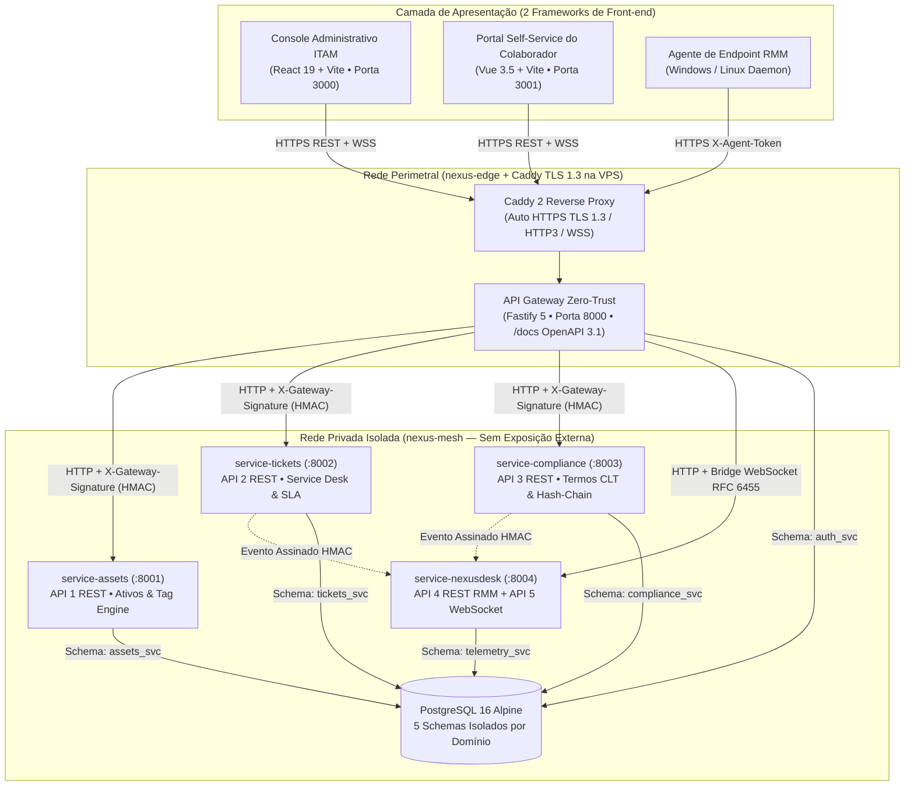
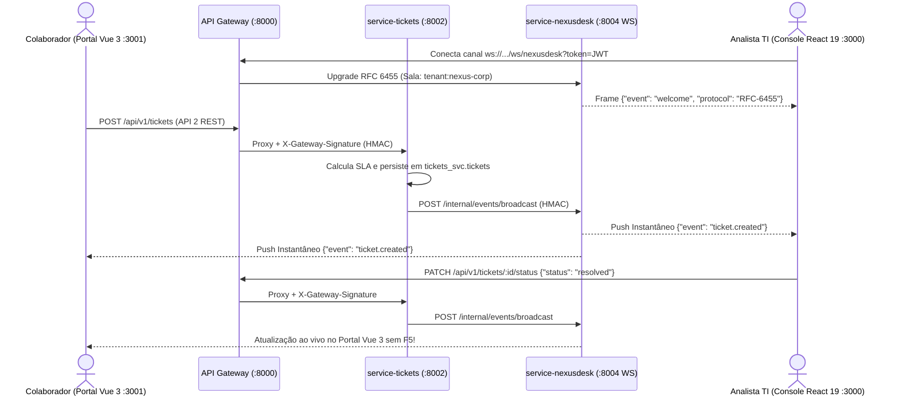

# Arquitetura Distribuída, Segurança Zero-Trust e Guia de Deploy VPS — Nexus ITAM v3.0

Este documento descreve a arquitetura distribuída do ecossistema **Nexus ITAM v3.0**, projetada para reforçar a segurança criptográfica corporativa, operar em produção em **VPS Linux com TLS 1.3 automático** e atender integralmente aos **5 requisitos arquiteturais de Engenharia de Software e Sistemas Distribuídos**.

---

## 1. Matriz de Conformidade Acadêmica e Arquitetural

| # | Requisito da Disciplina | Implementação Real no Nexus ITAM v3.0 | Diretórios e Artefatos |
| :--- | :--- | :--- | :--- |
| **1** | **Mínimo de 2 Frameworks de Front-end** | **1. React 19** (Console Administrativo de TI, RMM e Governança — `:3000` / `:5173`)<br>**2. Vue 3.5 Composition API** (Portal Self-Service do Colaborador — `:3001` / `:5174`) | `src/` (React 19)<br>`portal-colaborador/` (Vue 3.5) |
| **2** | **Desenvolvimento de 5 APIs (sendo ≥ 1 Não-REST)** | **API 1 (REST):** Gestão de Ativos & Tag Engine (`/api/v1/assets`)<br>**API 2 (REST):** Central de Chamados & SLA (`/api/v1/tickets`)<br>**API 3 (REST):** Termos CLT & Hash-Chain (`/api/v1/compliance`)<br>**API 4 (REST):** Ingestão RMM & Comandos (`/api/v1/telemetry`)<br>**API 5 (NÃO-REST):** Streaming **WebSocket Bidirecional Full-Duplex RFC 6455** (`ws://.../ws/nexusdesk`) | `services/service-assets/`<br>`services/service-tickets/`<br>`services/service-compliance/`<br>`services/service-nexusdesk/`<br>`services/api-gateway/` |
| **3** | **Utilização de Banco de Dados** | **PostgreSQL 16** com isolamento físico **Database-per-Service via 5 Schemas independentes** (`auth_svc`, `assets_svc`, `tickets_svc`, `compliance_svc`, `telemetry_svc`) + compatibilidade híbrida Firestore (*Strangler Fig*). | `services/shared/init.sql`<br>`services/shared/db.js` |
| **4** | **Utilização de Framework de Back-end** | **Fastify 5** sobre Node.js 22 LTS com validação nativa JSON Schema, `@fastify/helmet`, `@fastify/cors`, `@fastify/rate-limit`, `@fastify/websocket` e especificação **OpenAPI 3.1** interativa em `/docs`. | `services/package.json`<br>`services/api-gateway/src/openapiSpec.js` |
| **5** | **Arquitetura Baseada em Microsserviços** | **Edge API Gateway (`:8000`) + 4 Microsserviços independentes (`:8001`–`:8004`)**, barramentos de eventos internos assinados por HMAC e orquestração **Docker Compose** em redes isoladas (`nexus-edge` e `nexus-mesh`). | `docker-compose.yml`<br>`docker-compose.vps.yml`<br>`Caddyfile` |

---

## 2. Diagrama de Topologia de Containers e Redes (C4 Container)



---

## 3. Reforços de Segurança Criptográfica e Robustez (Defesa em Profundidade)

1. **Autenticação Zero-Trust & Anti-Spoofing Inter-Serviços (`services/shared/security.js`):**
   - Senhas derivadas com **`crypto.scrypt` (`N=16384, r=8, p=1`)** + sal aleatório de 128 bits e comparação em tempo constante (`crypto.timingSafeEqual`) imune a *timing attacks*.
   - O **API Gateway** valida o token **JWT (RFC 7519 HS256)** na borda e injeta o contexto do inquilino (`X-Tenant-Id`, `X-User-Id`, `X-User-Role`) assinado com **`X-Gateway-Signature` (HMAC-SHA256 + janela anti-replay de 60s)**. Qualquer tentativa de pular o Gateway ou forjar cabeçalhos de tenant é bloqueada com `401/403`.
2. **Isolamento Multi-Tenant e Row-Level Security Lógica:**
   - Um colaborador autenticado no **Portal Vue 3** (`role: collaborator`) enxerga **exclusivamente** os equipamentos sob sua guarda, seus próprios chamados e seus próprios termos CLT; tentativas de escalar privilégios ou ler dados de outra empresa (`alpha-logistica` vs `nexus-corp`) são bloqueadas no servidor.
3. **Validade Jurídica CLT Art. 462 §1º e Trilha Imutável em Hash-Chain SHA-256:**
   - No `service-compliance`, cada Termo de Responsabilidade gera um hash canônico SHA-256 do snapshot patrimonial e recebe um **Selo Criptográfico HMAC-SHA256** auditável em `/api/v1/compliance/terms/:id/verify`.
   - O log de auditoria encadeia cada registro ao `chain_hash` anterior (`prev_hash -> chain_hash`), exatamente como um *ledger* imutável verificável em tempo real em `/api/v1/compliance/audit/verify-chain`.
4. **Hardening de Containers e VPS:**
   - Containers Fastify executam sob usuário não-privilegiado (`USER node`), com `mem_limit`, rotação de logs JSON e `HEALTHCHECK` nativo.
   - Na VPS, `EXPOSE_HOST_IP=127.0.0.1` impede que o Docker exponha portas internas contornando o firewall `ufw`; **100% do tráfego externo entra apenas pelas portas `80/443` do Caddy com TLS 1.3 e HSTS**.

---

## 4. Fluxo em Tempo Real Entre os 2 Frameworks (Vue 3 ↔ Fastify ↔ React 19)



---

## 5. Como Executar na Apresentação Acadêmica (Passo a Passo)

### Opção A — Execução Completa via Docker Compose (PostgreSQL 16 + 8 Containers)
```bash
docker compose up --build -d
```
- **Console Administrativo (React 19):** `http://localhost:3000` (acesse **Telemetria & RMM → Service Desk & APIs**)
- **Portal do Colaborador (Vue 3.5):** `http://localhost:3001`
- **Catálogo Interativo das 5 APIs (OpenAPI 3.1):** `http://localhost:8000/docs`
- **Sondagem Distribuída do Cluster:** `http://localhost:8000/health`

### Opção B — Execução Rápida Sem Docker (Desenvolvimento Local em Memória Relacional ou PostgreSQL)
Abra 3 terminais na raiz do projeto:
```bash
# Terminal 1 — Sobe o API Gateway (:8000) + 4 Microsserviços (:8001..:8004)
npm run dev:microservices

# Terminal 2 — Sobe o Frontend 1: Console Administrativo (React 19 em :5173)
npm run dev

# Terminal 3 — Sobe o Frontend 2: Portal do Colaborador (Vue 3.5 em :3001)
npm run dev:portal
```

### Credenciais Corporativas Pré-Semeadas para Demonstração Ao Vivo
| Perfil | E-mail | Senha | Onde Demonstrar |
| :--- | :--- | :--- | :--- |
| **Colaboradora (Engenharia)** | `mariana.costa@nexuscorp.com.br` | `Colab@2026!` | **Portal Vue 3** (Assinar termo CLT, ver ativos em posse e abrir chamado) |
| **Administrador de TI** | `admin@nexuscorp.com.br` | `Nexus@2026!` | **Console React 19** (`/service-desk` — resolver chamado ao vivo, emitir termo e auditar Hash-Chain) |
| **Tenant Isolado (Prova de Segurança)** | `ti@alphalogistica.com.br` | `Alpha@2026!` | Demonstra isolamento multi-tenant total entre empresas distintas |

---

## 6. Guia de Hospedagem Segura na Sua VPS Linux

1. **Aponte o DNS do seu domínio** (registros Tipo `A`) para o IP público da VPS:
   - `api.seudominio.com.br` → IP da VPS
   - `itam.seudominio.com.br` → IP da VPS
   - `portal.seudominio.com.br` → IP da VPS
2. **No servidor VPS (Ubuntu 22.04 / 24.04 ou Debian 12):**
   ```bash
   # Libere apenas SSH e HTTP/HTTPS no firewall UFW
   sudo ufw allow OpenSSH
   sudo ufw allow 80/tcp
   sudo ufw allow 443/tcp
   sudo ufw allow 443/udp
   sudo ufw --force enable

   # Clone o repositório e gere automaticamente os segredos de 256 bits
   git clone <URL_DO_SEU_REPOSITORIO> nexus-itam
   cd nexus-itam
   chmod +x scripts/deploy-vps.sh
   ./scripts/deploy-vps.sh
   ```
3. **Edite os domínios gerados em `.env.vps`** (`nano .env.vps`) e execute novamente:
   ```bash
   ./scripts/deploy-vps.sh
   ```
   O **Caddy 2** emitirá automaticamente os certificados **Let's Encrypt TLS 1.3**, ativará HTTP/3 + WebSocket Seguro (`wss://`) e manterá todos os microsserviços e o PostgreSQL 16 blindados na rede interna `nexus-mesh`.
