# Documentação Mestra de Arquitetura, Stack e Relações de Funções — Nexus ITAM v3.0

**Versão do Sistema:** `3.0.0` (Agente Nativo Endpoint `3.2.0` · Console App Core `2.2.0`)  
**Classificação:** Referência Corporativa e Acadêmica de Engenharia de Software  
**Escopo:** Plataforma SaaS B2B Multi-Tenant de Gestão de Ativos de TI (ITAM), Governança Jurídica CLT, Telemetria/RMM (*NexusDesk*), Auditoria Física e Helpdesk Self-Service em Tempo Real  
**Padrão Arquitetural Central:** *Hybrid Polyglot Dual-Engine Architecture (Strangler Fig)* + Malha de Microsserviços *Zero-Trust*

---

## Sumário Executivo de Navegação

1. [Seção 1: Visão Executiva, Domínio de Negócio e Conformidade Arquitetural](#seção-1-visão-executiva-domínio-de-negócio-e-conformidade-arquitetural)
2. [Seção 2: Stack Tecnológica Completa (Raio-X de Camadas e Versões Exatas)](#seção-2-stack-tecnológica-completa-raio-x-de-camadas-e-versões-exatas)
3. [Seção 3: Arquitetura Macro (Modelo C4 + Padrão Dual-Engine Strangler Fig)](#seção-3-arquitetura-macro-modelo-c4--padrão-dual-engine-strangler-fig)
4. [Seção 4: Arquitetura Interna do Console React 19 (Providers, Rotas, RBAC e Entitlements)](#seção-4-arquitetura-interna-do-console-react-19-providers-rotas-rbac-e-entitlements)
5. [Seção 5: Mapeamento Completo das Relações de Funções (Frontend Core `src/`)](#seção-5-mapeamento-completo-das-relações-de-funções-frontend-core-src)
6. [Seção 6: Arquitetura da Malha de Microsserviços Fastify, 5 APIs e Segurança Zero-Trust (`services/`)](#seção-6-arquitetura-da-malha-de-microsserviços-fastify-5-apis-e-segurança-zero-trust-services)
7. [Seção 7: Arquitetura do 2º Framework Front-end — Portal do Colaborador Vue 3 (`portal-colaborador/`)](#seção-7-arquitetura-do-2º-framework-front-end--portal-do-colaborador-vue-3-portal-colaborador)
8. [Seção 8: Arquitetura de Dados Poliglota (PostgreSQL 16 + Cloud Firestore)](#seção-8-arquitetura-de-dados-poliglota-postgresql-16--cloud-firestore)
9. [Seção 9: Fluxos Comportamentais e Máquinas de Estado (Diagramas de Sequência e Estados)](#seção-9-fluxos-comportamentais-e-máquinas-de-estado-diagramas-de-sequência-e-estados)
10. [Seção 10: Avaliação Arquitetural Master (`/architect-review`): ADRs, Qualidade, Trade-offs e Guia Operacional](#seção-10-avaliação-arquitetural-master-architect-review-adrs-qualidade-trade-offs-e-guia-operacional)

### Índice de Diagramas Arquiteturais (Mermaid)

- **Diagrama 1 (`flowchart TB`)**: Visão C4 de Contexto e Containers Híbridos (Dual-Engine SaaS + VPS Mesh)
- **Diagrama 2 (`flowchart LR`)**: Topologia de Containers Docker e Segregação de Redes (`nexus-edge` vs. `nexus-mesh`)
- **Diagrama 3 (`flowchart TD`)**: Pipeline de Inicialização do Console React 19 e Árvore de Decisão em 7 Etapas do `PrivateRoute`
- **Diagrama 4 (`flowchart LR`)**: Grafo Arquitetural de Chamadas entre Camadas do Frontend Core (`src/`)
- **Diagrama 5 (`flowchart TB`)**: Relação de Funções no Backend Distribuído (`services/`)
- **Diagrama 6 (`flowchart LR`)**: Fluxo de Dados Reativo do Portal do Colaborador Vue 3 (`portal-colaborador/`)
- **Diagrama 7 (`erDiagram`)**: Modelo Entidade-Relacionamento Completo do PostgreSQL 16 (5 Schemas / 10 Tabelas)
- **Diagrama 8 (`sequenceDiagram`)**: Autenticação Scrypt/JWT e Propagação Zero-Trust (`X-Gateway-Signature` + Anti-Replay 60s)
- **Diagrama 9 (`sequenceDiagram`)**: Fluxo Real-Time Cross-Framework de Chamado (Vue 3 → Fastify Mesh → WebSocket RFC 6455 → React 19)
- **Diagrama 10 (`sequenceDiagram`)**: Emissão, Assinatura Eletrônica CLT (`HMAC-SHA256`), Ledger `audit_chain` e Verificação Forense
- **Diagrama 11 (`sequenceDiagram`)**: Ciclo RMM do `NexusAgent.exe` (Matrícula DPAPI, Wake-on-Heartbeat e Sessão Remota com Auditoria Atômica)
- **Diagrama 12 (`sequenceDiagram`)**: Instalação Nativa Mobile PWA em 4 Etapas (`PWAContext` + `PWAInstallModal`)
- **Diagrama 13 (`stateDiagram-v2`)**: Máquina de Estados do Ativo Patrimonial, Termos Jurídicos e Chamados de Suporte

---

## Seção 1: Visão Executiva, Domínio de Negócio e Conformidade Arquitetural

### 1.1 Propósito e Domínio de Negócio

O **Nexus ITAM v3.0** é uma plataforma corporativa **SaaS B2B Multi-Tenant** projetada para unificar o ciclo de vida completo de **Gestão de Ativos de Tecnologia da Informação (ITAM)**, **Governança Jurídica e Patrimonial Trabalhista (CLT Art. 462, §1º e Código Civil Art. 186)**, **Monitoramento e Gerenciamento Remoto de Endpoints (RMM / Acesso Remoto *NexusDesk*)**, **Auditoria Física de Campo via QR Code**, **Helpdesk Self-Service em Tempo Real** e **Gestão de Portfólio Operacional de TI** (Projetos, Quadro Kanban de Tarefas, Licenciamento de Software SAM e Contratos/SLAs de Fornecedores).

Diferentemente de ferramentas tradicionais de inventário estático, o Nexus ITAM resolve simultaneamente quatro dores críticas de médias e grandes operações distribuídas (matrizes, filiais, centros de distribuição e lojas):

1. **Rastreabilidade Física e Financeira Multi-Unidade**: controle individualizado de patrimônio (`internalId`), depreciação/valor de aquisição, garantias, notas fiscais, centros de custo, periféricos vinculados, IMEIs e movimentações inter-unidades com bloqueio transacional de trânsito (`Em Trânsito`).
2. **Segurança Jurídica Trabalhista e Forense**: emissão numerada sequencialmente por exercício fiscal de Termos de Entrega/Responsabilidade (`TR-YYYY-NNNN`), Devolução (`TD-YYYY-NNNN`) e Transferência (`TT-YYYY-NNNN`), com suporte tanto à guarda física digitalizada fragmentada em banco documental quanto ao aceite eletrônico com assinatura criptográfica `HMAC-SHA256` encadeada em livro-razão imutável (`audit_chain` estilo blockchain).
3. **Descoberta Automatizada e Operação Remota (*NexusDesk*)**: agentes nativos para Windows (`NexusAgent.exe` em C#/.NET Framework sem dependências externas), Linux e macOS que coletam telemetria profunda (SMBIOS, CPU, RAM, discos, volumes criptografados, antivírus, firewall, administradores locais, saúde de bateria e softwares instalados), reconciliam licenças automaticamente (SAM) e permitem suporte remoto com consentimento explícito e trilha de auditoria obrigatória compatível com a LGPD.
4. **Autoatendimento Desacoplado para o Colaborador Final**: portal web independente em **Vue 3.5**, livre de SDKs administrativos pesados, onde o colaborador consulta seus equipamentos sob guarda, assina termos eletronicamente e interage em tempo real com a equipe de TI via chamados com SLA calculado automaticamente e streaming bidirecional **WebSocket RFC 6455**.

> [!IMPORTANT]
> **Isolamento Estrito Multi-Tenant e Privacidade LGPD por Design:** Toda entidade de dados do Nexus ITAM é particionada por `tenantId`. Além do isolamento horizontal entre empresas clientes, o sistema implementa segregação vertical de privacidade: o papel global `superadmin` (*Nexus Master*) administra planos, faturamento recorrente (MRR) e provisionamento de inquilinos, mas é **bloqueado arquiteturalmente** (tanto na matriz RBAC em [`src/utils/permissions.js`](file:///c:/Users/ShinerayADM/Projetos/nexus-itam/src/utils/permissions.js) quanto nas regras de banco em [`firestore.rules`](file:///c:/Users/ShinerayADM/Projetos/nexus-itam/firestore.rules)) de ler credenciais de agentes, telemetria de máquinas ou abrir sessões remotas em endpoints de clientes.

### 1.2 Matriz de Conformidade Arquitetural Corporativa e Acadêmica

A tabela a seguir demonstra como a engenharia real do repositório **Nexus ITAM v3.0** cumpre nativamente — com código de produção testado e auditável — os cinco pilares estruturais de sistemas distribuídos modernos:

| Pilar Arquitetural | Especificação Implementada no Nexus ITAM v3.0 | Diretórios e Artefatos Reais no Repositório | Papel Funcional no Produto |
| :--- | :--- | :--- | :--- |
| **1. Dois Frameworks de Front-end** | **Framework 1:** **React 19.2** + React Router 7 + Vite 7<br>**Framework 2:** **Vue 3.5** (*Composition API* `<script setup>`) + Vite 6 | [`src/`](file:///c:/Users/ShinerayADM/Projetos/nexus-itam/src) ([`package.json`](file:///c:/Users/ShinerayADM/Projetos/nexus-itam/package.json))<br>[`portal-colaborador/`](file:///c:/Users/ShinerayADM/Projetos/nexus-itam/portal-colaborador) ([`portal-colaborador/package.json`](file:///c:/Users/ShinerayADM/Projetos/nexus-itam/portal-colaborador/package.json)) | **React 19:** Console Administrativo de TI, Service Desk Hub, RMM NexusDesk, Auditoria Mobile PWA e Console *Nexus Master* SaaS.<br>**Vue 3.5:** Portal Self-Service leve para Colaboradores Finais (custódia, assinatura CLT e chamados), com zero dependência do Firebase SDK. |
| **2. Cinco APIs Distintas (sendo 1 Não-REST)** | **API 1 (REST):** `service-assets` (`:8001`)<br>**API 2 (REST):** `service-tickets` (`:8002`)<br>**API 3 (REST):** `service-compliance` (`:8003`)<br>**API 4 (REST):** `service-nexusdesk` HTTP (`:8004`)<br>**API 5 (Não-REST):** `service-nexusdesk` **WebSocket Bidirecional RFC 6455** (`/ws/nexusdesk`, subprotocolo `nexusdesk-ws/3.0`) | [`services/service-assets/src/server.js`](file:///c:/Users/ShinerayADM/Projetos/nexus-itam/services/service-assets/src/server.js)<br>[`services/service-tickets/src/server.js`](file:///c:/Users/ShinerayADM/Projetos/nexus-itam/services/service-tickets/src/server.js)<br>[`services/service-compliance/src/server.js`](file:///c:/Users/ShinerayADM/Projetos/nexus-itam/services/service-compliance/src/server.js)<br>[`services/service-nexusdesk/src/server.js`](file:///c:/Users/ShinerayADM/Projetos/nexus-itam/services/service-nexusdesk/src/server.js)<br>[`services/api-gateway/src/openapiSpec.js`](file:///c:/Users/ShinerayADM/Projetos/nexus-itam/services/api-gateway/src/openapiSpec.js) | **APIs 1–4 (REST JSON):** CRUD patrimonial + gerador de tags, Service Desk com motor de SLA, Termos CLT + `audit_chain` criptográfica e ingestão M2M de heartbeat/comandos RMM.<br>**API 5 (WebSocket Stateful):** Canal full-duplex em tempo real com salas por `tenantId`, filtro LGPD por usuário e *bridge* via API Gateway (`:8000`). |
| **3. Banco de Dados (Persistência Poliglota Dual-Engine)** | **Motor Relacional ACID:** **PostgreSQL 16 Alpine** particionado em **5 schemas isolados** (10 tabelas com PK/FK/CHECK/JSONB/Advisory Locks)<br>**Motor Documental NoSQL:** **Google Cloud Firestore** Multi-Tenant com `persistentLocalCache` (IndexedDB multi-aba) | [`services/shared/init.sql`](file:///c:/Users/ShinerayADM/Projetos/nexus-itam/services/shared/init.sql)<br>[`services/shared/db.js`](file:///c:/Users/ShinerayADM/Projetos/nexus-itam/services/shared/db.js)<br>[`firestore.rules`](file:///c:/Users/ShinerayADM/Projetos/nexus-itam/firestore.rules)<br>[`firestore.indexes.json`](file:///c:/Users/ShinerayADM/Projetos/nexus-itam/firestore.indexes.json)<br>[`src/services/firebase.js`](file:///c:/Users/ShinerayADM/Projetos/nexus-itam/src/services/firebase.js) | **PostgreSQL 16:** Sustentação transacional dos microsserviços (`auth_svc`, `assets_svc`, `tickets_svc`, `compliance_svc`, `telemetry_svc`), constraints relacionais e locks transacionais da cadeia forense.<br>**Cloud Firestore:** Operação SaaS serverless *offline-first* para campo/mobile PWA, chunking binário `termFiles` e sinalização RMM *Spark-friendly*. |
| **4. Um Framework de Back-end Unificado** | **Fastify `^5.2.1`** padronizado em 100% da camada servidora Node.js (`>=20.0.0` / `node:22-alpine`) | [`services/package.json`](file:///c:/Users/ShinerayADM/Projetos/nexus-itam/services/package.json)<br>[`services/api-gateway/src/server.js`](file:///c:/Users/ShinerayADM/Projetos/nexus-itam/services/api-gateway/src/server.js)<br>Todos os 4 microsserviços em `services/service-*/` | Padronização de alta performance e baixo overhead com ecossistema oficial `@fastify/helmet`, `@fastify/cors`, `@fastify/rate-limit` e `@fastify/websocket` tanto no API Gateway quanto nos 4 serviços de domínio. |
| **5. Arquitetura de Microsserviços** | Topologia distribuída com **API Gateway (`:8000`) + 4 Microsserviços Independentes (`:8001..:8004`)**, segregação de redes Docker, *Schema-per-Service*, contexto assinado `HMAC-SHA256` e Event Bus assíncrono | [`docker-compose.yml`](file:///c:/Users/ShinerayADM/Projetos/nexus-itam/docker-compose.yml)<br>[`docker-compose.vps.yml`](file:///c:/Users/ShinerayADM/Projetos/nexus-itam/docker-compose.vps.yml)<br>[`services/orchestrator.js`](file:///c:/Users/ShinerayADM/Projetos/nexus-itam/services/orchestrator.js)<br>[`services/shared/security.js`](file:///c:/Users/ShinerayADM/Projetos/nexus-itam/services/shared/security.js)<br>[`services/shared/eventBus.js`](file:///c:/Users/ShinerayADM/Projetos/nexus-itam/services/shared/eventBus.js) | Isolamento de falhas e memória por container, rede interna `nexus-mesh` inacessível externamente, propagação de identidade Zero-Trust (`X-Gateway-Signature` com anti-replay de 60s) e publicação de eventos de domínio com *graceful degradation*. |

---

## Seção 2: Stack Tecnológica Completa (Raio-X de Camadas e Versões Exatas)

### 2.1 Frontend 1 — Console Administrativo & Master SaaS (`src/`)

Definido em [`package.json`](file:///c:/Users/ShinerayADM/Projetos/nexus-itam/package.json), [`vite.config.js`](file:///c:/Users/ShinerayADM/Projetos/nexus-itam/vite.config.js) e [`tailwind.config.js`](file:///c:/Users/ShinerayADM/Projetos/nexus-itam/tailwind.config.js):

| Categoria | Pacote / Tecnologia | Versão Exata (`package.json`) | Papel Técnico na Arquitetura |
| :--- | :--- | :--- | :--- |
| **Core UI & Concorrência** | `react` / `react-dom` | `^19.2.0` | Renderização declarativa, `Suspense`, code-splitting por rota (`React.lazy`) e reconciliação concorrente. |
| **Roteamento SPA** | `react-router-dom` | `^7.10.1` | Roteamento client-side (`BrowserRouter`), guards hierárquicos (`PrivateRoute`) e sincronização de query strings. |
| **Bundler & Build** | `vite` / `@vitejs/plugin-react` | `^7.2.4` / `^5.1.1` | Empacotamento ESM nativo, HMR instantâneo, importação `?raw` dos scripts de agente e *chunk splitting* determinístico. |
| **Estilização & Whitelabel** | `tailwindcss` / `postcss` / `autoprefixer` | `^3.4.17` / `^8.5.6` / `^10.4.22` | Design system utilitário (`darkMode: 'class'`), tokens tipográficos (`Plus Jakarta Sans`, `JetBrains Mono`) e cor dinâmica por canais RGB (`rgb(var(--color-brand-rgb) / <alpha-value>)`). |
| **Backend Serverless SDK** | `firebase` | `^12.6.0` | Firebase Auth, Cloud Firestore com `persistentLocalCache({ tabManager: persistentMultipleTabManager() })` e `experimentalAutoDetectLongPolling`. |
| **Visualização Analítica** | `chart.js` + `react-chartjs-2` | `^4.5.1` + `^5.3.1` | Gráficos executivos (`Bar`, `Doughnut`) para composição de inventário e métricas MRR do console *Nexus Master*. |
| **Iconografia & Feedback** | `lucide-react` + `sonner` | `^0.555.0` + `^2.0.7` | Ícones vetoriais *tree-shakeable* para catálogo de hardware e notificações *toast* não bloqueantes sincronizadas ao tema. |
| **QR Code (Emissão & Leitura)** | `qrcode.react` + `html5-qrcode` | `^4.2.0` + `^2.3.8` | Renderização SSR estática (`QRCodeSVG`) em etiquetas/termos A4 e leitura óptica via câmera mobile/webcam em campo. |
| **Motor PDF & OCR QR** | `pdfjs-dist` | `5.7.284` | Rasterização client-side das páginas 1–2 de PDFs digitalizados em `<canvas>` para detecção automática do QR Code de termos assinados. |
| **Relatórios PDF Vetoriais** | `jspdf` + `jspdf-autotable` | `^4.2.1` + `^5.0.8` | Geração client-side sob demanda de relatórios oficiais de Auditoria Patrimonial com tabelas paginadas e assinaturas. |
| **Planilhas Corporativas** | `xlsx` (SheetJS CDN tarball) | `0.20.3` | Ingestão em massa de planilhas legadas (`.xlsx`/`.csv`) e exportação sanitizada contra *CSV Formula Injection*. |
| **Progressive Web App** | `vite-plugin-pwa` (Workbox) | `^1.2.0` | Manifesto instalável standalone, Service Worker `prompt` controlado pelo usuário e cache inteligente de *chunks* pesados. |

#### Engenharia de Code-Splitting (`manualChunks`), Imports Sob Demanda e Workbox PWA

Em [`vite.config.js`](file:///c:/Users/ShinerayADM/Projetos/nexus-itam/vite.config.js), o empacotador aplica duas estratégias complementares para manter o *First Contentful Paint* enxuto em redes móveis 4G:

1. **Quatro `manualChunks` determinísticos** no Rollup:
   - `vendor-firebase`: isola `firebase/app`, `firebase/auth` e `firebase/firestore` para cache de longa duração independente de alterações de UI.
   - `vendor-react`: agrupa `react`, `react-dom` e `react-router-dom`.
   - `vendor-ui`: agrupa `lucide-react` e `sonner`.
   - `vendor-charts`: isola `chart.js` e `react-chartjs-2` (carregados apenas quando os painéis analíticos entram em cena).
2. **Bibliotecas pesadas carregadas exclusivamente por `import()` dinâmico sob demanda** (fora do bundle inicial e excluídas do pré-cache imediato do Service Worker):
   - `xlsx` (acionado apenas em `ImportData.jsx` e exportações).
   - `jspdf` e `jspdf-autotable` (acionados apenas em [`src/utils/auditReport.js`](file:///c:/Users/ShinerayADM/Projetos/nexus-itam/src/utils/auditReport.js) ao exportar PDF de auditoria).
   - `pdfjs-dist` e seu Web Worker `pdf.worker*.mjs` (acionados apenas em [`src/services/termScanService.js`](file:///c:/Users/ShinerayADM/Projetos/nexus-itam/src/services/termScanService.js) ao anexar PDF digitalizado).
   - `html5-qrcode` (acionado ao abrir câmera ou escanear imagem).
3. **Política Workbox (`vite-plugin-pwa`)**:
   - `registerType: 'prompt'` com `cleanupOutdatedCaches: true` (evita recarregamento abrupto durante o preenchimento de formulários ou auditorias de campo).
   - `navigateFallback: '/index.html'` protegido por `navigateFallbackDenylist: [/^\/__\//, /^\/auth\/action/, /\.[a-z0-9]+$/i]`, garantindo que fluxos OAuth/Firebase Action (`/__/auth/action`) e arquivos estáticos nunca sofram interceptação indevida pelo fallback SPA.
   - `globIgnores` exclui `**/xlsx*.js`, `**/jspdf*.js`, `**/html2canvas*.js` e `**/pdf.worker*.mjs` do precache de instalação, delegando-os à regra `runtimeCaching` **`CacheFirst`** no cache dedicado `nexus-on-demand-libs` (`maxEntries: 12`, TTL de 30 dias).

---

### 2.2 Frontend 2 — Portal Self-Service do Colaborador (`portal-colaborador/`)

Definido em [`portal-colaborador/package.json`](file:///c:/Users/ShinerayADM/Projetos/nexus-itam/portal-colaborador/package.json) e [`portal-colaborador/vite.config.js`](file:///c:/Users/ShinerayADM/Projetos/nexus-itam/portal-colaborador/vite.config.js):

| Pacote / Tecnologia | Versão Exata | Papel Técnico |
| :--- | :--- | :--- |
| `vue` | `^3.5.13` | Framework reativo baseado em Proxies ES6 e *Composition API* (`<script setup>`, `ref`, `computed`, `watch`, `onMounted`, `onBeforeUnmount`). |
| `vite` + `@vitejs/plugin-vue` | `^6.1.0` + `^5.2.1` | Compilador Single-File Components (`.vue`) com servidor dev dedicado na porta `:5174` (`strictPort: false`). |
| `tailwindcss` / `postcss` / `autoprefixer` | `^3.4.17` / `^8.5.3` / `^10.4.20` | Estilização responsiva dark-slate de alto contraste alinhada à identidade visual corporativa Nexus. |
| **Dependências Cloud / Firebase** | **Zero (`0`)** | **Zero-Firebase por design**: comunica-se exclusivamente via `fetch` REST nativo e `WebSocket` nativo do navegador contra o API Gateway (`:8000`). |

---

### 2.3 Backend & Malha de Microsserviços (`services/`)

Definido em [`services/package.json`](file:///c:/Users/ShinerayADM/Projetos/nexus-itam/services/package.json) e containerizado em [`services/Dockerfile`](file:///c:/Users/ShinerayADM/Projetos/nexus-itam/services/Dockerfile):

| Pacote / Runtime | Versão Exata | Papel Técnico na Malha Distribuída |
| :--- | :--- | :--- |
| **Node.js Runtime** | `>=20.0.0` (`node:22-alpine` em Docker) | Execução ESM (`"type": "module"`), `fetch` nativo para proxy/Event Bus, `node --test` nativo para suíte de integração e execução não-privilegiada (`USER node`). |
| `fastify` | `^5.2.1` | Servidor HTTP/1.1 de baixa latência, validação JSON Schema declarativa nas rotas e ciclo de vida determinístico de hooks (`onRequest`, `onClose`). |
| `@fastify/helmet` | `^13.0.1` | Hardening automático de cabeçalhos HTTP (CSP customizada para Swagger UI em `/docs`, `X-Content-Type-Options`, `Referrer-Policy`). |
| `@fastify/cors` | `^11.0.0` | Controle estrito de origens cruzadas com suporte a lista dinâmica `CORS_ORIGINS` em produção e exposição de `X-Request-Id`. |
| `@fastify/rate-limit` | `^10.2.2` | Proteção perimetral anti-abuso (`240 req/min` global por IP) e proteção *anti-brute-force* na rota `/api/v1/auth/login` (`20 req/min`). |
| `@fastify/websocket` + `ws` | `^11.2.0` + `^8.18.1` | Servidor WebSocket RFC 6455 no `service-nexusdesk` (`maxPayload: 1 MiB`) e ponte bidirecional (*WS Proxy Bridge*) no `api-gateway`. |
| `pg` (`node-postgres`) | `^8.13.3` | Pool de conexões assíncronas (`max: 20`, `idleTimeoutMillis: 30000`, `connectionTimeoutMillis: 5000`) com transações ACID e *Advisory Locks* no PostgreSQL 16. |
| `node:crypto` (Stdlib Nativo) | Built-in Node 20/22 | Zero dependências criptográficas de terceiros: `scrypt` (`N=16384, r=8, p=1`), `timingSafeEqual`, `createHmac('sha256')`, `createHash('sha256')`, `randomBytes` e `randomUUID`. |

---

### 2.4 Agentes de Endpoint Multi-OS (`src/agent/` e `scripts/build-agent.mjs`)

O subsistema de telemetria e acesso remoto (*NexusDesk*) abrange três sistemas operacionais com geração dinâmica de instaladores em [`src/utils/agentScripts.js`](file:///c:/Users/ShinerayADM/Projetos/nexus-itam/src/utils/agentScripts.js) e compilação offline em [`scripts/build-agent.mjs`](file:///c:/Users/ShinerayADM/Projetos/nexus-itam/scripts/build-agent.mjs):

1. **Agente Nativo Windows (`src/agent/windows/NexusAgent.cs` — v`3.2.0`, 3.604 linhas em C# 5)**:
   - **Compilação Zero-Dependency On-Target ou Build-Time**: compilado diretamente pelo `csc.exe` nativo do `.NET Framework 4.x` presente em toda instalação moderna do Windows (`%WINDIR%\Microsoft.NET\Framework64\v4.0.30319\csc.exe`), referenciando exclusivamente assemblies nativos do sistema operacional (`System.dll`, `System.Core.dll`, `System.Drawing.dll`, `System.Windows.Forms.dll`, `System.Web.Extensions.dll`, `System.Management.dll`, `System.Security.dll`, `System.ServiceProcess.dll`).
   - **Arquitetura de Binário Único com Duplo Papel**:
     - `--service`: executa como Serviço Windows `NexusITAMAgent` sob conta `NT AUTHORITY\SYSTEM`, mantendo heartbeat, telemetria WMI (`System.Management`), execução de ações remotas administrativas e disparo periódico do coletor de inventário antes mesmo do logon do usuário.
     - Modo Padrão (Sessão Interativa): executa na bandeja do sistema (*System Tray*) na sessão do colaborador (`HKLM\...\Run\NexusITAMAgent`), exibindo o ID de acesso *NexusDesk*, abertura rápida de chamado, diálogo de consentimento LGPD, tarja fixa de aviso em tela durante sessões remotas, captura GDI+ redimensionada em JPEG e injeção de mouse/teclado via Win32 P/Invoke (`SendInput`, `SetCursorPos`, `LockWorkStation`).
   - **Proteção Criptográfica de Credencial (DPAPI)**: na matrícula inicial (`--install`), o `NexusAgent.exe` autentica-se anonimamente no Firebase Auth, grava sua prova única `sha256(agentToken + ':' + uid)` em `/agentEnrollments/{uid}`, **apaga imediatamente o `agentToken` do arquivo `C:\ProgramData\NexusITAM\config.json`** e persiste o `refreshToken` cifrado via **Windows DPAPI (`ProtectedData.Protect` com escopo `LocalMachine`)** em `device.dat` com ACL restrita.
   - **Scripts Windows Auxiliares**: [`src/agent/windows/nexus-agent.ps1`](file:///c:/Users/ShinerayADM/Projetos/nexus-itam/src/agent/windows/nexus-agent.ps1) (359 linhas — coletor PowerShell WMI/CIM que no modo serviço opera com `-OutFile` sem carregar o token da empresa) e [`src/agent/windows/install.ps1`](file:///c:/Users/ShinerayADM/Projetos/nexus-itam/src/agent/windows/install.ps1) (95 linhas — compilação local atômica em `%TEMP%` e registro do serviço).
2. **Agente Linux ([`src/agent/linux/nexus-agent.sh`](file:///c:/Users/ShinerayADM/Projetos/nexus-itam/src/agent/linux/nexus-agent.sh) — 179 linhas & [`src/agent/linux/install.sh`](file:///c:/Users/ShinerayADM/Projetos/nexus-itam/src/agent/linux/install.sh) — 40 linhas)**:
   - Coleta DMI/SMBIOS (`/sys/class/dmi/id/*`), CPU (`/proc/cpuinfo`), memória (`/proc/meminfo`), discos/volumes (`lsblk`, `df`), criptografia LUKS, rede (`ip route`, `ip addr`) e pacotes (`dpkg-query` / `rpm`). Instalado em `/opt/nexus-itam` (`chmod 700`, exclusivo `root`) com agendamento em `/etc/cron.d/nexus-itam` (`@reboot` + a cada 6 horas com minuto randomizado anti-*thundering herd*).
3. **Agente macOS ([`src/agent/mac/nexus-agent.sh`](file:///c:/Users/ShinerayADM/Projetos/nexus-itam/src/agent/mac/nexus-agent.sh) — 131 linhas & [`src/agent/mac/install.sh`](file:///c:/Users/ShinerayADM/Projetos/nexus-itam/src/agent/mac/install.sh) — 48 linhas)**:
   - Coleta hardware via `system_profiler SPHardwareDataType`, `sysctl`, status do FileVault (`fdesetup status`), saúde de bateria (`ioreg -rc AppleSmartBattery`) e aplicativos `.app`. Instalado em `/usr/local/nexus-itam` (`chmod 700`) e orquestrado via `launchd` (`/Library/LaunchDaemons/com.nexusitam.agent.plist`, `RunAtLoad` + `StartInterval: 21600` = 6h).

---

### 2.5 Infraestrutura, DevOps, Segurança Perimetral e Engenharia de Qualidade

| Subsistemas | Arquivos de Configuração | Detalhamento Técnico de Produção |
| :--- | :--- | :--- |
| **Orquestração de Containers** | [`docker-compose.yml`](file:///c:/Users/ShinerayADM/Projetos/nexus-itam/docker-compose.yml)<br>[`docker-compose.vps.yml`](file:///c:/Users/ShinerayADM/Projetos/nexus-itam/docker-compose.vps.yml)<br>[`scripts/deploy-vps.sh`](file:///c:/Users/ShinerayADM/Projetos/nexus-itam/scripts/deploy-vps.sh) | Topologia declarativa com 8 serviços base + proxy reverso Caddy no overlay VPS, healthchecks HTTP/TCP nativos, limites estritos de RAM (`mem_limit`), rotação de logs `json-file` (`10m..25m`, `max-file: 3..5`) e geração automatizada de segredos de 256 bits via `openssl rand -hex 32`. |
| **Edge Proxy TLS 1.3 & HTTP/3** | [`Caddyfile`](file:///c:/Users/ShinerayADM/Projetos/nexus-itam/Caddyfile) (`caddy:2.8-alpine`) | Provisionamento automático Let's Encrypt / ZeroSSL, protocolo HTTP/3 QUIC (`443/udp`), compressão `zstd` + `gzip`, HSTS (`max-age=63072000; includeSubDomains; preload`), suporte a wildcard DNS zero-config (`sslip.io`) e roteamento triplo para `` `$CONSOLE_DOMAIN` ``, `` `$PORTAL_DOMAIN` `` e `` `$API_DOMAIN` ``. |
| **Servidores Estáticos SPA** | [`Dockerfile`](file:///c:/Users/ShinerayADM/Projetos/nexus-itam/Dockerfile)<br>[`nginx.spa.conf`](file:///c:/Users/ShinerayADM/Projetos/nexus-itam/nginx.spa.conf)<br>[`portal-colaborador/Dockerfile`](file:///c:/Users/ShinerayADM/Projetos/nexus-itam/portal-colaborador/Dockerfile) | Builds multi-stage (`node:22-alpine` → `nginx:1.27-alpine`), cache imutável de 1 ano para `/assets/` (`immutable`), `no-cache` estrito para `index.html`, `sw.js`, `registerSW.js` e `manifest.webmanifest`, e headers `Permissions-Policy: camera=(self)`. |
| **Firebase Multi-Site Hosting** | [`firebase.json`](file:///c:/Users/ShinerayADM/Projetos/nexus-itam/firebase.json) | Deploy simultâneo de dois targets independentes: `itam-nexus` (Console React em `dist` com CSP restritiva autorizando WebSockets e APIs Google/Firebase + HSTS de 1 ano) e `portal-itam-nexus` (Portal Vue 3 em `portal-colaborador/dist` com `X-Frame-Options: DENY` e HSTS). |
| **Pipeline CI/CD Automatizado** | [`.github/workflows/ci.yml`](file:///c:/Users/ShinerayADM/Projetos/nexus-itam/.github/workflows/ci.yml) | **3 Jobs paralelos no GitHub Actions**:<br>1. `build-and-test`: matriz Node `20` e `22` rodando ESLint 9, Vitest (suíte frontend) e `vite build` de produção.<br>2. `microservices-and-portal`: instala malha Fastify + Portal Vue 3, executa a suíte de integração das 5 APIs (`npm --prefix services test`) e valida o `vite build` do Vue 3.<br>3. `firestore-rules`: provisiona Java 21 (`temurin`) + `firebase-tools` e executa os testes de ataque contra o Firestore Emulator. |
| **Engenharia de Testes** | [`vitest.config.js`](file:///c:/Users/ShinerayADM/Projetos/nexus-itam/vitest.config.js)<br>[`vitest.rules.config.js`](file:///c:/Users/ShinerayADM/Projetos/nexus-itam/vitest.rules.config.js)<br>[`services/tests/microservices.test.js`](file:///c:/Users/ShinerayADM/Projetos/nexus-itam/services/tests/microservices.test.js)<br>[`tests/rules/firestore.rules.spec.js`](file:///c:/Users/ShinerayADM/Projetos/nexus-itam/tests/rules/firestore.rules.spec.js) | **Vitest `^4.1.8`** + `@testing-library/react ^16.3.2` + `happy-dom ^20.10.1` + `@firebase/rules-unit-testing ^5.0.2`:<br>• **34 suítes de testes no Frontend (`src/`)** (~383 asserções/casos cobrindo utils puros, services Dual-Engine, contexts, hooks, páginas e PWA).<br>• **Suíte End-to-End da Malha (`microservices.test.js`)**: sobe o `orchestrator.js` em memória e valida Gateway, 4 APIs REST, WebSocket RFC 6455, filtro LGPD e integridade da `audit_chain`.<br>• **Suíte de Segurança Documental (`firestore.rules.spec.js`)**: valida isolamento multi-tenant, bloqueio LGPD do `superadmin` e escrita atômica `getAfter`. |

---

## Seção 3: Arquitetura Macro (Modelo C4 + Padrão Dual-Engine Strangler Fig)

### 3.1 Visão C4 de Contexto e Containers Híbridos

O diagrama abaixo representa a visão combinada de **Contexto do Sistema e Containers (Níveis 1 e 2 do Modelo C4)**, evidenciando as quatro personas/atores externos, os dois frameworks de front-end e a coexistência coordenada entre o **Motor 1 (Serverless Cloud Firebase)** e o **Motor 2 (Malha de Microsserviços Fastify + PostgreSQL 16 em VPS)**:

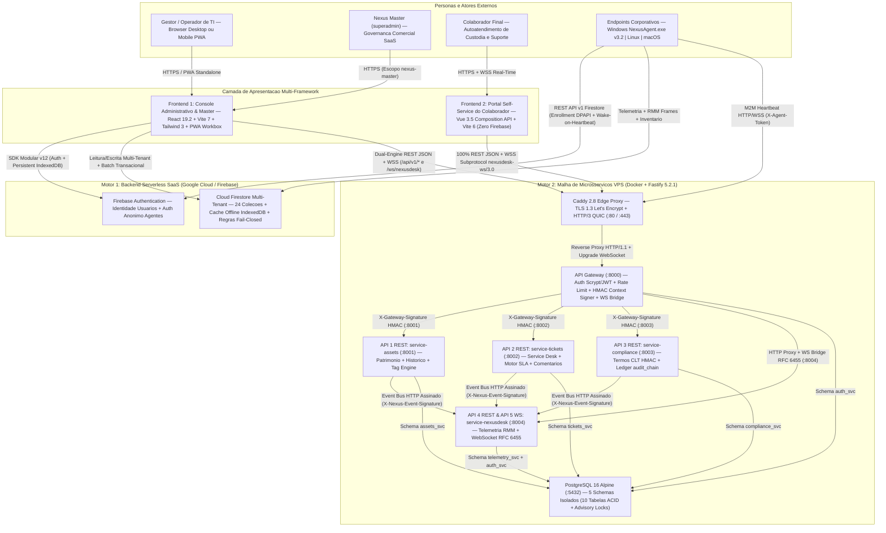

---

### 3.2 Topologia de Containers Docker e Segregação de Redes (`nexus-edge` vs. `nexus-mesh`)

Nos manifestos [`docker-compose.yml`](file:///c:/Users/ShinerayADM/Projetos/nexus-itam/docker-compose.yml) e [`docker-compose.vps.yml`](file:///c:/Users/ShinerayADM/Projetos/nexus-itam/docker-compose.vps.yml), a superfície de ataque de rede segue o princípio de **Defesa em Profundidade (Zero-Trust Network Segmentation)**:

- **`nexus-edge` (Rede Perimetral Bridge)**: hospeda exclusivamente os containers voltados à borda pública (`caddy`, `console-react`, `portal-vue`) e a interface externa do `api-gateway`.
- **`nexus-mesh` (Rede Interna Isolada)**: hospeda `postgres` e os 4 microsserviços (`service-assets`, `service-tickets`, `service-compliance`, `service-nexusdesk`). No overlay de produção [`docker-compose.vps.yml`](file:///c:/Users/ShinerayADM/Projetos/nexus-itam/docker-compose.vps.yml), `nexus-mesh` recebe **`internal: true`** e o `api-gateway` expõe apenas `127.0.0.1:8000:8000` no loopback local para healthcheck do script de deploy, impedindo qualquer acesso externo direto às portas `:5432` ou `:8001..:8004`.
- **`api-gateway` (Única Ponte Dual-Homed)**: é o único container conectado simultaneamente a `nexus-edge` e `nexus-mesh`.

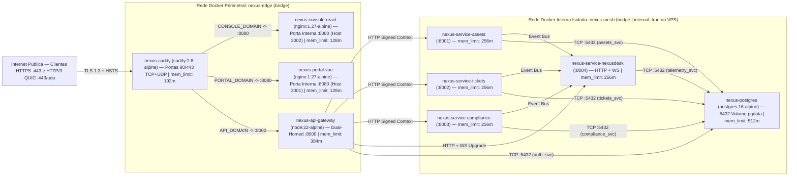

> [!NOTE]
> **Orçamento Determinístico de Memória em Produção:** A soma de todos os `mem_limit` declarados em [`docker-compose.vps.yml`](file:///c:/Users/ShinerayADM/Projetos/nexus-itam/docker-compose.vps.yml) totaliza exatamente **2.432 MiB (~2,37 GiB)** (`512m` PostgreSQL + `384m` Gateway + `4 × 256m` Microsserviços + `192m` Caddy + `2 × 128m` SPAs Nginx), permitindo operação estável e previsível em instâncias VPS Linux de **4 GB de RAM** sem risco de *OOM Killer* em cascata.

---

### 3.3 O Padrão *Strangler Fig Dual-Engine* em Profundidade

O Nexus ITAM implementa o padrão arquitetural **Strangler Fig** de forma transparente na camada de autenticação e de serviços do Console React, viabilizando dois modos operacionais simultâneos sem duplicar telas:

#### 1. Resolução de Sessão Híbrida (`authSource: 'firebase'` vs. `authSource: 'gateway'`)

Em [`src/contexts/AuthContext.jsx`](file:///c:/Users/ShinerayADM/Projetos/nexus-itam/src/contexts/AuthContext.jsx) e [`src/services/microservicesClient.js`](file:///c:/Users/ShinerayADM/Projetos/nexus-itam/src/services/microservicesClient.js):

- **Flag de Ambiente `isGatewayOnly`**: ativada quando `VITE_AUTH_MODE === 'gateway'` ou quando as chaves `VITE_FIREBASE_*` não são injetadas no build (ex.: container Docker autossuficiente `nexus-console-react` em VPS *on-premises*). Nesse modo, [`src/services/firebase.js`](file:///c:/Users/ShinerayADM/Projetos/nexus-itam/src/services/firebase.js) nem sequer exige conectividade externa com o Google Cloud.
- **Autenticação Cascateada em `AuthContext.login(email, password)`**:
  1. Quando `isGatewayOnly` está ativo, autentica diretamente via `POST /api/v1/auth/login` no API Gateway (`:8000`) e constrói o perfil normalizado via `buildGatewayCurrentUser(session)`, marcando `authSource: 'gateway'`.
  2. No modo híbrido padrão, tenta primeiramente `signInWithEmailAndPassword(auth, email, password)` no Firebase Auth (`authSource: 'firebase'`). Caso o usuário pertença exclusivamente ao diretório relacional PostgreSQL (`auth/user-not-found` ou `auth/invalid-credential`), realiza *fallback* transparente para `microservicesApi.login(email, password)` no API Gateway!
- **Detector de Sessão Ativa `isGatewayActiveSession()`**: exportado por [`src/services/microservicesClient.js`](file:///c:/Users/ShinerayADM/Projetos/nexus-itam/src/services/microservicesClient.js), verifica a presença simultânea do token JWT em `localStorage['nexus_ms_session_v3']` e da flag explícita `localStorage['nexus_primary_auth_source_v3'] === 'gateway'` (ou `VITE_AUTH_MODE === 'gateway'`). Isso garante que um administrador autenticado via Firebase que apenas abriu uma sessão secundária de inspeção na aba `/service-desk` não desvie acidentalmente o inventário Firestore principal para o banco da malha.

#### 2. Matriz de Roteamento Dual-Mode por Módulo

| Camada / Módulo | Comportamento em `authSource: 'firebase'` (Motor SaaS Cloud) | Comportamento em `authSource: 'gateway'` (Motor Malha Fastify + PG16) |
| :--- | :--- | :--- |
| **[`src/services/assetService.js`](file:///c:/Users/ShinerayADM/Projetos/nexus-itam/src/services/assetService.js)** | Lê/grava coleções `/assets` e `/history` no Cloud Firestore com transações e `writeBatch`. | Redireciona `getAllAssets`, `getAssetById`, `getAssetByInternalId`, `createAsset`, `updateAsset`, `deleteAsset` e `getRecentActivity` para `microservicesApi` (`service-assets :8001`), traduzindo payloads via `mapGatewayAssetToUi` / `mapUiAssetToGateway`. |
| **[`src/services/employeeService.js`](file:///c:/Users/ShinerayADM/Projetos/nexus-itam/src/services/employeeService.js)** | Lê/grava `/employees` e `/sectors` no Cloud Firestore. | Consulta `microservicesApi.listTenantUsers()` (`GET /api/v1/auth/users` no Gateway) e extrai departamentos dinamicamente dos membros do tenant no PostgreSQL. |
| **[`src/services/locationService.js`](file:///c:/Users/ShinerayADM/Projetos/nexus-itam/src/services/locationService.js)** | Lê/grava `/locations` no Cloud Firestore e sincroniza renomeações em lote em `/assets` e `/employees`. | Constrói localizações únicas (`gw-loc-*`) a partir das unidades reais dos ativos retornados por `microservicesApi.listAssets()`. |
| **[`src/pages/AssetForm.jsx`](file:///c:/Users/ShinerayADM/Projetos/nexus-itam/src/pages/AssetForm.jsx)** | Lê `/settings/{tenantId}` do Firestore e gera tags locais com `generateNextAssetTag`. | Sintetiza configurações do tenant a partir do JWT e consulta `POST /api/v1/assets/next-tag` no `service-assets` com fallback local. |
| **[`src/pages/ServiceDeskHub.jsx`](file:///c:/Users/ShinerayADM/Projetos/nexus-itam/src/pages/ServiceDeskHub.jsx)** | Conecta-se **diretamente à malha Fastify (`:8000`)** via `microservicesApi` + WebSocket `/ws/nexusdesk` (permitindo login dedicado na malha mesmo a partir de uma sessão Firebase). | Opera nativamente com a mesma sessão JWT primária da malha, agregando Health Check das 5 APIs, Chamados, Termos CLT, `audit_chain` e Telemetria Live. |
| **[`portal-colaborador/`](file:///c:/Users/ShinerayADM/Projetos/nexus-itam/portal-colaborador)** | **Não utiliza Firebase.** | Opera **100% no PostgreSQL 16 via API Gateway (`:8000`)**, consumindo `service-assets`, `service-tickets`, `service-compliance` e o WebSocket `/ws/nexusdesk`. |

---

## Seção 4: Arquitetura Interna do Console React 19 (Providers, Rotas, RBAC e Entitlements)

### 4.1 Pipeline de Inicialização e Árvore de Decisão em 7 Etapas (`PrivateRoute`)

A inicialização da SPA em [`src/main.jsx`](file:///c:/Users/ShinerayADM/Projetos/nexus-itam/src/main.jsx) e [`src/App.jsx`](file:///c:/Users/ShinerayADM/Projetos/nexus-itam/src/App.jsx) aplica uma cadeia estrita de resiliência e segurança *fail-closed*:

1. **Proteção Anti-Chunk-Stale (`vite:preloadError`)**: antes de montar o React, [`src/main.jsx`](file:///c:/Users/ShinerayADM/Projetos/nexus-itam/src/main.jsx) registra um listener global para `vite:preloadError`. Após um novo deploy em que hashes de chunks antigos (`React.lazy`) deixam de existir na CDN/Nginx, o app intercepta a falha de importação dinâmica, grava o guarda anti-loop `sessionStorage['nexus_chunk_reload']` e executa um único `window.location.reload()` transparente.
2. **Hierarquia Ordenada de Providers**:
   - `ErrorBoundary` ([`src/components/ErrorBoundary.jsx`](file:///c:/Users/ShinerayADM/Projetos/nexus-itam/src/components/ErrorBoundary.jsx)): captura exceções de renderização em toda a árvore.
   - `AuthProvider` ([`src/contexts/AuthContext.jsx`](file:///c:/Users/ShinerayADM/Projetos/nexus-itam/src/contexts/AuthContext.jsx)): resolve sessão Firebase/Gateway, perfil `/users/{uid}`, inquilino `/tenants/{tenantId}`, branding `/settings/{tenantId}` e entitlements efetivos.
   - `ThemeProvider` ([`src/contexts/ThemeContext.jsx`](file:///c:/Users/ShinerayADM/Projetos/nexus-itam/src/contexts/ThemeContext.jsx)): consome `currentUser?.primaryColor` do `AuthContext`, converte para canais RGB via `rgbChannels()` e injeta `--color-brand-rgb` e classe `.dark` no `<html>`.
   - `ConfirmProvider` ([`src/components/ConfirmDialog.jsx`](file:///c:/Users/ShinerayADM/Projetos/nexus-itam/src/components/ConfirmDialog.jsx)): provê diálogos modais imperativos baseados em `Promise<boolean>` via `useConfirm()`.
   - `PWAProvider` ([`src/contexts/PWAContext.jsx`](file:///c:/Users/ShinerayADM/Projetos/nexus-itam/src/contexts/PWAContext.jsx)): gerencia Service Worker Workbox, prompt nativo `beforeinstallprompt`, diagnóstico `navigator.storage.estimate()` e atualizações assistidas (`PWAUpdatePrompt`, `PWAInstallBanner`, `PWAInstallModal`).
   - `BrowserRouter` + `Suspense`: despacha rotas lazy-loaded protegidas pelo guardião [`src/components/PrivateRoute.jsx`](file:///c:/Users/ShinerayADM/Projetos/nexus-itam/src/components/PrivateRoute.jsx).

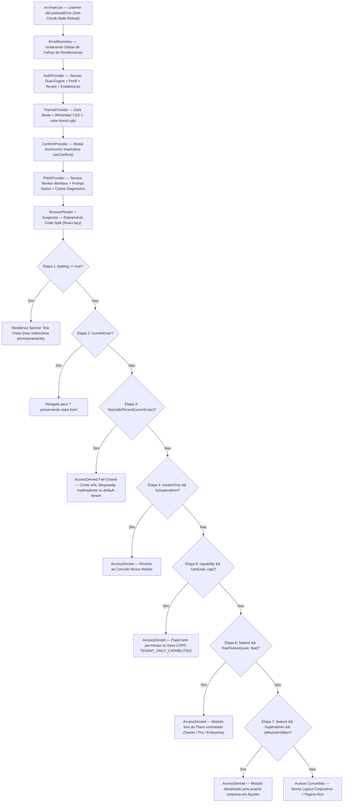

---

### 4.2 Catálogo Completo de Rotas de `src/App.jsx`

#### Rotas Públicas / Não-Autenticadas (7 Paths)

| # | Path (`Route`) | Componente Renderizado | Finalidade Funcional |
| :-: | :--- | :--- | :--- |
| 1 | `/` | [`Login.jsx`](file:///c:/Users/ShinerayADM/Projetos/nexus-itam/src/pages/Login.jsx) | Autenticação híbrida (Firebase Auth + fallback API Gateway), recuperação de senha por e-mail e atalho para o Portal do Colaborador. |
| 2 | `/login` | `<Navigate to="/" replace />` | Alias canônico de redirecionamento limpo para a raiz de autenticação. |
| 3 | `/register` | [`Register.jsx`](file:///c:/Users/ShinerayADM/Projetos/nexus-itam/src/pages/Register.jsx) | Auto-cadastro (self-service onboarding) de nova empresa cliente com criação transacional de tenant em `trial` (plano `pro` por 14 dias). |
| 4 | `/convite/:inviteId` | [`AcceptInvite.jsx`](file:///c:/Users/ShinerayADM/Projetos/nexus-itam/src/pages/AcceptInvite.jsx) | Aceite de convite corporativo (`/invites/{inviteId}`) com validação estrita de e-mail normalizado e prazo de expiração de 14 dias. |
| 5 | `/reset-password` | [`ResetPassword.jsx`](file:///c:/Users/ShinerayADM/Projetos/nexus-itam/src/pages/ResetPassword.jsx) | Redefinição nativa de senha via `verifyPasswordResetCode` e `confirmPasswordReset`. |
| 6 | `/auth/action` | [`ResetPassword.jsx`](file:///c:/Users/ShinerayADM/Projetos/nexus-itam/src/pages/ResetPassword.jsx) | Handler customizado de links transacionais enviados por e-mail pelo Firebase Auth. |
| 7 | `/__/auth/action` | [`ResetPassword.jsx`](file:///c:/Users/ShinerayADM/Projetos/nexus-itam/src/pages/ResetPassword.jsx) | Handler reservado do Firebase Hosting (excluído do `navigateFallback` do Service Worker Workbox). |

#### Rotas Privadas Protegidas por `AppRoute` (`PrivateRoute` + `Layout` — 23 Paths)

| # | Path (`Route`) | Página (`src/pages/`) | `capability` Exigida | `feature` (Plano) | `masterOnly` | Escopo Operacional |
| :-: | :--- | :--- | :--- | :--- | :-: | :--- |
| 1 | `/dashboard` | [`Dashboard.jsx`](file:///c:/Users/ShinerayADM/Projetos/nexus-itam/src/pages/Dashboard.jsx) (ou [`NexusDashboard.jsx`](file:///c:/Users/ShinerayADM/Projetos/nexus-itam/src/pages/NexusDashboard.jsx) p/ Master) | `assets:read` | — | `false` | KPIs patrimoniais do tenant ou painel MRR/saúde comercial global quando `isSuperadmin`. |
| 2 | `/assets` | [`AssetList.jsx`](file:///c:/Users/ShinerayADM/Projetos/nexus-itam/src/pages/AssetList.jsx) | `assets:read` | — | `false` | Inventário filtrável em tempo real, seleção múltipla para termos, impressão de etiquetas QR e exportação XLSX. |
| 3 | `/assets/new` | [`AssetForm.jsx`](file:///c:/Users/ShinerayADM/Projetos/nexus-itam/src/pages/AssetForm.jsx) | `assets:write` | — | `false` | Cadastro de ativo com auto-sequenciador de patrimônio, leitura QR de serial, cálculo de garantia e modo lote. |
| 4 | `/assets/edit/:id` | [`AssetForm.jsx`](file:///c:/Users/ShinerayADM/Projetos/nexus-itam/src/pages/AssetForm.jsx) | `assets:write` | — | `false` | Edição cadastral preservando `originalTenantId`, telemetria do agente e bloqueio caso `transit` esteja aberto. |
| 5 | `/assets/:id` | [`AssetDetail.jsx`](file:///c:/Users/ShinerayADM/Projetos/nexus-itam/src/pages/AssetDetail.jsx) | `assets:read` | — | `false` | Dossiê completo do ativo: linha do tempo, telemetria do agente, periféricos, ordens de manutenção, baixa e termos. |
| 6 | `/projects` | [`ProjectsPage.jsx`](file:///c:/Users/ShinerayADM/Projetos/nexus-itam/src/pages/ProjectsPage.jsx) | `projects:write` | `projects` | `false` | Portfólio de projetos de infraestrutura/rollout de TI com orçamento, progresso e gerente responsável. |
| 7 | `/projects/:id` | [`ProjectDetails.jsx`](file:///c:/Users/ShinerayADM/Projetos/nexus-itam/src/pages/ProjectDetails.jsx) | `projects:write` | `projects` | `false` | Diário de bordo cronológico, anexos/marcos e acompanhamento detalhado de projeto. |
| 8 | `/tasks` | [`TaskManager.jsx`](file:///c:/Users/ShinerayADM/Projetos/nexus-itam/src/pages/TaskManager.jsx) | `tasks:write` | `projects` | `false` | Quadro Kanban de 4 colunas + visão em lista, checklists, prioridades, prazos e vínculo opcional com projetos. |
| 9 | `/licenses` | [`LicenseManager.jsx`](file:///c:/Users/ShinerayADM/Projetos/nexus-itam/src/pages/LicenseManager.jsx) | `licenses:write` | `licenses` | `false` | Gestão SAM de assentos de software, chaves mascaradas, vencimentos e vinculação manual ou automática pelo agente. |
| 10 | `/services` | [`ServiceManager.jsx`](file:///c:/Users/ShinerayADM/Projetos/nexus-itam/src/pages/ServiceManager.jsx) | `contracts:write` | `contracts` | `false` | Gestão financeira de contratos recorrentes de TI, links de telecom, SLAs e alertas de renovação. |
| 11 | `/employees` | [`EmployeeManager.jsx`](file:///c:/Users/ShinerayADM/Projetos/nexus-itam/src/pages/EmployeeManager.jsx) | `employees:write` | — | `false` | Cadastro de colaboradores e setores, visualização de custódia ativa e disparo direto de termos de entrega/devolução. |
| 12 | `/audit` | [`AuditPage.jsx`](file:///c:/Users/ShinerayADM/Projetos/nexus-itam/src/pages/AuditPage.jsx) | `audit:run` | `audit` | `false` | Conferência física de campo por unidade via leitor QR Code, presença confirmada pelo Agente ITAM e laudo PDF. |
| 13 | `/termos` | [`TermsPage.jsx`](file:///c:/Users/ShinerayADM/Projetos/nexus-itam/src/pages/TermsPage.jsx) | `terms:read` | — | `false` | Central de Termos (`TR`, `TD`, `TT`), fila de assinaturas pendentes, remessas em trânsito e upload OCR em lote. |
| 14 | `/termos/:termId` | [`TermsPage.jsx`](file:///c:/Users/ShinerayADM/Projetos/nexus-itam/src/pages/TermsPage.jsx) | `terms:read` | — | `false` | Deep-link direto aberto pelo QR Code impresso no cabeçalho do termo físico para conferência ou upload imediato. |
| 15 | `/agent` | [`AgentManager.jsx`](file:///c:/Users/ShinerayADM/Projetos/nexus-itam/src/pages/AgentManager.jsx) | `agent:manage` | `agent` | `false` | Central *NexusDesk* & RMM: Frota Online, Acesso Remoto Ao Vivo, Caixa de Entrada, Gerador de Instaladores e Políticas. |
| 16 | `/service-desk` | [`ServiceDeskHub.jsx`](file:///c:/Users/ShinerayADM/Projetos/nexus-itam/src/pages/ServiceDeskHub.jsx) | `assets:read` | — | `false` | Console unificado das 5 APIs Fastify: Chamados Real-Time WebSocket, Termos CLT HMAC, Auditoria Forense e Frota M2M. |
| 17 | `/import` | [`ImportData.jsx`](file:///c:/Users/ShinerayADM/Projetos/nexus-itam/src/pages/ImportData.jsx) | `assets:import` | `import` | `false` | Assistente de ingestão em massa XLSX/CSV com mapeamento de colunas, deduplicação e validação de cotas do plano. |
| 18 | `/settings` | [`SettingsPage.jsx`](file:///c:/Users/ShinerayADM/Projetos/nexus-itam/src/pages/SettingsPage.jsx) | `settings:read` | — | `false` | Ajustes corporativos: dados fiscais, filiais/sub-redes IP, whitelabel, catálogo customizado, cláusulas CLT e backup JSON. |
| 19 | `/users` | [`UserManager.jsx`](file:///c:/Users/ShinerayADM/Projetos/nexus-itam/src/pages/UserManager.jsx) | `users:manage` | — | `false` | Gestão de membros da equipe de TI do inquilino, emissão/revogação de convites e alteração de papéis RBAC. |
| 20 | `/admin/tenants` | [`TenantManager.jsx`](file:///c:/Users/ShinerayADM/Projetos/nexus-itam/src/pages/TenantManager.jsx) | — | — | **`true`** | Provisionamento comercial de empresas clientes, suspensão/reativação e overrides contratuais sob medida. |
| 21 | `/admin/users` | [`NexusUserManager.jsx`](file:///c:/Users/ShinerayADM/Projetos/nexus-itam/src/pages/NexusUserManager.jsx) | — | — | **`true`** | Governança global de contas de usuários em todos os inquilinos, realocação de tenant e bloqueio administrativo. |
| 22 | `/admin/plans` | [`NexusPlansManager.jsx`](file:///c:/Users/ShinerayADM/Projetos/nexus-itam/src/pages/NexusPlansManager.jsx) | — | — | **`true`** | Editor dinâmico do catálogo comercial `/plans/{planId}` (preços mensais, limites de ativos/usuários e matriz de features). |
| 23 | `*` | `NotFound` (inline em [`App.jsx`](file:///c:/Users/ShinerayADM/Projetos/nexus-itam/src/App.jsx)) | — | — | `false` | Fallback 404 autenticado dentro da casca `Layout` com retorno seguro ao `/dashboard`. |

---

### 4.3 Matriz RBAC Cumulativa e Trava LGPD (`src/utils/permissions.js`)

O controle de acesso baseado em papéis em [`src/utils/permissions.js`](file:///c:/Users/ShinerayADM/Projetos/nexus-itam/src/utils/permissions.js) é **cumulativo** (cada degrau herda integralmente as capacidades do anterior via composição de arrays) e normaliza aliases históricos (`operador -> operator`, `tecnico -> member`, `gestor -> manager`, `administrador -> admin`, `proprietario -> owner`).

| Papel Canônico (`role`) | Rótulo Corporativo | Escopo | Capabilities Adicionadas no Nível (Cumulativo sobre os anteriores) |
| :--- | :--- | :--- | :--- |
| **`viewer`** | Somente leitura | Inquilino | `assets:read`, `terms:read`, `settings:read` |
| **`operator`** | Operador | Inquilino | *Herda `viewer` +* `assets:write`, `terms:write`, `audit:run`, `tasks:write` |
| **`member`** | Técnico | Inquilino | *Herda `operator` +* `assets:move`, `assets:maintenance`, `projects:write`, `employees:write`, `agent:read`, `agent:remote` |
| **`manager`** | Gestor de TI | Inquilino | *Herda `member` +* `assets:retire`, `assets:export`, `licenses:write`, `contracts:write` |
| **`admin`** | Administrador | Inquilino | *Herda `manager` +* `assets:delete`, `assets:import`, `audit:delete`, `settings:write`, `users:manage`, `backup:create`, `agent:manage` |
| **`owner`** | Proprietário | Inquilino | *Herda `admin` +* `backup:restore`, `tenant:billing` |
| **`superadmin`** | Nexus Master | Plataforma (`nexus-master`) | Todas as capabilities administrativas/cadastrais **EXCETO** `TENANT_ONLY_CAPABILITIES`, somadas a `tenants:manage` |

> [!WARNING]
> **Trava Estrita de Privacidade LGPD (`TENANT_ONLY_CAPABILITIES`):** O conjunto `new Set(['agent:read', 'agent:remote', 'agent:manage'])` em [`src/utils/permissions.js`](file:///c:/Users/ShinerayADM/Projetos/nexus-itam/src/utils/permissions.js) retorna **`false` incondicional** em `can(user, capability)` quando `user.role === 'superadmin'`. Essa barreira de código no frontend é espelhada de forma *server-side* em [`firestore.rules`](file:///c:/Users/ShinerayADM/Projetos/nexus-itam/firestore.rules), onde as 8 coleções do ecossistema RMM/segredos (`tenantSecrets`, `agentEnrollments`, `agentPolicies`, `agentAudit`, `agentInbox`, `assetInventory`, `agentDevices`, `agentControl`) **omitem propositalmente `isMaster()`**, garantindo que o dono da plataforma SaaS jamais acesse telas remotas, tokens ou máquinas de clientes.

---

### 4.4 Motor Comercial SaaS e Resolução de Entitlements (`src/utils/entitlements.js`)

Em [`src/utils/entitlements.js`](file:///c:/Users/ShinerayADM/Projetos/nexus-itam/src/utils/entitlements.js), a função pura `resolveEntitlements({ tenant, planDoc })` calcula os direitos efetivos da empresa combinando **3 camadas de precedência crescente**:

$$\text{Entitlements Efetivos} = \text{DEFAULT\_PLANS}[\text{planId}] \;\triangleleft\; \text{/plans/}\{\text{planId}\} \;\triangleleft\; \text{tenant.overrides}$$

1. **Camada 1 — Catálogo Estático Base (`DEFAULT_PLANS`)**: garante operação determinística mesmo antes de existir coleção `/plans` no banco.
2. **Camada 2 — Catálogo Dinâmico Persistido (`/plans/{planId}`)**: editável em tempo real pelo *Nexus Master* em [`NexusPlansManager.jsx`](file:///c:/Users/ShinerayADM/Projetos/nexus-itam/src/pages/NexusPlansManager.jsx).
3. **Camada 3 — Negociação Comercial Individual (`tenant.overrides`)**: permite conceder `maxAssets`, `maxUsers`, `priceMonthly` ou `features` pontuais a uma conta Enterprise específica em [`TenantManager.jsx`](file:///c:/Users/ShinerayADM/Projetos/nexus-itam/src/pages/TenantManager.jsx) sem alterar o plano base das demais empresas.

#### Tabela Oficial dos 3 Planos SaaS (`DEFAULT_PLANS`)

| Plano (`id`) | Nome Comercial | Mensalidade Base | Limite de Ativos (`maxAssets`) | Limite de Usuários (`maxUsers`) | Features Liberadas (`audit`, `projects`, `licenses`, `contracts`, `agent`, `import`, `api`, `whitelabel`) |
| :--- | :--- | :---: | :---: | :---: | :--- |
| **`starter`** | Starter | **R\$ 199** / mês | `150` ativos | `5` usuários | `import: true` *(Inventário essencial, colaboradores, termos patrimoniais e etiquetas QR inclusos no núcleo)* |
| **`pro`** | Profissional *(Recomendado)* | **R\$ 499** / mês | `1.000` ativos | `20` usuários | `audit: true`, `projects: true`, `licenses: true`, `contracts: true`, `agent: true`, `import: true` (`api: false`, `whitelabel: false`) |
| **`enterprise`** | Enterprise | **R\$ 1.299** / mês | `-1` (**Ilimitado**) | `-1` (**Ilimitado**) | **Todas as 8 features `true`** (`audit`, `projects`, `licenses`, `contracts`, `agent`, `import`, `api`, `whitelabel`) |

#### Bloqueio Ativo de Inadimplência e Contas Suspensas

- **`BLOCKED_TENANT_STATUSES = ['suspended', 'cancelled']`**: avaliado tanto no cliente (`isTenantBlocked(tenant)` → `hasValidTenant(currentUser)` em [`AuthContext.jsx`](file:///c:/Users/ShinerayADM/Projetos/nexus-itam/src/contexts/AuthContext.jsx) e [`PrivateRoute.jsx`](file:///c:/Users/ShinerayADM/Projetos/nexus-itam/src/components/PrivateRoute.jsx)) quanto no banco (`tenantAcceptingAccess(tid)` em [`firestore.rules`](file:///c:/Users/ShinerayADM/Projetos/nexus-itam/firestore.rules)). Quando uma empresa é suspensa por inadimplência (`suspended`) ou encerrada (`cancelled`), **todas as leituras e escritas** daquele `tenantId` são rejeitadas instantaneamente.
- **`BLOCKED_USER_STATUSES = ['disabled', 'blocked', 'suspended']`**: avaliado individualmente em `isUserBlocked(userDoc)` e no helper `callerActive()` das regras do Firestore, revogando o acesso do operador sem precisar excluir seu histórico de auditoria.

---

## Seção 5: Mapeamento Completo das Relações de Funções (Frontend Core `src/`)

### 5.1 Grafo Arquitetural de Chamadas entre Camadas (`src/`)

O frontend principal segue princípios de **Clean Layered Frontend Architecture**, separando rigorosamente componentes visuais (`pages/` e `components/`), gerenciamento de estado transversal (`contexts/` e `hooks/`), adaptadores de infraestrutura/persistência (`services/`) e regras de negócio puras sem efeitos colaterais (`utils/`):

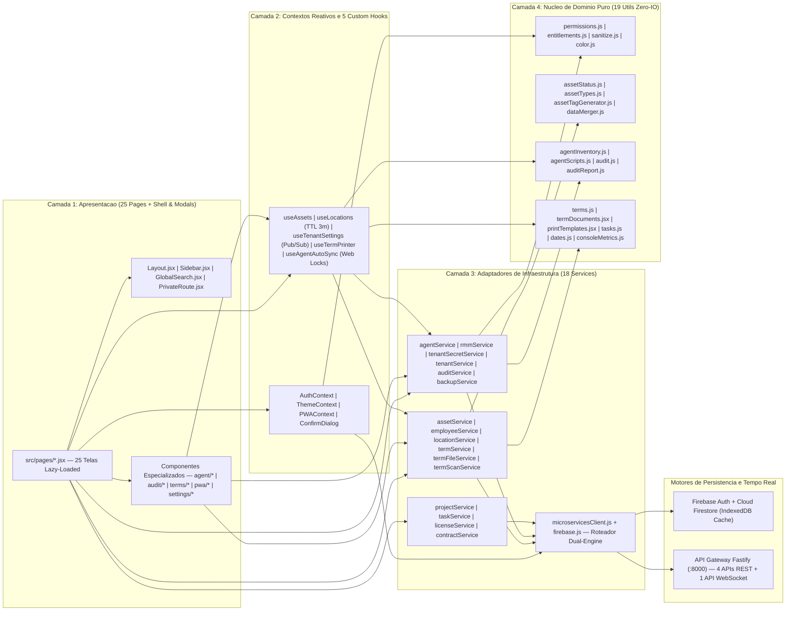

---

### 5.2 Contextos Globais e os 5 Hooks Customizados (`src/contexts/` e `src/hooks/`)

#### Contextos Reativos (4 Módulos)

| Arquivo | Símbolos Exportados | Estado e Funções Expostas / Mecanismo Interno |
| :--- | :--- | :--- |
| [`src/contexts/AuthContext.jsx`](file:///c:/Users/ShinerayADM/Projetos/nexus-itam/src/contexts/AuthContext.jsx) | `useAuth`, `AuthProvider` | Expõe `{ currentUser, login, registerCompany, acceptInvite, resetPassword, createSystemUser, logout, reloadCurrentUser, loading }`. Unifica sessões Firebase e Gateway (`isGatewayOnly`, `onGatewaySessionChange`), cria instância secundária isolada de `FirebaseApp` (`SecondaryApp`) em `createSystemUser` para cadastrar operadores sem derrubar a sessão do admin logado, e bloqueia contas órfãs ou suspensas. |
| [`src/contexts/ThemeContext.jsx`](file:///c:/Users/ShinerayADM/Projetos/nexus-itam/src/contexts/ThemeContext.jsx) | `useTheme`, `ThemeProvider`, `DEFAULT_BRAND_COLOR` | Expõe `{ theme, resolvedTheme, isDark, setTheme, toggleTheme, brandColor }`. Suporta `'light'`, `'dark'` e `'system'` (`matchMedia('(prefers-color-scheme: dark)')`), persiste em `localStorage['nexus_theme']` e aplica whitelabel dinâmico convertendo `safeCssColor(currentUser?.primaryColor)` via `rgbChannels` e `darken` nas variáveis CSS `--color-brand`, `--color-brand-rgb` e `--color-brand-hover`. |
| [`src/contexts/PWAContext.jsx`](file:///c:/Users/ShinerayADM/Projetos/nexus-itam/src/contexts/PWAContext.jsx) | `usePWA`, `PWAProvider` | Expõe `{ needRefresh, offlineReady, isStandalone, isIOS, canInstall, isInstallBannerVisible, isInstallModalOpen, setIsInstallModalOpen, installProgress, isChecking, lastCheckedAt, storageDiagnostics, applyUpdate, dismissUpdate, checkForUpdates, triggerInstallPrompt, startInstallWithProgress, dismissInstallBanner }`. Orquestra `useRegisterSW` (`virtual:pwa-register/react`), checagem horária de SW, aquecimento de `CacheStorage` e telemetria `navigator.storage.estimate()`. |
| [`src/components/ConfirmDialog.jsx`](file:///c:/Users/ShinerayADM/Projetos/nexus-itam/src/components/ConfirmDialog.jsx) | `useConfirm`, `ConfirmProvider` | Expõe `confirm({ title, message, confirmText, cancelText, tone, requireText }) -> Promise<boolean>`. Substitui `window.confirm` por modal acessível com foco automático, fechamento por `Escape` e trava de digitação obrigatória (`requireText`, ex.: digitar `RESTAURAR` em operações destrutivas). |

#### Os 5 Hooks Customizados (`src/hooks/*.js`)

| Arquivo | Símbolos Exportados | Arquitetura Interna, Cache e Concorrência |
| :--- | :--- | :--- |
| [`src/hooks/useAssets.js`](file:///c:/Users/ShinerayADM/Projetos/nexus-itam/src/hooks/useAssets.js) | `useAssets(tenantId)` | Hook reativo Dual-Engine que retorna `{ assets, loading, error }`. Quando `isGatewayActiveSession()` é verdadeiro, consome `getAllAssets(tenantId)` via `microservicesClient` e reage a `onGatewaySessionChange`; no modo Firebase, abre assinatura em tempo real `onSnapshot` ordenada por `internalId` filtrada por `tenantId`. |
| [`src/hooks/useLocations.js`](file:///c:/Users/ShinerayADM/Projetos/nexus-itam/src/hooks/useLocations.js) | `useLocations()`, `invalidateLocationsCache(tenantId)` | Mantém `Map` em memória (`locationsCache`) indexado por `tenantId` com **TTL de 3 minutos (`180.000 ms`)** e deduplicação de `inflightPromise` para evitar *stampede* de queries simultâneas quando múltiplos `LocationSelect` montam na mesma tela. Retorna `{ locations, locationNames, loading, reload }`. |
| [`src/hooks/useTenantSettings.js`](file:///c:/Users/ShinerayADM/Projetos/nexus-itam/src/hooks/useTenantSettings.js) | `useTenantSettings()`, `invalidateTenantSettings(tenantId)` | Cache em memória por `tenantId` acoplado a um barramento **Pub/Sub leve (`listeners = new Set()`)**. Quando [`SettingsPage.jsx`](file:///c:/Users/ShinerayADM/Projetos/nexus-itam/src/pages/SettingsPage.jsx) grava `/settings/{tenantId}`, dispara `invalidateTenantSettings(tenantId)`, limpando o cache e notificando todas as telas montadas para recarregar configurações imediatamente. No modo Gateway, sintetiza as configurações a partir do perfil JWT sem tocar no Firestore. |
| [`src/hooks/useAgentAutoSync.js`](file:///c:/Users/ShinerayADM/Projetos/nexus-itam/src/hooks/useAgentAutoSync.js) | `useAgentAutoSync()` | Worker de segundo plano montado em [`Layout.jsx`](file:///c:/Users/ShinerayADM/Projetos/nexus-itam/src/components/Layout.jsx) exclusivamente para administradores (`can(currentUser, 'agent:manage')`) quando `settings.agentAutoSync !== false`. Abre `onSnapshot` leve (`limit(25)`) sobre `/agentInbox` filtrando `status == 'pending'`, aplica debounce de `1.500 ms` e coordena exclusividade entre múltiplas abas do navegador usando a **Web Locks API** (`navigator.locks.request('nexus-agent-autosync', { ifAvailable: true }, task)`), invocando `processAgentInbox` sem duplicar ativos nem consumir cota em abas ocultas. |
| [`src/hooks/useTermPrinter.js`](file:///c:/Users/ShinerayADM/Projetos/nexus-itam/src/hooks/useTermPrinter.js) | `useTermPrinter()` | Retorna `{ printTerm, preparePrintTerm, printDraft, branding, termOptions, reloadSettings }`. Resolve o bloqueio de popups em navegadores mobile/desktop abrindo a janela síncrona no evento de clique (`openPrintWindow` em [`printTemplates.jsx`](file:///c:/Users/ShinerayADM/Projetos/nexus-itam/src/utils/printTemplates.jsx)) antes do `await` da transação de emissão, gerando a URL canônica `${origin}/termos/${term.id}` embutida no QR Code do cabeçalho A4. |

---

### 5.3 Catálogo Completo dos 18 Serviços (`src/services/*.js`)

| # | Serviço (`src/services/`) | Funções / Constantes Exportadas | Coleções Firestore / Endpoints API Acessados | Estratégias Transacionais, Batching e Relações |
| :-: | :--- | :--- | :--- | :--- |
| 1 | [`firebase.js`](file:///c:/Users/ShinerayADM/Projetos/nexus-itam/src/services/firebase.js) | `isGatewayOnly`, `firebasePublicConfig`, `auth`, `db`, `default (app)` | Inicialização Firebase Auth + Cloud Firestore | Configura `initializeFirestore` com `persistentLocalCache({ tabManager: persistentMultipleTabManager() })` e `experimentalAutoDetectLongPolling: true`. Em `isGatewayOnly`, usa config placeholder sem tráfego externo. |
| 2 | [`microservicesClient.js`](file:///c:/Users/ShinerayADM/Projetos/nexus-itam/src/services/microservicesClient.js) | `getGatewayBaseUrl`, `resolvePortalUrl`, `getGatewaySession`, `isGatewayActiveSession`, `setPrimaryAuthSource`, `getPrimaryAuthSource`, `saveGatewaySession`, `clearGatewaySession`, `onGatewaySessionChange`, `gatewayFetch`, `microservicesApi` (22 métodos) | Gateway `:8000`: `/health`, `/api/v1/auth/*`, `/api/v1/assets*`, `/api/v1/tickets*`, `/api/v1/compliance/*`, `/api/v1/telemetry/*` | Resolve URL do Gateway adaptativamente (env, porta `3002 -> :8000`, localhost `:8000`), injeta `Authorization: Bearer`, propaga eventos DOM `nexus:ms-session` e expõe cliente tipado completo para as 5 APIs. |
| 3 | [`assetService.js`](file:///c:/Users/ShinerayADM/Projetos/nexus-itam/src/services/assetService.js) | `getAllAssets`, `getAssetsByTenant`, `getAssetsAssignedTo`, `getAssetByInternalId`, `getAssetById`, `createAsset`, `updateAsset`, `deleteAsset`, `getAssetHistory`, `getRecentActivity`, `getGlobalActivity`, `logHistory` | **Dual-Engine:** Firestore (`/assets`, `/history`, `collectionGroup('history')`) **ou** `service-assets` (`/api/v1/assets*`) | Em `updateAsset`, calcula diff campo a campo (status, local, responsável, nota fiscal, garantia) para gravar trilha auditável automática em `/history`. Impede alterações manuais de `status`/`location` quando `existing.transit?.termId` está ativo (`lifecycleBlocker`). |
| 4 | [`agentService.js`](file:///c:/Users/ShinerayADM/Projetos/nexus-itam/src/services/agentService.js) | `getAgentToken`, `rotateAgentToken`, `submitAgentReport`, `getAgentSubmissions`, `deleteAgentSubmission`, `reconcileAssetLicenses`, `syncAgentReport`, `processAgentInbox`, ` AGENT_VERSION` | Firestore: `/agentInbox`, `/assets`, `/assetInventory`, `/history`, `/licenses`, `/settings` + REST v1 `:commit` | `submitAgentReport` replica o protocolo HTTP REST `:commit` do script sem login; `syncAgentReport` correlaciona máquina via `findAgentAsset`, calcula `diffInventory` e `evaluateAgentAlerts`, separa telemetria pesada (lista completa de softwares/discos) em `/assetInventory/{assetId}` para manter `/assets` leve e reconcilia licenças SAM (`reconcileLicenses`). |
| 5 | [`rmmService.js`](file:///c:/Users/ShinerayADM/Projetos/nexus-itam/src/services/rmmService.js) | `HEARTBEAT_DEFAULT_SEC`, `DEVICE_ONLINE_MS`, `SESSION_TTL_MS`, `REMOTE_ACTIONS`, `formatAccessCode`, `isDeviceOnline`, `subscribeDevices`, `subscribeDevice`, `subscribeControl`, `loadAgentPolicy`, `saveAgentPolicy`, `wakeAgent`, `sendRemoteCommand`, `clearRemoteCommand`, `requestRemoteSession`, `sendSessionInput`, `closeRemoteSession`, `listEnrolledAgents`, `revokeAgentEnrollment`, `listAgentAudit` | Firestore: `/agentDevices`, `/agentControl`, `/agentAudit`, `/agentPolicies`, `/agentEnrollments` | Implementa o protocolo **RMM Spark-Friendly**: `wakeAgent` grava `consoleWakeAt` em `agentDevices`; toda operação sensível (`sendRemoteCommand`, `requestRemoteSession`, `closeRemoteSession`) usa `writeBatch` atômico gravando simultaneamente em `/agentControl/{docId}` (com `lastAuditId`) e `/agentAudit/{auditId}`, satisfazendo a regra `auditedNow()` do Firestore. |
| 6 | [`auditService.js`](file:///c:/Users/ShinerayADM/Projetos/nexus-itam/src/services/auditService.js) | `saveAudit`, `listAudits`, `getAudit`, `deleteAudit` | Firestore: `/audits` | Constrói fotografia imutável da conferência física via `buildAuditRecord` (`src/utils/audit.js`), carimba `serverTimestamp()` e ordena histórico da empresa do mais recente ao mais antigo. |
| 7 | [`backupService.js`](file:///c:/Users/ShinerayADM/Projetos/nexus-itam/src/services/backupService.js) | `BACKUP_FORMAT`, `BACKUP_VERSION`, `TENANT_BACKUP_COLLECTIONS`, `exportTenantBackup`, `validateBackupPayload`, `previewBackup`, `restoreTenantBackup`, `downloadBackupFile` | Firestore: `assets`, `assetInventory`, `employees`, `sectors`, `locations`, `projects`, `tasks`, `licenses`, `contracts`, `serviceOrders`, `audits`, `history`, `terms`, `termFiles`, `settings` | Exporta e restaura 14 coleções + `/settings/{tenantId}` + contadores anuais `/termCounters/{tenantId}/years/*`. Converte `Timestamp` (`__type: 'timestamp'`) e `Bytes` binários (`__type: 'bytes'` Base64) sem perda e executa `commitInChunks` de **400 operações por `writeBatch`** (abaixo do teto de 500 do Firestore), nunca restaurando segredos nem matrículas de agentes. |
| 8 | [`contractService.js`](file:///c:/Users/ShinerayADM/Projetos/nexus-itam/src/services/contractService.js) | `getContracts`, `createContract`, `updateContract`, `deleteContract` | Firestore: `/contracts` | CRUD multi-tenant de contratos de serviços recorrentes, links dedicados e fornecedores de TI, consumido por [`ServiceManager.jsx`](file:///c:/Users/ShinerayADM/Projetos/nexus-itam/src/pages/ServiceManager.jsx). |
| 9 | [`employeeService.js`](file:///c:/Users/ShinerayADM/Projetos/nexus-itam/src/services/employeeService.js) | `getEmployees`, `createEmployee`, `updateEmployee`, `deleteEmployee`, `getSectors`, `createSector`, `deleteSector` | **Dual-Engine:** Firestore (`/employees`, `/sectors`, `/assets`) **ou** Gateway (`GET /api/v1/auth/users`) | Em `updateEmployee`, quando o nome de um colaborador é corrigido (`previousName !== nextName`), propaga automaticamente a atualização de `assignedTo` em lotes de **400 operações (`BATCH_LIMIT = 400`)** em todos os `/assets` daquele `tenantId` para manter integridade referencial documental. |
| 10 | [`locationService.js`](file:///c:/Users/ShinerayADM/Projetos/nexus-itam/src/services/locationService.js) | `LOCATION_KINDS`, `getLocations`, `createLocation`, `updateLocation`, `deleteLocation`, `syncLocationsFromAssets`, `countAtLocation`, `groupLocations`, `groupLocationsByKind` | **Dual-Engine:** Firestore (`/locations`, `/assets`, `/employees`) **ou** síntese via `microservicesApi.listAssets()` | Gerencia matriz, filiais, lojas, CDs e fábricas com sub-redes CIDR (`networks`). Em `updateLocation`, renomeia em cascata (`BATCH_LIMIT = 400`) `asset.location` e `employee.branch` quando `previousName` muda; `syncLocationsFromAssets` descobre unidades legadas presentes nos ativos. |
| 11 | [`licenseService.js`](file:///c:/Users/ShinerayADM/Projetos/nexus-itam/src/services/licenseService.js) | `getLicenses`, `createLicense`, `deleteLicense`, `assignLicense`, `unassignLicense` | Firestore: `/licenses` | Executa alocação e liberação de assentos de software via **`runTransaction`** atômica no Firestore, impedindo *race conditions* de *over-allocation* acima de `totalSeats` quando dois técnicos ou o Agente ITAM alocam licenças simultaneamente. |
| 12 | [`projectService.js`](file:///c:/Users/ShinerayADM/Projetos/nexus-itam/src/services/projectService.js) | `getProjects`, `getProject`, `createProject`, `updateProject`, `deleteProject`, `addProjectLog`, `setProjectLogs` | Firestore: `/projects` | Gerencia projetos de TI com verificação explícita de pertencimento `data.tenantId !== tenantId` em leituras unitárias (`getProject`) e adição atômica de entradas no diário de bordo via `arrayUnion`. |
| 13 | [`taskService.js`](file:///c:/Users/ShinerayADM/Projetos/nexus-itam/src/services/taskService.js) | `getTasks`, `addTask`, `updateTask`, `deleteTask` | Firestore: `/tasks` | Persistência multi-tenant do quadro Kanban e lista de tarefas operacionais, ordenando por `createdAt` decrescente em memória para dispensar índices compostos redundantes. |
| 14 | [`tenantSecretService.js`](file:///c:/Users/ShinerayADM/Projetos/nexus-itam/src/services/tenantSecretService.js) | `generateSecretToken`, `getTenantSecrets`, `ensureAgentToken`, `rotateTenantAgentToken`, `migrateLegacyAgentToken` | Firestore: `/tenantSecrets/{tenantId}`, `/settings/{tenantId}` | Gera tokens criptográficos de 192 bits (`crypto.getRandomValues(new Uint8Array(24))`), isola segredos fora de `/settings` (que é legível por `viewer`) e migra de forma idempotente tokens legados via `deleteField()` em `writeBatch`. |
| 15 | [`tenantService.js`](file:///c:/Users/ShinerayADM/Projetos/nexus-itam/src/services/tenantService.js) | `slugifyCompany`, `assetPrefixFor`, `describeFirebaseError`, `loadPlans`, `countTenantUsage`, `assertWithinLimit`, `provisionTenant`, `updateTenant`, `loadConsoleSnapshot` | Firestore: `/tenants`, `/tenantInternal`, `/plans`, `/settings`, `/invites`, `/users`, `collectionGroup('assets')` | Serviço mestre de governança SaaS: `assertWithinLimit` bloqueia criação de ativos/usuários acima da cota do plano usando `getCountFromServer` (custo de 1 leitura agregada); `provisionTenant` cria atomicamente `tenants`, `tenantInternal`, `settings` e `invites` em único `writeBatch`; `loadConsoleSnapshot` consolida MRR e uso global para o *Nexus Master*. |
| 16 | [`termFileService.js`](file:///c:/Users/ShinerayADM/Projetos/nexus-itam/src/services/termFileService.js) | `sha256Hex`, `prepareSignedCopyChunks`, `loadSignedCopyBlob`, `deleteSignedCopyChunks` | Firestore: `/termFiles/{fileId}_{index}` | Resolve ausência de Cloud Storage no plano Spark dividindo PDFs/imagens assinados de até **5 MiB** em até **6 chunks binários de 900 KiB** (`Bytes.fromUint8Array`), calculando hash de integridade `SHA-256` via Web Crypto API (`crypto.subtle.digest`) e conferindo o hash na reconstituição do `Blob`. |
| 17 | [`termScanService.js`](file:///c:/Users/ShinerayADM/Projetos/nexus-itam/src/services/termScanService.js) | `readQrFromFile`, `identifySignedCopyFile` | Processamento 100% Client-Side (Canvas + Web Worker) | Escaneia imagens (tentando 1600px e 2600px para QRs pequenos de cabeçalho A4) e PDFs digitalizados (renderizando páginas 1–2 em `scale: 2.2` com `pdfjs-dist` + `html5-qrcode`) para extrair automaticamente o `termId` do QR Code ou casar pelo número `TR/TD/TT-YYYY-NNNN` no nome do arquivo. |
| 18 | [`termService.js`](file:///c:/Users/ShinerayADM/Projetos/nexus-itam/src/services/termService.js) | `issueResponsibilityTerm`, `issueReturnTerm`, `issueTransferTerm`, `confirmTermSignature`, `confirmTransferReceipt`, `attachSignedCopy`, `cancelTransfer`, `getTerm`, `listTerms`, `listTermsForAsset` | Firestore: `/terms`, `/termCounters/{tenantId}/years/{year}`, `/termFiles`, `/assets`, `/history` | Orquestrador transacional dos termos no modo SaaS: reserva numeração sequencial sem furos via `runTransaction` em `/termCounters/{tenantId}/years/{year}`, trava ativos em trânsito (`transit: { termId, number, from, to }`, `status: 'Em Trânsito'`), reverte ao estado anterior em `cancelTransfer` (`snapshotAsset.previousStatus`) e conclui automaticamente assinatura/recebimento ao anexar a via assinada (`attachSignedCopy`). |

---

### 5.4 Catálogo Completo dos 19 Módulos de Domínio Puro (`src/utils/*.js*`)

Nenhum módulo em `src/utils/` importa `firebase/firestore` ou `fetch`, garantindo **testabilidade unitária instantânea e determinística**:

| # | Módulo (`src/utils/`) | Principais Símbolos Exportados | Responsabilidade no Domínio |
| :-: | :--- | :--- | :--- |
| 1 | [`permissions.js`](file:///c:/Users/ShinerayADM/Projetos/nexus-itam/src/utils/permissions.js) | `MASTER_TENANT`, `INVALID_TENANTS`, `ROLE_LABELS`, `TENANT_ROLES`, `TENANT_ONLY_CAPABILITIES`, `normalizeRole`, `hasValidTenant`, `isSuperadmin`, `can`, `capabilitiesFor` | Matriz RBAC cumulativa de 7 papéis, validação *fail-closed* de `tenantId` e trava de privacidade LGPD contra acesso remoto pelo `superadmin`. |
| 2 | [`entitlements.js`](file:///c:/Users/ShinerayADM/Projetos/nexus-itam/src/utils/entitlements.js) | `UNLIMITED`, `FEATURES`, `MODULAR_FEATURES`, `DEFAULT_PLANS`, `TENANT_STATUSES`, `BLOCKED_TENANT_STATUSES`, `BLOCKED_USER_STATUSES`, `isTenantBlocked`, `isUserBlocked`, `resolveEntitlements`, `hasFeature`, `isModuleHidden`, `isModuleEnabled`, `withinLimit`, `usageRatio`, `usageTone`, `formatUsage` | Motor comercial SaaS em 3 camadas, cotas de ativos/usuários, flags de módulos e detecção de inadimplência/suspensão. |
| 3 | [`assetStatus.js`](file:///c:/Users/ShinerayADM/Projetos/nexus-itam/src/utils/assetStatus.js) | `ASSET_STATUSES`, `MANUAL_STATUSES`, `RETIRED_STATUSES`, `WRITE_OFF_REASONS`, `WARRANTY_DAYS_SOON`, `getStatus`, `isRetired`, `lifecycleBlocker`, `statusBadgeClass`, `statusDotClass`, `warrantyStatus` | Máquina de estados do ativo (`Disponível`, `Em Uso`, `Em Trânsito`, `Manutenção`, `Defeito`, `Baixado`, `Extraviado`), motivos de baixa patrimonial e cálculo de vencimento de garantia (60 dias). |
| 4 | [`assetTypes.js`](file:///c:/Users/ShinerayADM/Projetos/nexus-itam/src/utils/assetTypes.js) | `SPEC_FIELDS`, `ASSET_TYPES` (17 tipos base), `getAssetType`, `specsForType`, `isRootSpec`, `buildAssetCatalog` | Catálogo unificado de tipos de hardware, ícones Lucide, especificações técnicas dinâmicas (`processor`, `ram`, `imei1`, `pageCount`, `ports`) e fusão com tipos customizados do inquilino. |
| 5 | [`assetTagGenerator.js`](file:///c:/Users/ShinerayADM/Projetos/nexus-itam/src/utils/assetTagGenerator.js) | `TYPE_CODE_MAP`, `parseTag`, `locationCodeFor`, `resolveTypeCode`, `generateNextAssetTag` | Sequenciador inteligente que infere o padrão de etiquetagem já adotado pela empresa (`SHL-BEL-NTB-001`, `ACME-CPU-042`, `PAT-0125` ou numérico puro), preserva padding e garante unicidade. |
| 6 | [`agentInventory.js`](file:///c:/Users/ShinerayADM/Projetos/nexus-itam/src/utils/agentInventory.js) | `AGENT_VERSION` (`'3.2.0'`), `compareAgentVersion`, `isAgentOutdated`, `isUsableId`, `vendorName`, `hostnameAssetTag`, `inferAssetType`, `normalizeInventory`, `findAgentAsset`, `diffInventory`, `ipInNetwork`, `locationForIp`, `matchEmployeeByLogin`, `resolveAgentPolicy`, `evaluateAgentAlerts`, `reconcileLicenses`, `agentHealth`, `summarizeFleet`, `ALERT_LABELS` | Coração analítico do Agente ITAM: descarta seriais genéricos de fábrica (`To Be Filled By O.E.M.`, `Default string`), casa máquina com ativo em 5 níveis de confiança, mapeia sub-rede CIDR para filial, detecta colaborador pelo login AD e avalia 16 regras de alerta de segurança/conformidade. |
| 7 | [`agentScripts.js`](file:///c:/Users/ShinerayADM/Projetos/nexus-itam/src/utils/agentScripts.js) | `AGENT_TARGETS`, `AGENT_MODES`, `DEFAULT_FIRESTORE_BASE`, `buildAgentScript`, `buildWindowsCmdInstaller`, `buildAgentSource`, `buildAgentConfigJson`, `buildWindowsScript`, `buildLinuxScript`, `buildMacScript` | Montador seguro (com validação regex anti-injeção de shell e UTF-8 BOM para PowerShell 5.1) dos pacotes instaladores `.cmd`, `.ps1`, `.sh`, código C# `NexusAgent.cs` e `config.json` efêmero. |
| 8 | [`appVersion.js`](file:///c:/Users/ShinerayADM/Projetos/nexus-itam/src/utils/appVersion.js) | `APP_VERSION` (`'2.2.0'`) | Constante semântica de versão do shell administrativo exibida em diagnósticos e rodapés. |
| 9 | [`audit.js`](file:///c:/Users/ShinerayADM/Projetos/nexus-itam/src/utils/audit.js) | `AUDIT_COVERAGE_DAYS` (`90`), `SCAN_RESULTS`, `sameLocation`, `isAuditable`, `normalizeCode`, `buildAssetIndex`, `resolveScan`, `classifyScan`, `expectedAt`, `seenByAgentAt`, `summarizeAudit`, `buildAuditRecord`, `auditCoverage`, `auditsInLastDays` | Motor matemático de auditoria física: indexa ativos por tag/serial/URL, classifica leituras (`found`, `missing`, `other_location`, `retired`, `transit_in`, `transit_out`, `unknown`), confirma presença automática por IP/rede do agente e calcula cobertura de 90 dias por unidade. |
| 10 | [`auditReport.js`](file:///c:/Users/ShinerayADM/Projetos/nexus-itam/src/utils/auditReport.js) | `buildAuditPdf`, `auditPdfName` | Gerador assíncrono de relatório executivo A4 em PDF usando `import('jspdf')` + `import('jspdf-autotable')` sob demanda com numeração de páginas e linhas de assinatura. |
| 11 | [`color.js`](file:///c:/Users/ShinerayADM/Projetos/nexus-itam/src/utils/color.js) | `parseColor`, `toHex`, `rgbChannels`, `darken`, `contrastRatio` | Conversor cromático (`#hex`, `rgb()`, `hsl()`) para canais RGB consumidos pelo Tailwind (`bg-brand/10`) e cálculo de luminância relativa WCAG 2.1 (`1..21`). |
| 12 | [`consoleMetrics.js`](file:///c:/Users/ShinerayADM/Projetos/nexus-itam/src/utils/consoleMetrics.js) | `brl`, `brlCompact`, `relativeDays`, `daysSince`, `tenantAlerts`, `ALERT_STYLE` | Motor de inteligência comercial do *Nexus Master*: detecta risco de *churn* (>30 dias sem login), oportunidades de *upsell* (>=85% da cota) e contas sem proprietário. |
| 13 | [`dataMerger.js`](file:///c:/Users/ShinerayADM/Projetos/nexus-itam/src/utils/dataMerger.js) | `generateCleanData` | Sanitizador de migração legada: corrige *mojibake* UTF-8/Latin-1 de planilhas antigas e cruza comentários XML do Excel para extrair seriais, IMEIs de 15 dígitos e CPFs. |
| 14 | [`dates.js`](file:///c:/Users/ShinerayADM/Projetos/nexus-itam/src/utils/dates.js) | `toLocalDate`, `isoDay`, `today`, `formatDateBR`, `formatDateTimeBR`, `endOfLocalDay` | Tratamento seguro de datas no fuso local (elimina o bug clássico de `new Date('YYYY-MM-DD')` recuar um dia em `UTC-3`). |
| 15 | [`printTemplates.jsx`](file:///c:/Users/ShinerayADM/Projetos/nexus-itam/src/utils/printTemplates.jsx) | `NEXUS_INDIGO`, `escapeHtml`, `NEXUS_MARK_SVG`, `resolvePrintBranding`, `buildLabelsDocument`, `printHtml`, `openPrintWindow` | Gerador blindado contra XSS (`escapeHtml` em todos os campos) para etiquetas patrimoniais (`7×3,5 cm`) e de periféricos (`5×2,5 cm`) com QR Code SVG e whitelabel. |
| 16 | [`sanitize.js`](file:///c:/Users/ShinerayADM/Projetos/nexus-itam/src/utils/sanitize.js) | `safeLinkUrl`, `safeImageUrl`, `safeCssColor`, `safeText`, `safeSpreadsheetCell` | Barreira anti-XSS e anti-*CSV Formula Injection*: bloqueia protocolos `javascript:`/`vbscript:`, CSS `url()`/`;` e prefixa `' ` em células iniciadas por `=`, `+`, `-`, `@`. |
| 17 | [`tasks.js`](file:///c:/Users/ShinerayADM/Projetos/nexus-itam/src/utils/tasks.js) | `TASK_COLUMNS`, `TASK_STATUSES`, `TASK_PRIORITIES`, `TASK_CATEGORIES`, `DONE_STATUS`, `isDone`, `columnOf`, `offFlowStatus`, `dueState`, `dueLabel`, `checklistProgress`, `createChecklistItem`, `filterTasks`, `sortTasks`, `summarizeTasks`, `statusPatch`, `sanitizeTaskDraft` | Regras puras do Kanban de tarefas: ordenação inteligente (`smart` por peso de prioridade + prazo + criação), checklists e cálculo de atrasos. |
| 18 | [`termDocuments.jsx`](file:///c:/Users/ShinerayADM/Projetos/nexus-itam/src/utils/termDocuments.jsx) | `buildResponsibilityTermDocument`, `buildReturnTermDocument`, `buildTransferTermDocument`, `buildTermDocumentFor`, `buildTermDocument` | Renderizador jurídico A4 em HTML/CSS de impressão a partir do *snapshot* imutável do termo, com QR Code de retorno no cabeçalho, marca d'água de rascunho e cláusulas CLT Art. 462. |
| 19 | [`terms.js`](file:///c:/Users/ShinerayADM/Projetos/nexus-itam/src/utils/terms.js) | `TERM_KINDS`, `TERM_STATUS`, `OPEN_TERM_STATUSES`, `ASSET_CONDITIONS`, `TRANSPORT_MODES`, `RECEIPT_OUTCOMES`, `MAX_TERM_ASSETS`, `SIGNED_COPY_MAX_BYTES`, `SIGNED_COPY_CHUNK_BYTES`, `formatTermNumber`, `snapshotAsset`, `cleanPerson`, `cleanPlace`, `transferBlocker`, `receiptStatus`, `parseMoney`, `resolveTermOptions`, `splitIntoChunks`, `joinChunks`, `termIdFromQr`, `termNumberFromText`, `matchSignedCopy`, `defaultReceipt`, `isOverdue` | Regras de negócio dos termos patrimoniais, formatação `TR/TD/TT-YYYY-NNNN`, fotografia reversível do ativo, chunking binário `900 KiB` e casamento automático de digitalizações. |

---

### 5.5 Mapa de Acoplamento da Casca Global e das 25 Páginas (`src/pages/*.jsx`)

#### Casca Global (`Layout`, `Sidebar`, `GlobalSearch`, `PWAInstallModal`)

| Componente | Arquivo Real | Hooks, Serviços e Subcomponentes Acionados |
| :--- | :--- | :--- |
| **`Layout`** | [`src/components/Layout.jsx`](file:///c:/Users/ShinerayADM/Projetos/nexus-itam/src/components/Layout.jsx) | Consome `useAuth`, `useTheme`, `usePWA` e monta o worker em background `useAgentAutoSync()`. Gerencia atalhos globais (`Ctrl+K` → `GlobalSearch`, `Alt+N` → `/assets/new`, `Escape`), título/favicon whitelabel, largura auto-calibrada da `Sidebar`, barra mobile com LED online/offline e *Bottom Navigation Bar* adaptativa por permissões. |
| **`Sidebar`** | [`src/components/Sidebar.jsx`](file:///c:/Users/ShinerayADM/Projetos/nexus-itam/src/components/Sidebar.jsx) | Consome `useAuth`, `useTheme`, `usePWA`, `can`, `isSuperadmin`, `isModuleEnabled`. Renderiza navegação corporativa em cascata persistida (`nexus_sidebar_cascade_v2`), alça de redimensionamento por arraste (`250px..340px`), modo recolhido tático (`78px`), seletor de tema e gatilho do instalador PWA. |
| **`GlobalSearch`** | [`src/components/GlobalSearch.jsx`](file:///c:/Users/ShinerayADM/Projetos/nexus-itam/src/components/GlobalSearch.jsx) | Command Palette (`Ctrl+K`) com cache em memória de **TTL 3 minutos** (`globalSearchCache`). Opera em Dual-Mode: busca telas + ativos + colaboradores no tenant (via Firestore ou `getAllAssets`/`getEmployees` no Gateway), ou empresas + usuários globais quando `isSuperadmin`. |
| **`PWAInstallModal`** | [`src/components/pwa/PWAInstallModal.jsx`](file:///c:/Users/ShinerayADM/Projetos/nexus-itam/src/components/pwa/PWAInstallModal.jsx) | Consome `usePWA()` (`startInstallWithProgress`, `installProgress`, `isStandalone`, `isIOS`, `storageDiagnostics`, `checkForUpdates`). Apresenta *Bottom Sheet* / Modal nativo com barra de progresso real em 4 etapas, instruções dedicadas para Safari iOS e medidor de quota offline em MB. |

#### Acoplamento das 25 Páginas (`src/pages/*.jsx`)

| # | Página (`src/pages/`) | Contextos & Hooks | Serviços Consumidos | Utils & Componentes Filhos Principais |
| :-: | :--- | :--- | :--- | :--- |
| 1 | [`Login.jsx`](file:///c:/Users/ShinerayADM/Projetos/nexus-itam/src/pages/Login.jsx) | `useAuth` | `microservicesClient` (`resolvePortalUrl`) | `Logo` |
| 2 | [`Register.jsx`](file:///c:/Users/ShinerayADM/Projetos/nexus-itam/src/pages/Register.jsx) | `useAuth` | *(via `AuthContext.registerCompany`)* | `Logo` |
| 3 | [`AcceptInvite.jsx`](file:///c:/Users/ShinerayADM/Projetos/nexus-itam/src/pages/AcceptInvite.jsx) | `useAuth` | `firebase` (`auth`), `tenantService` (`describeFirebaseError`) | `permissions` (`hasValidTenant`) |
| 4 | [`ResetPassword.jsx`](file:///c:/Users/ShinerayADM/Projetos/nexus-itam/src/pages/ResetPassword.jsx) | — | `firebase` (`auth`, `verifyPasswordResetCode`, `confirmPasswordReset`) | `Logo` |
| 5 | [`Dashboard.jsx`](file:///c:/Users/ShinerayADM/Projetos/nexus-itam/src/pages/Dashboard.jsx) | `useAuth` | `assetService` (`getAllAssets`, `getRecentActivity`), `employeeService` (`getEmployees`), `firebase` (`getCountFromServer`) | `assetStatus`, `assetTypes`, `permissions`, `entitlements`, `DashboardSkeleton`, lazy `DashboardCharts` & `NexusDashboard` |
| 6 | [`NexusDashboard.jsx`](file:///c:/Users/ShinerayADM/Projetos/nexus-itam/src/pages/NexusDashboard.jsx) | `useTheme` | `tenantService` (`loadConsoleSnapshot`), `assetService` (`getGlobalActivity`) | `consoleMetrics`, `entitlements`, `consoleUi` (`KpiTile`, `PlanBadge`, `UsageBar`), `react-chartjs-2` |
| 7 | [`AssetList.jsx`](file:///c:/Users/ShinerayADM/Projetos/nexus-itam/src/pages/AssetList.jsx) | `useAuth`, `useConfirm` | `assetService` (`getAllAssets`, `updateAsset`), `firebase` (`onSnapshot`) | `sanitize`, `assetStatus`, `assetTypes`, `permissions`, `entitlements`, `printTemplates`, `dates`, `AssetMetrics`, `TermIssueModal`, `TransferModal` |
| 8 | [`AssetForm.jsx`](file:///c:/Users/ShinerayADM/Projetos/nexus-itam/src/pages/AssetForm.jsx) | `useAuth` | `assetService`, `employeeService`, `tenantService` (`assertWithinLimit`), `microservicesClient`, `firebase` | `assetTypes`, `assetTagGenerator`, `assetStatus`, `QRScanner`, `LocationSelect`, `AssetIcon`, `StatusBadge` |
| 9 | [`AssetDetail.jsx`](file:///c:/Users/ShinerayADM/Projetos/nexus-itam/src/pages/AssetDetail.jsx) | `useAuth`, `useConfirm` | `assetService`, `firebase` (`serviceOrders`, `settings`) | `assetStatus`, `sanitize`, `permissions`, `dates`, `terms`, `printTemplates`, `MoveAssetModal`, `MaintenanceModal`, `WriteOffModal`, `TermIssueModal`, `TransferModal`, `AssetTermsCard`, `AgentInventoryCard` |
| 10 | [`AgentManager.jsx`](file:///c:/Users/ShinerayADM/Projetos/nexus-itam/src/pages/AgentManager.jsx) | `useAuth`, `useAssets`, `useTenantSettings` | `agentService` (`getAgentSubmissions`, `processAgentInbox`), `tenantSecretService` (`migrateLegacyAgentToken`), `tenantService` (`assertWithinLimit`) | `agentInventory`, `assetStatus`, `FleetTab`, `InboxTab`, `InstallTab`, `PoliciesTab`, `SimulatorTab`, `RemoteControlModal` |
| 11 | [`ServiceDeskHub.jsx`](file:///c:/Users/ShinerayADM/Projetos/nexus-itam/src/pages/ServiceDeskHub.jsx) | *(estado local + `onGatewaySessionChange`)* | `microservicesClient` (`microservicesApi`, `getGatewayBaseUrl`, `resolvePortalUrl`) + `WebSocket` `/ws/nexusdesk` | Console completo das 5 APIs (Chamados SLA, Termos CLT HMAC, `audit_chain` e Telemetria Live) |
| 12 | [`AuditPage.jsx`](file:///c:/Users/ShinerayADM/Projetos/nexus-itam/src/pages/AuditPage.jsx) | `useAuth`, `useAssets`, `useLocations`, `useConfirm` | `auditService` (`getAudit`, `listAudits`, `saveAudit`) | `audit` (`expectedAt`, `sameLocation`), `permissions`, `AuditHome`, `AuditSession`, `AuditReport` |
| 13 | [`TermsPage.jsx`](file:///c:/Users/ShinerayADM/Projetos/nexus-itam/src/pages/TermsPage.jsx) | `useAuth`, `useTermPrinter`, `useConfirm` | `termService` (`listTerms`, `getTerm`, `cancelTransfer`) | `terms`, `permissions`, `TermIssueModal`, `TransferModal`, `ConcludeTermModal`, `SignedCopiesModal`, `SignedCopyViewer` |
| 14 | [`EmployeeManager.jsx`](file:///c:/Users/ShinerayADM/Projetos/nexus-itam/src/pages/EmployeeManager.jsx) | `useAuth`, `useConfirm` | `employeeService` (CRUD colaboradores/setores), `assetService` (`getAssetsAssignedTo`) | `assetStatus`, `permissions`, `TermIssueModal`, `LocationSelect`, `ManagerSkeleton` |
| 15 | [`ProjectsPage.jsx`](file:///c:/Users/ShinerayADM/Projetos/nexus-itam/src/pages/ProjectsPage.jsx) | `useAuth`, `useConfirm` | `projectService` (`getProjects`, `createProject`, `deleteProject`), `employeeService` (`getEmployees`) | `permissions`, `dates` |
| 16 | [`ProjectDetails.jsx`](file:///c:/Users/ShinerayADM/Projetos/nexus-itam/src/pages/ProjectDetails.jsx) | `useAuth`, `useConfirm` | `projectService` (`getProject`, `updateProject`, `addProjectLog`, `setProjectLogs`) | `permissions`, `dates` |
| 17 | [`TaskManager.jsx`](file:///c:/Users/ShinerayADM/Projetos/nexus-itam/src/pages/TaskManager.jsx) | `useAuth`, `useConfirm` | `taskService` (`getTasks`, `addTask`, `updateTask`, `deleteTask`), `projectService`, `employeeService` | `tasks`, `permissions`, `dates` |
| 18 | [`LicenseManager.jsx`](file:///c:/Users/ShinerayADM/Projetos/nexus-itam/src/pages/LicenseManager.jsx) | `useAuth`, `useAssets`, `useConfirm` | `licenseService` (`getLicenses`, `createLicense`, `deleteLicense`, `assignLicense`, `unassignLicense`) | `permissions`, `assetStatus`, `dates` |
| 19 | [`ServiceManager.jsx`](file:///c:/Users/ShinerayADM/Projetos/nexus-itam/src/pages/ServiceManager.jsx) | `useAuth`, `useConfirm` | `contractService` (`getContracts`, `createContract`, `updateContract`, `deleteContract`) | `permissions`, `dates`, `ManagerSkeleton` |
| 20 | [`ImportData.jsx`](file:///c:/Users/ShinerayADM/Projetos/nexus-itam/src/pages/ImportData.jsx) | `useAuth`, `useConfirm` | `firebase` (`writeBatch` em `/assets`), `tenantService` (`assertWithinLimit`), `import('xlsx')` dinâmico | `sanitize` (`safeSpreadsheetCell`), `assetTagGenerator` |
| 21 | [`SettingsPage.jsx`](file:///c:/Users/ShinerayADM/Projetos/nexus-itam/src/pages/SettingsPage.jsx) | `useAuth` | `firebase` (`/settings/{tenantId}`), `tenantService` (`describeFirebaseError`), `invalidateTenantSettings` | `permissions`, `entitlements`, `sanitize`, 10 seções modulares (`CompanySection`, `BrandingSection`, `LocationManager`, `BackupSection`, etc.) |
| 22 | [`UserManager.jsx`](file:///c:/Users/ShinerayADM/Projetos/nexus-itam/src/pages/UserManager.jsx) | `useAuth`, `useConfirm` | `firebase` (`/users`, `/invites`), `tenantService` (`assertWithinLimit`, `describeFirebaseError`) | `permissions`, `entitlements`, `ManagerSkeleton` |
| 23 | [`TenantManager.jsx`](file:///c:/Users/ShinerayADM/Projetos/nexus-itam/src/pages/TenantManager.jsx) | `useConfirm` | `tenantService` (`loadConsoleSnapshot`, `provisionTenant`, `updateTenant`, `describeFirebaseError`) | `entitlements`, `consoleMetrics`, `consoleUi`, `TenantDetailDrawer` |
| 24 | [`NexusUserManager.jsx`](file:///c:/Users/ShinerayADM/Projetos/nexus-itam/src/pages/NexusUserManager.jsx) | `useAuth`, `useConfirm` | `firebase` (`/users`, `/tenants`), `tenantService` (`describeFirebaseError`) | `permissions`, `entitlements`, `consoleMetrics` |
| 25 | [`NexusPlansManager.jsx`](file:///c:/Users/ShinerayADM/Projetos/nexus-itam/src/pages/NexusPlansManager.jsx) | — | `firebase` (`/plans/{planId}`), `tenantService` (`loadPlans`, `describeFirebaseError`) | `entitlements` (`FEATURES`, `UNLIMITED`, `resolveEntitlements`), `consoleMetrics` (`brl`) |

---

## Seção 6: Arquitetura da Malha de Microsserviços Fastify, 5 APIs e Segurança Zero-Trust (`services/`)

### 6.1 Diagrama de Relação de Funções no Backend Distribuído

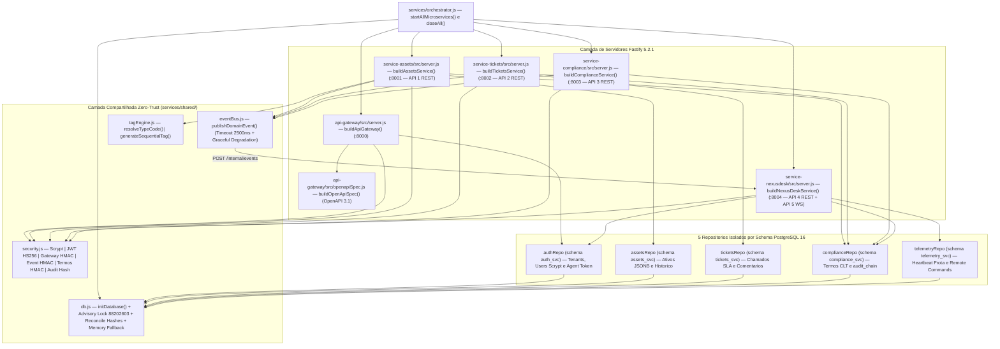

---

### 6.2 Orquestração e Boot Distribuído (`orchestrator.js` e `initDatabase()`)

O boot da malha suporta dois modelos de implantação idênticos em contrato:

1. **Containers Isolados em Produção (`docker-compose.yml` / `docker-compose.vps.yml`)**: cada serviço sobe em seu próprio container Alpine executando `node <service>/src/server.js` sob `USER node`, conectando-se ao mesmo cluster PostgreSQL 16 mas operando exclusivamente sobre seu próprio schema lógico.
2. **Orquestrador Unificado Multi-Porta ([`services/orchestrator.js`](file:///c:/Users/ShinerayADM/Projetos/nexus-itam/services/orchestrator.js))**: `startAllMicroservices(options)` inicializa o banco uma vez (`initDatabase`), levanta em paralelo as 4 instâncias Fastify nas portas `:8001..:8004`, injeta os endereços resolvidos no `buildApiGateway` (`:8000`) e registra *graceful shutdown* nos sinais `SIGINT`/`SIGTERM` via `closeAll()` (`Promise.allSettled` fechando os 5 servidores + `closeDatabase()`).

#### Concorrência Segura na Inicialização do PostgreSQL (`initDatabase` em [`services/shared/db.js`](file:///c:/Users/ShinerayADM/Projetos/nexus-itam/services/shared/db.js))

Quando 5 containers sobem simultaneamente no Docker Compose, todos chamam `initDatabase()` ao mesmo tempo. Para evitar *race conditions* de DDL (`tuple concurrently updated`) e garantir determinismo criptográfico:

- **Retry Progressivo de Conexão**: até `15` tentativas com espera linear limitada `Math.min(1000 * attempt, 5000)` ms enquanto o container `postgres:16-alpine` conclui o boot.
- **Lock Distribuído de Sessão (`SELECT pg_advisory_lock(88202603)`)**: o primeiro container adquire o lock exclusivo no PostgreSQL, executa [`services/shared/init.sql`](file:///c:/Users/ShinerayADM/Projetos/nexus-itam/services/shared/init.sql), popula os *seeds* idempotentes (`ON CONFLICT DO NOTHING`) e executa `reconcileCanonicalHashesIfNeeded(client)` antes de liberar `pg_advisory_unlock(88202603)` no bloco `finally`.
- **Auto-Reconciliação Criptográfica (`reconcileCanonicalHashesIfNeeded`)**: recalcula e reencadeia eventuais registros de `compliance_svc.responsibility_terms` e `compliance_svc.audit_chain` caso a chave `COMPLIANCE_SIGNING_SECRET` tenha sido rotacionada na primeira subida ou se o formato JSONB tiver sido normalizado.
- **Store Relacional em Memória (`NEXUS_DB_MODE=memory`)**: caso o PostgreSQL não esteja presente em desenvolvimento local rápido ou na suíte de integração `npm --prefix services test` (a menos que `NEXUS_REQUIRE_PG=true` esteja definido, como em produção), `db.js` ativa automaticamente um motor transacional em memória com exatamente a mesma assinatura assíncrona dos 5 repositórios e dados *seed* realistas.

---

### 6.3 Biblioteca Compartilhada (`services/shared/`)

#### 1. Módulo de Segurança Zero-Trust ([`services/shared/security.js`](file:///c:/Users/ShinerayADM/Projetos/nexus-itam/services/shared/security.js) — 23 Símbolos Exportados)

Em `NODE_ENV === 'production'`, `resolveSecret()` aborta imediatamente o processo (`throw Error('[FATAL SECURITY]')`) se qualquer um dos três segredos de ambiente (`JWT_SECRET`, `INTERNAL_GATEWAY_SECRET`, `COMPLIANCE_SIGNING_SECRET`) estiver ausente ou tiver menos de 32 caracteres.

| # | Símbolo Exportado | Algoritmo / Parâmetros | Papel Técnico |
| :-: | :--- | :--- | :--- |
| 1 | `JWT_SECRET` | Segredo `>= 32 chars` | Chave mestra de assinatura/verificação de tokens JWT emitidos pelo API Gateway. |
| 2 | `INTERNAL_GATEWAY_SECRET` | Segredo `>= 32 chars` | Chave M2M compartilhada entre Gateway e microsserviços para assinar `X-Gateway-Signature` e eventos internos. |
| 3 | `COMPLIANCE_SIGNING_SECRET` | Segredo `>= 32 chars` | Chave jurídica dedicada à assinatura eletrônica `HMAC-SHA256` dos Termos CLT. |
| 4 | `hashPassword(password)` | `crypto.scrypt` (`N=16384, r=8, p=1`, `64 bytes`, salt `16 bytes`) | Derivação resistente a GPU/ASIC no formato `scrypt$16384$8$1$<saltHex>$<hashHex>`. |
| 5 | `verifyPassword(password, stored)` | `scrypt` + `crypto.timingSafeEqual` | Verificação em tempo constante imune a ataques de temporização (*timing side-channel*). |
| 6 | `signJwt(payload, expiresInSec)` | `HS256` (`HMAC-SHA256`, TTL padrão `28800s` = 8h, `jti` UUID v4) | Emissão nativa de JWT RFC 7519 sem pacotes externos. |
| 7 | `verifyJwt(token)` | `HS256` + `timingSafeEqual` + checagem de `exp` | Validação criptográfica e temporal de tokens Bearer HTTP e WebSocket. |
| 8 | `signGatewayContext(userContext)` | `HMAC-SHA256` sobre `sub|tenantId|role|email|ts` | Gera o trio `{ userHeader, timestampHeader, signature }` injetado pelo Gateway nas chamadas internas. |
| 9 | `verifyGatewayOrJwt(request, reply)` | Hook Fastify (`preHandler`) com **Anti-Replay de `60.000 ms`** | Verifica `X-Gateway-Signature` + frescor de `X-Gateway-Timestamp` (`<= 60s`), impedindo falsificação de headers ou *replay attacks* na rede interna; aceita fallback Bearer JWT direto para testes/dev. |
| 10 | `signInternalEvent(rawBody, ts)` | `HMAC-SHA256` sobre `${timestamp}.${rawBody}` | Assina publicações HTTP no Event Bus entre microsserviços (`X-Nexus-Event-Signature`). |
| 11 | `verifyInternalEvent(rawBody, ts, sig)` | `timingSafeEqual` + janela de `60.000 ms` | Autentica eventos recebidos em `POST /internal/events` no `service-nexusdesk`. |
| 12 | `GENESIS_HASH` | `'0'.repeat(64)` | Hash semente do bloco #1 da cadeia forense `audit_chain` de cada inquilino. |
| 13 | `canonicalizeForHash(value)` | Ordenação recursiva de chaves + `Date -> epoch ms` | **Determinismo JSONB**: garante o mesmo JSON canônico antes e depois de gravar em colunas `JSONB` ou `TIMESTAMPTZ` do PostgreSQL 16. |
| 14 | `sha256Hex(content)` | `SHA-256` hexadecimal (64 chars) | Primitiva de resumo criptográfico de propósito geral. |
| 15 | `computeTermDocumentHash(termPayload)` | `SHA-256(canonicalizeForHash(...))` | Calcula a impressão digital imutável do conteúdo contratual do Termo de Responsabilidade. |
| 16 | `signResponsibilityTerm({...})` | `HMAC-SHA256` (`COMPLIANCE_SIGNING_SECRET`) | Gera `{ documentHash, signatureHash }` vinculando documento, signatário, e-mail, IP, User-Agent e timestamp do aceite CLT. |
| 17 | `verifyResponsibilityTermSignature(term)` | Recálculo canônico + `timingSafeEqual` | Auditoria forense que detecta adulteração de qualquer caractere no banco (`documentIntact`, `signatureIntact`, `valid`). |
| 18 | `computeAuditChainHash({...})` | `SHA-256(canonicalizeForHash({ previousHash, ... }))` | Encadeia cada bloco da `audit_chain` ao `recordHash` imediatamente anterior do mesmo `tenantId`. |
| 19 | `hashAgentToken(rawToken)` | `SHA-256('agent-v3:' + token)` | Armazena apenas o digest irreversível do token M2M da empresa em `auth_svc.tenants.agent_token_hash`. |
| 20 | `verifyAgentToken(rawToken, expected)` | `timingSafeEqual` sobre digests de 64 chars | Autentica agentes de endpoint (`X-Agent-Token`) em tempo constante. |
| 21 | `ROLE_HIERARCHY` | Mapa numérico (`collaborator: 10` .. `superadmin: 100`) | Unifica papéis do Portal (`collaborator`, `technician`) e do Console (`viewer`..`superadmin`). |
| 22 | `requireRoles(...allowedRoles)` | Factory de middleware Fastify | Restringe rotas específicas a conjuntos explícitos de papéis RBAC (`403 Forbidden`). |
| 23 | `sanitizeText(value, maxLen)` | Strip de caracteres de controle ASCII (`0x00..0x1F`, `0x7F`) | Higienização defensiva de strings de entrada em todos os serviços. |

#### 2. Barramento de Eventos (`eventBus.js`), Motor de Tags (`tagEngine.js`) e Repositórios (`db.js`)

- **[`services/shared/eventBus.js`](file:///c:/Users/ShinerayADM/Projetos/nexus-itam/services/shared/eventBus.js)**: exporta `publishDomainEvent({ eventType, tenantId, actor, data })`. Empacota um envelope com `id: randomUUID()`, assina com `signInternalEvent` e dispara `POST ${NEXUSDESK_INTERNAL_URL}/internal/events` protegido por `AbortSignal.timeout(2500)`. Se o `service-nexusdesk` estiver indisponível ou reiniciar, captura o erro silenciosamente e retorna `{ delivered: false }`, assegurando que uma falha no barramento de notificações em tempo real **jamais derrube uma transação crítica** de patrimônio, chamado ou termo jurídico.
- **[`services/shared/tagEngine.js`](file:///c:/Users/ShinerayADM/Projetos/nexus-itam/services/shared/tagEngine.js)**: exporta `TYPE_CODE_MAP`, `resolveTypeCode(type)` e `generateSequentialTag({ prefix, locationName, type, existingTags })`, gerando etiquetas padronizadas `[PREFIX]-[LOC]-[TYPE]-[SEQ]` (ex.: `NEX-MAT-NTB-005`) no servidor.
- **Os 5 Repositórios de [`services/shared/db.js`](file:///c:/Users/ShinerayADM/Projetos/nexus-itam/services/shared/db.js)**:
  - **`authRepo`** (`auth_svc`): `findUserByEmail(email)`, `findUserById(id)`, `findTenantById(tenantId)`, `verifyTenantAgentToken(tenantId, rawToken)`, `listTenantUsers(tenantId)`.
  - **`assetsRepo`** (`assets_svc`): `list(tenantId, filters)`, `findById(tenantId, id)`, `create(tenantId, payload, actorName)`, `update(tenantId, id, patch, actorName)`, `retire(tenantId, id, reason, actorName)` — grava automaticamente em `assets_svc.asset_history` dentro da operação.
  - **`ticketsRepo`** (`tickets_svc`): `list(tenantId, filters)`, `findById(tenantId, id)`, `create(tenantId, payload)`, `updateStatus(tenantId, id, patch, actor)`, `addComment(tenantId, ticketId, comment)`, `getMetrics(tenantId)`.
  - **`complianceRepo`** (`compliance_svc`): `listTerms(tenantId, filters)`, `findTermById(tenantId, id)`, `createTerm(tenantId, term)`, `signTerm(tenantId, id, signatureData)`, `appendAuditLog({ tenantId, serviceOrigin, eventType, actorId, actorName, targetId, payload })` (protegido por `SELECT pg_advisory_xact_lock(202603, hashtext($1))`), `listAuditChain(tenantId, limit)`, `verifyAuditChainIntegrity(tenantId)`.
  - **`telemetryRepo`** (`telemetry_svc`): `upsertHeartbeat(tenantId, payload)`, `listFleet(tenantId)`, `queueCommand(tenantId, cmd)`.

---

### 6.4 Catálogo Completo de Endpoints do API Gateway (`:8000`) e das 5 APIs

#### Camada Perimetral: API Gateway (`services/api-gateway/src/server.js` — Porta `:8000`)

- **Políticas Globais**: `@fastify/helmet`, `@fastify/cors`, `@fastify/rate-limit` (`max: 240`, `timeWindow: '1 minute'`), rastreamento distribuído `X-Request-Id` (`randomUUID()`) e timeout de upstream de `15.000 ms` (`502 Bad Gateway` estruturado caso um microsserviço não responda).
- **Bridge WebSocket RFC 6455 (`/ws/nexusdesk`)**: aceita upgrade no subprotocolo `nexusdesk-ws/3.0`, valida frame size (`<= 64 KiB`), enfileira até `MAX_PENDING_MESSAGES = 32` frames enviados pelo cliente durante o handshake com o upstream `:8004` e higieniza códigos de fechamento reservados (`1005`, `1006`, `1015`) via `isForwardableCloseCode`.

| Método & Path no Gateway (`:8000`) | Autenticação / Rate-Limit | Destino / Comportamento |
| :--- | :--- | :--- |
| `GET /openapi.json` | Público | Retorna especificação **OpenAPI 3.1.0** completa das 5 APIs (`buildOpenApiSpec`). |
| `GET /docs` | Público | Renderiza interface interativa **Swagger UI 5** com CSP ajustada. |
| `GET /health` | Público | Sondagem distribuída agregada: consulta PostgreSQL (`checkDbHealth`) + `/health` dos 4 microsserviços em paralelo (`timeout 2500ms`), retornando `200 healthy` ou `503 degraded`. |
| `POST /api/v1/auth/login` | Público (`max: 20 req/min`) | Valida credenciais contra `authRepo.findUserByEmail` + `verifyPassword` (`scrypt`), verifica `tenant.status` e emite JWT HS256 (8h) + perfil do usuário/empresa. |
| `GET /api/v1/auth/me` | `Bearer JWT` | Recarrega perfil atualizado do usuário e status do tenant no PostgreSQL. |
| `GET /api/v1/auth/users` | `Bearer JWT` (`technician`..`superadmin`) | Lista diretório de colaboradores ativos do `tenantId` (`authRepo.listTenantUsers`). |
| `ALL /api/v1/assets*` | `Bearer JWT` → `X-Gateway-Signature` | Proxy reverso autenticado para **API 1 (`service-assets :8001`)**. |
| `ALL /api/v1/tickets*` | `Bearer JWT` → `X-Gateway-Signature` | Proxy reverso autenticado para **API 2 (`service-tickets :8002`)**. |
| `ALL /api/v1/compliance*` | `Bearer JWT` → `X-Gateway-Signature` | Proxy reverso autenticado para **API 3 (`service-compliance :8003`)**. |
| `ALL /api/v1/telemetry*` | `Bearer JWT` **ou** `X-Agent-Token` | Proxy reverso Dual-Auth (Operador JWT ou Agente M2M) para **API 4 (`service-nexusdesk :8004`)**. |
| `WS /ws/nexusdesk` | `?token=JWT` ou `X-Agent-Token` | Ponte WebSocket full-duplex para **API 5 (`service-nexusdesk :8004`)**. |

---

#### API 1 (REST) — `service-assets` (`:8001`) · Patrimônio, Ciclo de Vida e Tag Engine

| Método & Endpoint | RBAC Permitido | Regras de Domínio, Auditoria e Eventos Emitidos |
| :--- | :--- | :--- |
| `GET /health` | Interno | Verifica saúde do serviço e conectividade com schema `assets_svc`. |
| `GET /api/v1/assets` | Todos os papéis autenticados | Suporta filtros `?status=`, `?type=`, `?search=` e `?mine=true`. **Isolamento Row-Level:** se `user.role === 'collaborator'` ou `mine === 'true'`, força `assignedEmail = user.email`. |
| `GET /api/v1/assets/:id` | Todos (com guarda de posse p/ `collaborator`) | Retorna o ativo + trilha cronológica `history`; bloqueia `403` se `collaborator` tentar ler equipamento de terceiros. |
| `POST /api/v1/assets/next-tag` | `operator`, `technician`, `member`, `manager`, `admin`, `owner`, `superadmin` | Calcula próxima etiqueta patrimonial sequencial via `generateSequentialTag` (`tagEngine.js`). |
| `POST /api/v1/assets` | `operator`..`superadmin` | Gera tag automática caso `internalId` seja omitido, valida unicidade (`409 Conflict`), grava na `audit_chain` e publica evento `asset.created`. |
| `PATCH /api/v1/assets/:id` | `operator`..`superadmin` | Atualiza cadastro/custódia/status, registra histórico detalhado em `asset_history`, grava na `audit_chain` e publica `asset.updated`. |
| `DELETE /api/v1/assets/:id` | `manager`, `admin`, `owner`, `superadmin` | Executa baixa lógica auditável (`status = 'Baixado'`, preservando registro contábil), grava na `audit_chain` e publica `asset.retired`. |

---

#### API 2 (REST) — `service-tickets` (`:8002`) · Service Desk Self-Service e Motor de SLA

Matriz automática de SLA (`SLA_HOURS`): **`critical`: `4h`**, **`high`: `8h`**, **`medium`: `24h`**, **`low`: `48h`**. Código sequencial anual por empresa no formato `CHM-YYYY-XXXX` (ex.: `CHM-2026-0001`).

| Método & Endpoint | RBAC Permitido | Regras de Domínio, Auditoria e Eventos Emitidos |
| :--- | :--- | :--- |
| `GET /health` | Interno | Sonda saúde do schema `tickets_svc`. |
| `GET /api/v1/tickets` | Todos os papéis autenticados | Filtros `?status=`, `?priority=`, `?mine=true`. Se `user.role === 'collaborator'`, restringe estritamente aos chamados abertos pelo próprio colaborador (`requesterEmail = user.email`). |
| `GET /api/v1/tickets/metrics` | `viewer`, `technician`, `operator`, `member`, `manager`, `admin`, `owner`, `superadmin` | Agrega contadores executivos: `total`, `open`, `inProgress`, `resolved`, `closed`, `criticalOpen` e `slaBreached` (`sla_due_at < now()`). |
| `GET /api/v1/tickets/:id` | Todos (com guarda de posse p/ `collaborator`) | Retorna chamado + thread cronológica `comments`, filtrando `is_internal = true` quando consultado por `collaborator`. |
| `POST /api/v1/tickets` | Todos (incluindo `collaborator` no Portal Vue 3) | Valida `title` (`minLength: 4`) e `description` (`minLength: 6`), calcula `sla_due_at` pela prioridade, grava na `audit_chain` e publica `ticket.created` (com `targetEmail` do solicitante). |
| `PATCH /api/v1/tickets/:id/status` | Equipe de TI (`technician`..`superadmin`) | Transiciona `open -> in_progress -> resolved -> closed`, carimba `resolved_at`, grava na `audit_chain` e publica `ticket.updated`. |
| `POST /api/v1/tickets/:id/comments` | Equipe de TI ou `collaborator` dono do chamado | Colaborador nunca pode marcar `isInternal = true`; grava comentário em `ticket_comments` e publica `ticket.commented` (omitindo broadcast para o colaborador caso a nota seja interna da TI!). |

---

#### API 3 (REST) — `service-compliance` (`:8003`) · Termos Jurídicos CLT e Cadeia Imutável `audit_chain`

| Método & Endpoint | RBAC Permitido | Regras Criptográficas e Forenses |
| :--- | :--- | :--- |
| `GET /health` | Interno | Sonda saúde do schema `compliance_svc`. |
| `GET /api/v1/compliance/terms` | Todos os papéis autenticados | Lista termos do tenant; para `collaborator`, filtra exclusivamente `employeeEmail = user.email`. |
| `POST /api/v1/compliance/terms` | `operator`, `technician`, `member`, `manager`, `admin`, `owner`, `superadmin` | Emite termo `TR-YYYY-XXXX` com status `pending`, calcula `document_hash` canônico (`computeTermDocumentHash`), grava bloco na `audit_chain` e publica `compliance.term_issued`. |
| `POST /api/v1/compliance/terms/:id/sign` | Titular do termo (`employeeEmail === user.email`) ou `admin`/`owner` | Exige `acceptedClauses === true`, captura IP real (`x-forwarded-for` / `request.ip`) e `user-agent`, assina com `signResponsibilityTerm` (`HMAC-SHA256`), impede dupla assinatura (`409`), grava na `audit_chain` e publica `compliance.term_signed`. |
| `GET /api/v1/compliance/terms/:id/verify` | Todos (com guarda de titularidade p/ `collaborator`) | Executa `verifyResponsibilityTermSignature`, recalculando o hash do documento e o HMAC da assinatura eletrônica para atestar validade jurídica (`valid: boolean`, `documentIntact`, `signatureIntact`). |
| `GET /api/v1/compliance/audit-chain` | `viewer`, `manager`, `admin`, `owner`, `superadmin` | Lista os últimos blocos (`?limit=1..200`) do livro-razão imutável do inquilino. |
| `GET /api/v1/compliance/verify-chain` | `viewer`, `manager`, `admin`, `owner`, `superadmin` | Percorre toda a cadeia do inquilino desde o `GENESIS_HASH`, recalculando `computeAuditChainHash` bloco a bloco e reportando `{ intact: boolean, checkedRecords, brokenAtId, reason }`. |

---

#### API 4 (REST) e API 5 (NÃO-REST WebSocket) — `service-nexusdesk` (`:8004`)

##### Endpoints HTTP da API 4 (`service-nexusdesk`)

| Método & Endpoint | Autenticação | Função Operacional |
| :--- | :--- | :--- |
| `GET /health` | Interno | Retorna saúde do banco + métricas de conexões WebSocket ativas (`activeTenantRooms`, `connectedRealtimeClients`). |
| `POST /internal/events` | `X-Nexus-Event-Signature` (`verifyInternalEvent`) | Endpoint interno do Event Bus: recebe eventos publicados por `:8001`, `:8002` e `:8003` e faz *broadcast* seletivo para a sala `tenantRooms.get(tenantId)`. |
| `POST /api/v1/telemetry/heartbeat` | **Dual-Auth:** `X-Agent-Token` + `X-Tenant-Id` (M2M) **ou** `Bearer JWT` | Persiste telemetria de CPU, RAM, disco, IP, OS, usuário logado e `access_code` em `telemetry_svc.device_telemetry` (`ON CONFLICT (tenant_id, device_id) DO UPDATE`) e transmite frame `telemetry.heartbeat` em tempo real para os consoles conectados. |
| `GET /api/v1/telemetry/fleet` | `Bearer JWT` (`viewer`..`superadmin`) | Retorna resumo da frota (`total`, `online` nos últimos `5 min`, `offline`, `avgCpu`, `avgRam`) e lista ordenada de endpoints. |
| `POST /api/v1/telemetry/commands` | `Bearer JWT` (`technician`, `operator`, `member`, `manager`, `admin`, `owner`, `superadmin`) | Valida `commandType` (`sync_inventory`, `clear_temp`, `gpupdate`, `flush_dns`, `restart_spooler`, `request_remote_session`), enfileira em `remote_commands`, registra na `audit_chain` e dispara frame `rmm.command_queued` via WebSocket. |

##### Especificação Completa da API 5 (Não-REST): WebSocket Bidirecional RFC 6455 (`/ws/nexusdesk`)

- **Subprotocolo Oficial**: `nexusdesk-ws/3.0`.
- **Autenticação Dual no Handshake**:
  1. **Usuários Humanos (Console React 19 / Portal Vue 3)**: token JWT via query `?token=<jwt>` ou header `Authorization: Bearer <jwt>`.
  2. **Agentes de Endpoint M2M (`role: 'agent'`)**: headers `X-Agent-Token` + `X-Tenant-Id` (+ `X-Device-Id`) validados via `authRepo.verifyTenantAgentToken`. Em caso de falha, envia frame `auth.rejected` e encerra o socket com código RFC 6455 `1008` (*Policy Violation*).
- **Isolamento em Salas Multi-Tenant**: `tenantRooms = new Map<tenantId, Set<ClientMeta>>()`. Eventos de um `tenantId` jamais atravessam para conexões de outro inquilino.
- **Filtro LGPD por Colaborador (`canCollaboratorReceiveEvent(clientMeta, message)`)**:
  - Administradores e técnicos de TI recebem todos os frames operacionais da sala do seu `tenantId`.
  - Conexões com `role === 'collaborator'` passam por um filtro *whitelist* estrito antes de cada `socket.send()`:
    1. Eventos de telemetria (`telemetry.*`) e comandos RMM (`rmm.*`) são **sempre bloqueados** para colaboradores (impedindo espionagem lateral de máquinas de colegas).
    2. Eventos `domain.event` só são entregues se a família do evento for `ticket.*`, `compliance.*` ou `asset.*` **E** o atributo `data.targetEmail` (ou `requesterEmail` / `employeeEmail` / `assignedEmail`) coincidir em *case-insensitive* com `clientMeta.email`!

| Direção | Tipo do Frame (`type`) | Origem / Gatilho | Estrutura Resumida do Payload JSON |
| :---: | :--- | :--- | :--- |
| **Server → Client** | `nexusdesk.welcome` | Conexão aceita | `{ protocol: 'nexusdesk-ws/3.0', tenantId, role, connectedPeers, timestamp }` |
| **Server → Client** | `auth.rejected` | Falha de credencial (seguido de close `1008`) | `{ error: 'Autenticacao WebSocket obrigatoria...' }` |
| **Server → Client** | `domain.event` | Publicação em `/internal/events` | `{ eventType, id, tenantId, actor, data, publishedAt }` |
| **Server → Client** | `telemetry.heartbeat` | `POST /heartbeat` ou frame WS `agent.heartbeat` | `{ device: { deviceId, hostname, cpuUsage, ramUsage, diskUsage, accessCode, ... }, timestamp }` |
| **Server → Client** | `rmm.command_queued` | `POST /commands` ou frame WS `console.command` | `{ command: { id, deviceId, commandType, status, issuedByName }, timestamp }` |
| **Server → Client** | `pong` | Resposta ao watchdog `ping` do cliente | `{ timestamp }` |
| **Server → Client** | `error` | Frame malformado ou permissão negada | `{ error: 'Formato JSON invalido...' }` |
| **Client → Server** | `ping` | Watchdog periódico (25s no Portal Vue 3) | `{ type: 'ping' }` |
| **Client → Server** | `agent.heartbeat` | Streaming direto de telemetria pelo endpoint | `{ type: 'agent.heartbeat', payload: { deviceId, hostname, cpuUsage, ramUsage, ... } }` |
| **Client → Server** | `console.command` | Disparo RMM ao vivo pelo técnico TI (`technician`+) | `{ type: 'console.command', deviceId, commandType, payload }` *(auditado na `audit_chain`)* |

---

## Seção 7: Arquitetura do 2º Framework Front-end — Portal do Colaborador Vue 3 (`portal-colaborador/`)

### 7.1 Fluxo de Dados Reativo Vue 3 (*Composition API*)

O segundo front-end da plataforma ([`portal-colaborador/`](file:///c:/Users/ShinerayADM/Projetos/nexus-itam/portal-colaborador)) foi construído do zero em **Vue 3.5 (`<script setup>`)** com **zero dependências do Firebase**, provando o desacoplamento completo das APIs da malha Fastify e entregando um bundle levíssimo para milhares de colaboradores finais:

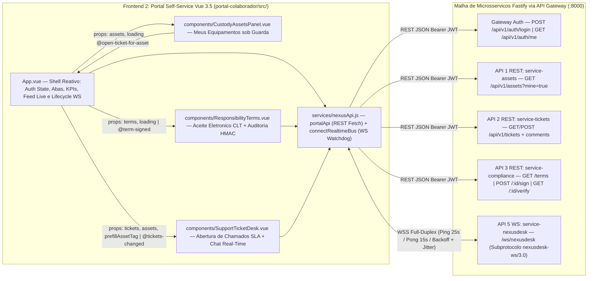

---

### 7.2 Engenharia do Cliente HTTP e WebSocket Resiliente (`portal-colaborador/src/services/nexusApi.js`)

O módulo [`portal-colaborador/src/services/nexusApi.js`](file:///c:/Users/ShinerayADM/Projetos/nexus-itam/portal-colaborador/src/services/nexusApi.js) encapsula toda a comunicação externa do Portal Vue 3:

#### 1. Resolução Adaptativa de Endpoint em 4 Cenários (`resolveGatewayBaseUrl()`)

1. **Variável Explícita de Build (`VITE_API_GATEWAY_URL`)**: prioridade máxima quando definida (ex.: `https://api.empresa.com.br`), removendo barras finais excedentes.
2. **Desenvolvimento Local (`localhost` / `127.0.0.1`)**: aponta automaticamente para `http://localhost:8000`.
3. **Implantação VPS por IP Direto (Porta `:3001`)**: quando o container `nexus-portal-vue` é acessado via `http://<IP_VPS>:3001`, redireciona automaticamente para `${protocol}//${hostname}:8000`.
4. **Produção com Domínio Dedicado / Subdomínio (`portal.dominio.com.br` ou Firebase Multi-Site)**: deriva `https://api.<dominio>` quando o host inicia com `portal.`, ou usa o próprio `window.location.origin` atrás de proxy reverso unificado.

#### 2. Os Métodos Exportados por `portalApi`

| Categoria | Métodos em `portalApi` | Endpoint Consumido no Gateway (`:8000`) |
| :--- | :--- | :--- |
| **Sessão & Infra** | `getGatewayUrl()`, `getSession()`, `clearSession()` | Gerenciamento local em `localStorage['nexus_portal_session_v3']`. Em caso de HTTP `401`, `apiFetch` limpa automaticamente a sessão expirada. |
| **Identidade** | `login(email, password)`, `me()` | `POST /api/v1/auth/login` (salva JWT) e `GET /api/v1/auth/me`. |
| **Custódia (API 1)** | `getMyAssets()` | `GET /api/v1/assets?mine=true` |
| **Termos CLT (API 3)** | `getMyTerms()`, `signTerm(termId)`, `verifyTerm(termId)` | `GET /api/v1/compliance/terms`, `POST /api/v1/compliance/terms/:id/sign` (`{ acceptedClauses: true }`) e `GET /api/v1/compliance/terms/:id/verify`. |
| **Chamados (API 2)** | `getMyTickets()`, `getTicketDetail(ticketId)`, `createTicket(payload)`, `addTicketComment(ticketId, message)` | `GET /api/v1/tickets?mine=true`, `GET /api/v1/tickets/:id`, `POST /api/v1/tickets` e `POST /api/v1/tickets/:id/comments`. |

#### 3. Motor WebSocket Resiliente (`connectRealtimeBus({ onEvent, onStatusChange })`)

- **Watchdog Ativo de Conexão Silenciosa (*Half-Open TCP Detection*)**: a cada **`25.000 ms`** (`PING_INTERVAL_MS`), envia `{ type: 'ping' }` e arma um temporizador de **`15.000 ms`** (`PONG_TIMEOUT_MS`). Qualquer frame recebido do servidor (incluindo `pong` ou eventos de domínio) limpa o timer `pongTimer`. Se 15 segundos transcorrerem sem resposta (ex.: queda de Wi-Fi ou NAT corporativo expirado), força `ws.close(4000, 'Ping timeout')` para acionar reconexão limpa imediata.
- **Reconexão com Backoff Exponencial + Jitter**: em desconexões transitórias, calcula o atraso $\min(1000 \times 2^{\min(\text{attempt},\, 5)},\; 30000) + \text{rand}(0..500)\text{ ms}$, evitando tempestades de reconexão simultâneas quando o proxy de borda reinicia.
- **Parada Definitiva em Rejeição de Credencial**: se o servidor enviar `{ type: 'auth.rejected' }` ou encerrar o socket com código RFC 6455 **`1008`**, seta `permanentlyRejected = true`, muda o status visual para `'rejected'` e interrompe tentativas inúteis de reconexão com token inválido.

---

### 7.3 Anatomia dos 4 Componentes Single-File Vue 3 (`.vue`)

| Componente Vue 3 | Props Recebidas (`defineProps`) | Eventos Emitidos (`defineEmits`) | Estados Reativos Principais (`ref` / `computed`) | Métodos Consumidos e Responsabilidade |
| :--- | :--- | :--- | :--- | :--- |
| **[`App.vue`](file:///c:/Users/ShinerayADM/Projetos/nexus-itam/portal-colaborador/src/App.vue)** | — *(Componente Raiz)* | — | `session`, `activeTab` (`'assets'` \| `'terms'` \| `'tickets'`), `loadingData`, `wsStatus`, `realtimeFeed` (últimos 8 eventos), `assets`, `terms`, `tickets`, `prefillAssetTag`, `pendingTermsCount`, `openTicketsCount`, `loginForm` | Orquestra login/logout (`portalApi.login`, `portalApi.me`, `clearSession`), carrega dados iniciais em paralelo (`Promise.all`), gerencia ciclo de vida `connectRealtimeBus` (`onMounted` / `onBeforeUnmount`) recarregando termos/chamados/ativos automaticamente ao receber `domain.event` via WebSocket, e exibe banner de alerta quando há termos CLT pendentes. |
| **[`CustodyAssetsPanel.vue`](file:///c:/Users/ShinerayADM/Projetos/nexus-itam/portal-colaborador/src/components/CustodyAssetsPanel.vue)** | `assets: Array`, `loading: Boolean` | `open-ticket-for-asset(internalId)` | Renderização reativa sobre `props.assets` | Exibe cartões detalhados dos equipamentos sob responsabilidade do colaborador (etiqueta patrimonial, categoria, modelo, serial, unidade, CPU/RAM/armazenamento) e botão de 1 clique **"Reportar Problema neste Ativo"**, que navega para a aba de Suporte já preenchendo a tag patrimonial. |
| **[`ResponsibilityTerms.vue`](file:///c:/Users/ShinerayADM/Projetos/nexus-itam/portal-colaborador/src/components/ResponsibilityTerms.vue)** | `terms: Array`, `loading: Boolean` | `term-signed` | `signingId`, `verifyingId`, `acceptedMap` (checkbox por termo), `verificationResult` (`Record<termId, VerifyPayload>`), `errorMsg` | Renderiza texto integral do Termo CLT Art. 462, exige aceite explícito do checkbox antes de habilitar `portalApi.signTerm(termId)`, exibe selos `document_hash` (`SHA-256`) e `signature_hash` (`HMAC-SHA256`) e permite ao próprio colaborador auditar a integridade criptográfica em tempo real via `portalApi.verifyTerm(termId)`. |
| **[`SupportTicketDesk.vue`](file:///c:/Users/ShinerayADM/Projetos/nexus-itam/portal-colaborador/src/components/SupportTicketDesk.vue)** | `tickets: Array`, `assets: Array`, `prefillAssetTag: String` | `tickets-changed` | `submitting`, `errorMsg`, `selectedTicket`, `loadingDetail`, `commentText`, `sendingComment`, `form` (`title`, `category`, `priority`, `assetTag`, `description`) | Observa `prefillAssetTag` via `watch(..., { immediate: true })` para pré-vincular ativo ao chamado; cria tickets com cálculo automático de SLA (`portalApi.createTicket`); abre modal/painel de detalhes (`portalApi.getTicketDetail`) e envia mensagens na conversa com o técnico de TI (`portalApi.addTicketComment`). |

---

## Seção 8: Arquitetura de Dados Poliglota (PostgreSQL 16 + Cloud Firestore)

### 8.1 Modelo Relacional PostgreSQL 16 (`services/shared/init.sql`)

A malha de microsserviços adota o padrão **Database Schema-per-Service** dentro do PostgreSQL 16 (`pgcrypto` habilitado), particionando **10 tabelas ACID** ao longo de **5 schemas independentes** (`auth_svc`, `assets_svc`, `tickets_svc`, `compliance_svc`, `telemetry_svc`). As referências cruzadas entre domínios (ex.: `asset_tag` em chamados ou `target_id` na cadeia de auditoria) são acopladas frouxamente por chaves naturais imutáveis, enquanto cada domínio preserva integridade referencial forte (`FOREIGN KEY ... ON DELETE CASCADE`) dentro de seu próprio schema.

```mermaid
erDiagram
  AUTH_SVC_TENANTS ||--o{ AUTH_SVC_USERS : "possui membros"
  ASSETS_SVC_ASSETS ||--o{ ASSETS_SVC_ASSET_HISTORY : "registra historico"
  TICKETS_SVC_TICKETS ||--o{ TICKETS_SVC_TICKET_COMMENTS : "contem interacoes"
  AUTH_SVC_TENANTS ||--o{ ASSETS_SVC_ASSETS : "escopo logico tenant_id"
  AUTH_SVC_TENANTS ||--o{ TICKETS_SVC_TICKETS : "escopo logico tenant_id"
  AUTH_SVC_TENANTS ||--o{ COMPLIANCE_SVC_RESPONSIBILITY_TERMS : "escopo logico tenant_id"
  AUTH_SVC_TENANTS ||--o{ COMPLIANCE_SVC_AUDIT_CHAIN : "escopo logico tenant_id"
  AUTH_SVC_TENANTS ||--o{ TELEMETRY_SVC_DEVICE_TELEMETRY : "escopo logico tenant_id"
  AUTH_SVC_TENANTS ||--o{ TELEMETRY_SVC_REMOTE_COMMANDS : "escopo logico tenant_id"

  AUTH_SVC_TENANTS {
    varchar_64 id PK
    varchar_160 name "NOT NULL"
    varchar_32 cnpj
    varchar_32 plan "starter pro enterprise"
    varchar_24 status "active trial suspended"
    varchar_16 asset_prefix "DEFAULT NEX"
    integer max_assets "DEFAULT 500"
    integer max_users "DEFAULT 50"
    varchar_128 agent_token_hash "SHA256 M2M digest"
    timestamptz created_at "NOT NULL"
    timestamptz updated_at "NOT NULL"
  }

  AUTH_SVC_USERS {
    uuid id PK
    varchar_64 tenant_id FK
    varchar_160 email "UNIQUE NOT NULL"
    varchar_160 full_name "NOT NULL"
    varchar_32 role "CHECK 9 papeis RBAC"
    varchar_120 department
    varchar_120 job_title
    varchar_24 cpf
    text password_hash "Scrypt N16384 r8 p1"
    boolean active "DEFAULT true"
    timestamptz last_login_at
    timestamptz created_at "NOT NULL"
  }

  ASSETS_SVC_ASSETS {
    uuid id PK
    varchar_64 tenant_id "UNIQUE com internal_id"
    varchar_64 internal_id "NOT NULL"
    varchar_48 type "NOT NULL"
    varchar_180 model "NOT NULL"
    varchar_120 brand
    varchar_120 serial_number
    varchar_32 status "DEFAULT Disponivel"
    varchar_120 location_name
    varchar_120 department
    varchar_160 assigned_to
    varchar_160 assigned_email
    numeric_12_2 purchase_value "DEFAULT 0"
    date purchase_date
    date warranty_until
    varchar_64 invoice_number
    varchar_140 supplier
    varchar_120 hostname
    jsonb specs "DEFAULT jsonb vazio"
    text notes
    timestamptz created_at "NOT NULL"
    timestamptz updated_at "NOT NULL"
  }

  ASSETS_SVC_ASSET_HISTORY {
    uuid id PK
    uuid asset_id FK
    varchar_64 tenant_id "NOT NULL"
    varchar_64 action "NOT NULL"
    varchar_160 actor_name "NOT NULL"
    jsonb details "DEFAULT jsonb vazio"
    timestamptz created_at "NOT NULL"
  }

  TICKETS_SVC_TICKETS {
    uuid id PK
    varchar_64 tenant_id "UNIQUE com code"
    varchar_32 code "CHM-YYYY-XXXX"
    varchar_200 title "NOT NULL"
    text description "NOT NULL"
    varchar_48 category "hardware software network"
    varchar_24 priority "low medium high critical"
    varchar_32 status "open in_progress resolved closed"
    uuid asset_id
    varchar_64 asset_tag
    varchar_160 requester_name "NOT NULL"
    varchar_160 requester_email "NOT NULL"
    varchar_120 department
    varchar_160 assigned_technician
    timestamptz sla_due_at
    timestamptz resolved_at
    timestamptz created_at "NOT NULL"
    timestamptz updated_at "NOT NULL"
  }

  TICKETS_SVC_TICKET_COMMENTS {
    uuid id PK
    uuid ticket_id FK
    varchar_64 tenant_id "NOT NULL"
    varchar_160 author_name "NOT NULL"
    varchar_160 author_email "NOT NULL"
    varchar_32 author_role "NOT NULL"
    text message "NOT NULL"
    boolean is_internal "DEFAULT false"
    timestamptz created_at "NOT NULL"
  }

  COMPLIANCE_SVC_RESPONSIBILITY_TERMS {
    uuid id PK
    varchar_64 tenant_id "UNIQUE com term_code"
    varchar_32 term_code "TR-YYYY-XXXX"
    varchar_32 term_type "entrega devolucao emprestimo"
    varchar_160 employee_name "NOT NULL"
    varchar_160 employee_email "NOT NULL"
    varchar_24 employee_cpf
    varchar_120 department
    jsonb asset_snapshot "Fotografia imutavel"
    text legal_clauses "Clausulas CLT Art 462"
    varchar_24 status "pending signed revoked"
    varchar_128 document_hash "SHA-256 canonico"
    varchar_128 signature_hash "HMAC-SHA256 juridico"
    varchar_64 signer_ip
    text signer_user_agent
    timestamptz issued_at "NOT NULL"
    timestamptz signed_at
    varchar_160 issued_by "NOT NULL"
  }

  COMPLIANCE_SVC_AUDIT_CHAIN {
    bigserial id PK
    varchar_64 tenant_id "NOT NULL"
    varchar_48 service_origin "NOT NULL"
    varchar_64 event_type "NOT NULL"
    varchar_160 actor_id "NOT NULL"
    varchar_160 actor_name "NOT NULL"
    varchar_128 target_id
    jsonb payload "DEFAULT jsonb vazio"
    varchar_128 previous_hash "Elo anterior ou GENESIS"
    varchar_128 record_hash "SHA-256 do bloco"
    timestamptz created_at "NOT NULL"
  }

  TELEMETRY_SVC_DEVICE_TELEMETRY {
    uuid id PK
    varchar_64 tenant_id "UNIQUE com device_id"
    varchar_128 device_id "NOT NULL"
    varchar_120 hostname "NOT NULL"
    varchar_64 asset_tag
    varchar_120 serial_number
    varchar_120 os_name
    varchar_64 os_version
    varchar_120 cpu_model
    numeric_5_2 cpu_usage "DEFAULT 0"
    numeric_5_2 ram_usage "DEFAULT 0"
    integer ram_total_gb "DEFAULT 8"
    numeric_5_2 disk_usage "DEFAULT 0"
    varchar_64 ip_address
    varchar_120 logged_user
    varchar_32 agent_version "DEFAULT 3.2.0"
    varchar_24 status "DEFAULT online"
    bigint uptime_seconds "DEFAULT 0"
    varchar_24 access_code "ID NexusDesk XXX-XXX-XXX"
    jsonb metrics_extra "DEFAULT jsonb vazio"
    timestamptz last_seen_at "NOT NULL"
  }

  TELEMETRY_SVC_REMOTE_COMMANDS {
    uuid id PK
    varchar_64 tenant_id "NOT NULL"
    varchar_128 device_id "NOT NULL"
    varchar_64 command_type "NOT NULL"
    jsonb payload "DEFAULT jsonb vazio"
    varchar_24 status "queued running completed failed"
    varchar_160 issued_by "NOT NULL"
    text result_output
    timestamptz created_at "NOT NULL"
    timestamptz executed_at
  }
```

#### Referência de Schemas, Constraints e Índices do PostgreSQL 16

| Schema | Tabela | Chaves & Constraints (`PK`, `FK`, `UNIQUE`, `CHECK`) | Índices Dedicados de Performance |
| :--- | :--- | :--- | :--- |
| **`auth_svc`** | `tenants` | `PK(id)`, `CHECK (plan IN ('starter','pro','enterprise'))`, `CHECK (status IN ('active','trial','suspended','cancelled'))` | PK B-Tree (`id`) |
| **`auth_svc`** | `users` | `PK(id)`, `FK(tenant_id) -> auth_svc.tenants(id) ON DELETE CASCADE`, `UNIQUE(email)`, `CHECK (role IN ('superadmin','owner','admin','manager','member','operator','viewer','collaborator','technician'))` | `idx_users_tenant_email (tenant_id, email)` |
| **`assets_svc`** | `assets` | `PK(id)`, `UNIQUE(tenant_id, internal_id)` | `idx_assets_tenant_status (tenant_id, status)`, `idx_assets_assigned_email (tenant_id, assigned_email)` |
| **`assets_svc`** | `asset_history` | `PK(id)`, `FK(asset_id) -> assets_svc.assets(id) ON DELETE CASCADE` | `idx_asset_history_asset (asset_id, created_at DESC)` |
| **`tickets_svc`** | `tickets` | `PK(id)`, `UNIQUE(tenant_id, code)`, `CHECK (priority IN ('low','medium','high','critical'))`, `CHECK (status IN ('open','in_progress','waiting_user','resolved','closed'))` | `idx_tickets_tenant_status (tenant_id, status, priority)`, `idx_tickets_requester (tenant_id, requester_email)` |
| **`tickets_svc`** | `ticket_comments` | `PK(id)`, `FK(ticket_id) -> tickets_svc.tickets(id) ON DELETE CASCADE` | Scan indexado via `ticket_id` |
| **`compliance_svc`** | `responsibility_terms` | `PK(id)`, `UNIQUE(tenant_id, term_code)`, `CHECK (term_type IN ('entrega','devolucao','emprestimo'))`, `CHECK (status IN ('pending','signed','revoked'))` | `idx_terms_tenant_employee (tenant_id, employee_email, status)` |
| **`compliance_svc`** | `audit_chain` | `PK(id BIGSERIAL)` *(Append-Only por contrato + `pg_advisory_xact_lock(202603, hashtext($1))`)* | `idx_audit_chain_tenant_id (tenant_id, id DESC)` |
| **`telemetry_svc`** | `device_telemetry` | `PK(id)`, `UNIQUE(tenant_id, device_id)` *(Upsert atômico `ON CONFLICT DO UPDATE`)* | `idx_telemetry_tenant_seen (tenant_id, last_seen_at DESC)` |
| **`telemetry_svc`** | `remote_commands` | `PK(id)`, `CHECK (status IN ('queued','running','completed','failed'))` | PK B-Tree (`id`) |

---

### 8.2 Modelo Documental Cloud Firestore (`firestore.rules` + `firestore.indexes.json`)

#### 1. Princípios de Segurança *Fail-Closed* e Segregação `signedIn()` vs. `isAgent()`

Em [`firestore.rules`](file:///c:/Users/ShinerayADM/Projetos/nexus-itam/firestore.rules) (839 linhas), a regra global de fallback no final do arquivo é estritamente `match /{document=**} { allow read, write: if false; }`. Três barreiras fundamentais estruturam o motor de autorização:

1. **Separação Inviolável Humano vs. Máquina (`signedIn()` vs. `isAgent()`)**:
   - `signedIn()` exige `request.auth != null && request.auth.token.firebase.sign_in_provider != 'anonymous'`. Isso garante matematicamente que um `NexusAgent.exe` (que usa Firebase Anonymous Auth) **jamais consiga passar em nenhuma regra de operador humano**, mesmo que tente forjar documentos.
   - `isAgent()` exige `sign_in_provider == 'anonymous'` somado a `exists(/databases/$(database)/documents/agentEnrollments/$(request.auth.uid))`, atrelando o UID anônimo da máquina exclusivamente ao seu `agentTenant()` e `agentDeviceKey()`.
2. **Hierarquia Cumulativa de Guards no Banco**:
   - `tenantRead(data)` (`viewer`+) < `tenantCreate(data)` (`operator`+) < `memberCreate(data)` (`member`+) < `managerCreate(data)` (`manager`+) < `isTenantAdmin(tid)` (`admin`/`owner`) < `isTenantOwner(tid)` (`owner`) e `isMaster()` (`superadmin` com `tenantId == 'nexus-master'`).
   - Todos os guards de tenant exigem `callerActive()` (usuário não bloqueado em `/users/{uid}`) e `tenantAcceptingAccess(tid)` (empresa não `suspended`/`cancelled` em `/tenants/{tid}`).
3. **Exclusão LGPD do `superadmin` nas 8 Coleções RMM/Segredos**: as regras de `/tenantSecrets`, `/agentEnrollments`, `/agentPolicies`, `/agentAudit`, `/agentInbox`, `/assetInventory`, `/agentDevices` e `/agentControl` **não incluem `isMaster()`** em `allow read` nem `allow write`.

#### 2. Catálogo Completo das 24 Coleções / Caminhos do Cloud Firestore

| # | Coleção / Caminho (`firestore.rules`) | Campos Principais | Regras Exatas de Leitura / Escrita e Invariantes de Segurança |
| :-: | :--- | :--- | :--- |
| 1 | `/users/{userId}` | `email`, `name`, `role`, `tenantId`, `companyName`, `status`, `lastLoginAt` | Self-read sem recursão `get()`; criação via auto-registro (`owner` de novo tenant) ou convite válido (`/invites/{inviteId}` com `lower(email)` e `expiresAt > request.time`); `tenantId` imutável por membros comuns; `isMaster` gerencia globalmente exceto rebaixar o próprio `superadmin`. |
| 2 | `/tenants/{tenantId}` | `name`, `companyName`, `plan`, `status`, `trialEndsAt`, `overrides`, `assetPrefix` | Leitura restrita aos membros ativos do próprio tenant ou `isMaster()`; criação self-service apenas com `plan == 'pro'`, `status == 'trial'`, `overrides == {}` e `ownerUid == request.auth.uid`; alteração de `plan`/`status`/`overrides` exclusiva de `isMaster()`. |
| 3 | `/tenantInternal/{tenantId}` | `notes`, `mrrOverride`, `salesOwner`, `contractRef` | **100% exclusivo `isMaster()`** (`allow read, write: if isMaster()`). Notas comerciais internas da plataforma invisíveis ao cliente. |
| 4 | `/plans/{planId}` | `name`, `priceMonthly`, `maxAssets`, `maxUsers`, `features` | Leitura por qualquer `signedIn()` autenticado; escrita exclusiva `isMaster()`. |
| 5 | `/settings/{tenantId}` | `companyName`, `cnpj`, `primaryColor`, `logoUrl`, `hiddenModules`, `agentPolicy`, `termClauses` | Leitura por membros ativos (`sameTenant`) ou `isMaster()`; escrita por `isTenantAdmin(tenantId)` ou no instante de bootstrap do `owner`. |
| 6 | `/tenantSecrets/{tenantId}` | `agentToken`, `updatedAt`, `rotatedBy` | **LGPD/Segredo (Sem `isMaster`):** leitura e escrita exclusivas de `isTenantAdmin(tenantId)` (ou criação no bootstrap pelo `owner`). |
| 7 | `/invites/{inviteId}` | `email`, `role`, `tenantId`, `companyName`, `status`, `expiresAt` | `get` público por ID (link secreto `/convite/:id`); `list` restrito ao admin do tenant, convidado pelo próprio e-mail ou `isMaster`; `update` pelo convidado aceita apenas transição `'pending' -> 'accepted'`. |
| 8 | `/agentEnrollments/{uid}` | `tenantId`, `deviceKey`, `hostname`, `tokenProof`, `enrolledAt` | **LGPD (Sem `isMaster`):** matrícula única por UID anônimo exigindo `tokenProof == sha256(agentToken + ':' + uid)` em tempo de regra (`hashing.sha256`); imutável (`allow update: if false`); revogável (`delete`) pelo próprio agente (`--uninstall`) ou `canManageAgent`. |
| 9 | `/agentPolicies/{tenantId}` | `tenantId`, `heartbeatSec`, `remoteConsent`, `allowScripts` | **LGPD (Sem `isMaster`):** leitura por membros e agentes matriculados do tenant; escrita exclusiva `canManageAgent` com `heartbeatSec` validado entre `30` e `900` segundos. |
| 10 | `/agentAudit/{entryId}` | `tenantId`, `deviceKey`, `action`, `actorUid`, `sessionId`, `at` | **LGPD Append-Only (Sem `isMaster`):** `update` e `delete` **proibidos (`if false`)**; criação exige `at == request.time` (`serverTimestamp()`) e ator legítimo (`canRemoteAgent` ou o próprio `isAgentForDevice`). |
| 11 | `/agentInbox/{docId}` | `tenantId`, `agentToken` *(opcional)*, `status`, `hostname`, `payload`, `submittedAt` | **LGPD (Sem `isMaster`):** aceita `create` tanto de scripts Linux/macOS/portáteis (validando `agentToken == tenantAgentToken` + `submittedAt == request.time` + tamanho `<= 450 KB`, **sem conceder `read`**) quanto de `NexusAgent.exe` matriculado (`!('agentToken' in data)`); leitura/processamento exclusiva `canManageAgent`. |
| 12 | `/assetInventory/{assetId}` | `tenantId`, `software[]`, `disks[]`, `volumes[]`, `network[]`, `monitors[]` | **LGPD (Sem `isMaster`):** separa listas pesadas de software/hardware do documento `/assets`; leitura `sameTenant`, escrita `canOperate` e exclusão `canManage`. |
| 13 | `/agentDevices/{docId}` | `tenantId`, `deviceKey`, `accessCode`, `online`, `metrics`, `consoleWakeAt` | **LGPD (Sem `isMaster`):** ID obrigatório `{tenantId}_{deviceKey}`; o agente grava sua própria telemetria (`<= 32 KB`, sem incluir `agentToken`); operadores (`canRemoteAgent`) só podem atualizar o subconjunto `['consoleWakeAt', 'consoleWakeBy', 'assignedAssetId', 'label', 'notes']`. |
| 14 | `/agentControl/{docId}` | `tenantId`, `deviceKey`, `pendingCommand`, `session`, `frame`, `inputQueue`, `lastAuditId` | **LGPD + Auditoria Atômica `getAfter` (Sem `isMaster`):** quando um operador altera `pendingCommand` ou `session`, a regra `auditedNow(tid, lastAuditId)` exige **`existsAfter` + `getAfter`** comprovando que um registro correspondente em `/agentAudit/{lastAuditId}` está sendo gravado **na mesma transação/batch** com `at == request.time`! |
| 15 | `/assets/{docId}` | `tenantId`, `internalId`, `model`, `type`, `status`, `location`, `assignedTo`, `transit`, `specs` | Leitura `tenantRead`, criação `tenantCreate`, edição `tenantUpdate` (`tenantId` imutável), exclusão `isTenantAdmin` (ou `isMaster`). Possui também `collectionGroup('assets')` `read` para `isMaster()`. |
| 16 | `/employees/{docId}` | `tenantId`, `name`, `email`, `cpf`, `role`, `sector`, `branch`, `login` | Leitura `tenantRead`; criação/edição/exclusão `memberCreate`/`memberUpdate`/`memberDelete` (`member`+ ou `isMaster`). Possui `collectionGroup('employees')` p/ `isMaster()`. |
| 17 | `/sectors/{docId}` | `tenantId`, `name` | Leitura `tenantRead`; escrita `memberCreate`/`memberUpdate`/`memberDelete`. Possui `collectionGroup('sectors')` p/ `isMaster()`. |
| 18 | `/locations/{docId}` | `tenantId`, `name`, `kind`, `city`, `state`, `address`, `manager`, `networks` | Leitura `tenantRead`; escrita restrita a `isTenantAdmin(tenantId)` ou `isMaster()`. |
| 19 | `/projects/{docId}` | `tenantId`, `name`, `status`, `manager`, `budget`, `progress`, `logs[]` | Leitura `tenantRead`; escrita `memberCreate`/`memberUpdate`; exclusão `managerDelete` (`manager`+). Possui `collectionGroup('projects')` p/ `isMaster()`. |
| 20 | `/tasks/{docId}` | `tenantId`, `title`, `status`, `priority`, `category`, `dueDate`, `assignee`, `checklist[]` | Leitura `tenantRead`; criação e movimentação Kanban liberadas desde `operator` (`tenantCreate`/`tenantUpdate`); exclusão `memberDelete`. |
| 21 | `/licenses/{docId}` | `tenantId`, `softwareName`, `totalSeats`, `assignedAssets[]`, `expirationDate` | Leitura `tenantRead`; criação/alocação/exclusão restritas a `manager`+ (`managerCreate`/`managerUpdate`/`managerDelete`). |
| 22 | `/contracts/{docId}` | `tenantId`, `provider`, `serviceName`, `monthlyCost`, `sla`, `renewalDate` | Leitura `tenantRead`; escrita restrita a `manager`+ (`managerCreate`/`managerUpdate`/`managerDelete`). |
| 23 | `/serviceOrders/{docId}` | `tenantId`, `assetId`, `provider`, `cost`, `status`, `openedAt`, `closedAt` | Leitura `tenantRead`; abertura/fechamento de manutenção por `member`+; exclusão `managerDelete`. |
| 24 | Ecossistema Documental de Auditoria e Termos (`/audits`, `/history`, `/terms`, `/termFiles`, `/termCounters/{tenantId}/years/{year}`) | • `/audits/{docId}`: laudo físico imutável<br>• `/history/{docId}`: trilha append-only<br>• `/terms/{termId}`: `number`, `kind`, `status`, `assets[]`, `signedCopy`<br>• `/termFiles/{fileId}`: `termId`, `index`, `total`, `sha256`, `data` (`Bytes`)<br>• `/termCounters/{tenantId}/years/{year}`: `responsabilidade`, `devolucao`, `transferencia`, `updatedAt` | • `/audits`: criação `tenantCreate`, `update` proibido, `delete` só `isTenantAdmin`.<br>• `/history`: **append-only** (`update`/`delete` proibidos; `collectionGroup('history')` p/ `isMaster`).<br>• `/terms`: criação/conclusão `tenantCreate`/`tenantUpdate`, `delete` proibido para operadores comuns (preserva sequência fiscal; só `isTenantOwner` p/ restore de backup).<br>• `/termFiles`: chunks imutáveis (`update: if false`) com `data is bytes && data.size() <= 950000` (~900 KiB × até 6 partes) e `index in 0..7`.<br>• `/termCounters/{tenantId}/years/{year}`: valida os contadores inteiros `responsabilidade`, `devolucao`, `transferencia` e `updatedAt` via `bumpedAtMostOne`, garantindo incremento máximo de `+1` por transação e impedindo regressão numérica! |

#### 3. Resumo de Índices Compostos e `fieldOverrides` ([`firestore.indexes.json`](file:///c:/Users/ShinerayADM/Projetos/nexus-itam/firestore.indexes.json))

O arquivo [`firestore.indexes.json`](file:///c:/Users/ShinerayADM/Projetos/nexus-itam/firestore.indexes.json) declara **24 índices compostos** e **4 `fieldOverrides` de `COLLECTION_GROUP`**:

- **24 Índices Compostos (`COLLECTION`)**: cobrem todas as consultas multi-tenant ordenadas ou filtradas sem *full scan*, incluindo `agentAudit` (`tenantId + at DESC`, `tenantId + deviceKey + at DESC`), `agentDevices` (`tenantId + updatedAt DESC`), `agentInbox` (`tenantId + submittedAt DESC`, `tenantId + status`), `assets` (8 combinações cobrindo `internalId`, `updatedAt`, `category`, `location`, `assignedTo`, `status` e `type`), `audits` (`tenantId + date DESC`, `tenantId + location + date DESC`), `contracts`, `employees`, `history` (`tenantId + timestamp DESC`, `tenantId + assetId + timestamp DESC`), `licenses`, `locations`, `serviceOrders`, `terms` (`tenantId + issuedAt DESC`, `tenantId + assetIds CONTAINS + issuedAt DESC`) e `users` (`tenantId + email`).
- **4 `fieldOverrides` (`COLLECTION_GROUP`)**: habilitam indexação transversal em `assets.tenantId`, `employees.tenantId`, `projects.tenantId` e `history.timestamp` (`DESCENDING`), sustentando as contagens agregadas de cotas e o feed global de atividades do Console *Nexus Master*.

---

## Seção 9: Fluxos Comportamentais e Máquinas de Estado (Diagramas de Sequência e Estados)

### 9.1 Diagrama 8 — Autenticação Scrypt/JWT e Propagação Zero-Trust (`X-Gateway-Signature` + Anti-Replay 60s)

Quando um usuário autentica na malha Fastify e realiza uma operação de negócio, nenhum microsserviço confia cegamente em cabeçalhos de rede interna. O API Gateway valida o JWT e assina um contexto efêmero com validade máxima de 60 segundos:

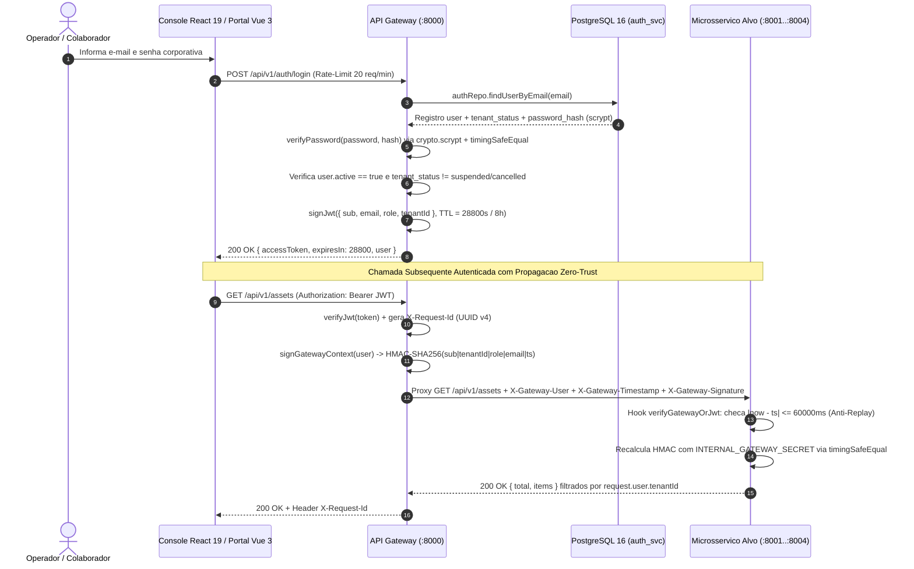

---

### 9.2 Diagrama 9 — Fluxo Real-Time Cross-Framework de Chamado (Vue 3 → Malha → WebSocket → React 19)

Este fluxo demonstra a interoperabilidade instantânea entre os **dois frameworks de front-end (Vue 3.5 e React 19.2)** através das APIs REST e Não-REST (WebSocket RFC 6455) com filtragem de privacidade LGPD:

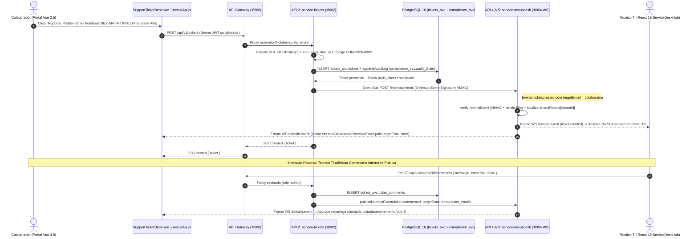

---

### 9.3 Diagrama 10 — Emissão, Assinatura Eletrônica CLT (`HMAC-SHA256`), `audit_chain` e Verificação Forense

O subsistema jurídico em `service-compliance` (`:8003`) assegura validade probatória nos termos do Art. 462, §1º da CLT e MP 2.200-2/2001 (assinatura eletrônica admitida pelas partes com evidência de autoria e integridade):

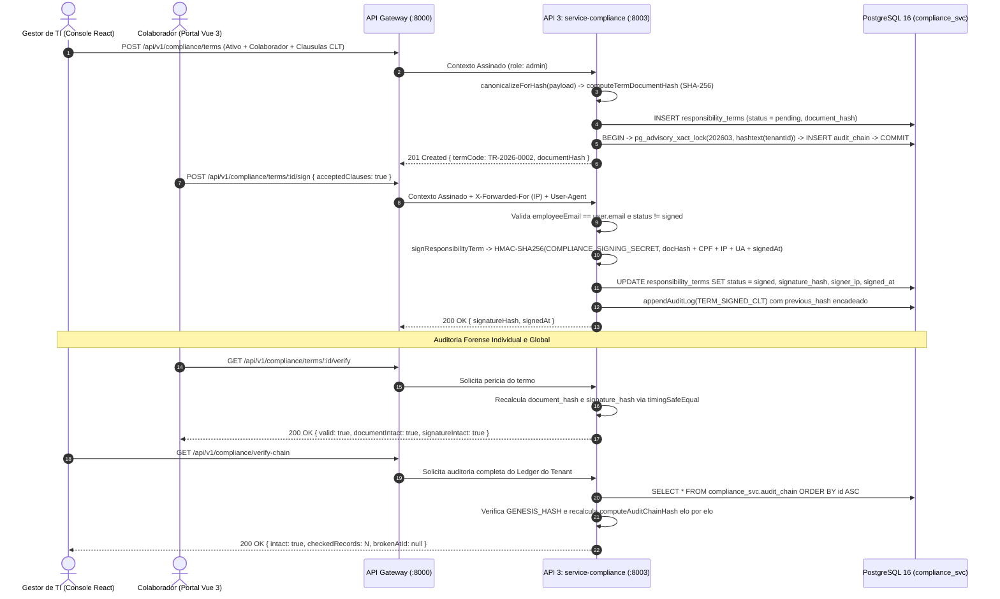

---

### 9.4 Diagrama 11 — Ciclo RMM do `NexusAgent.exe` (Matrícula DPAPI, Wake-on-Heartbeat e Auditoria Atômica)

Projetado para operar com **zero leituras ociosas no Firestore** e conformidade total com a LGPD, o protocolo RMM combina Windows DPAPI, sinalização *Wake-on-Heartbeat* e validação transacional `getAfter` nas regras do banco:

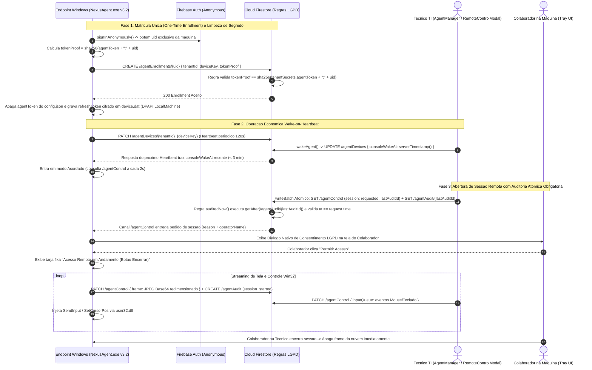

---

### 9.5 Diagrama 12 — Instalação Nativa Mobile PWA em 4 Etapas (`PWAContext` + `PWAInstallModal`)

O fluxo guiado em [`src/contexts/PWAContext.jsx`](file:///c:/Users/ShinerayADM/Projetos/nexus-itam/src/contexts/PWAContext.jsx) e [`src/components/pwa/PWAInstallModal.jsx`](file:///c:/Users/ShinerayADM/Projetos/nexus-itam/src/components/pwa/PWAInstallModal.jsx) transforma a instalação web em uma experiência de loja de aplicativos corporativos com pré-aquecimento real do `CacheStorage`:

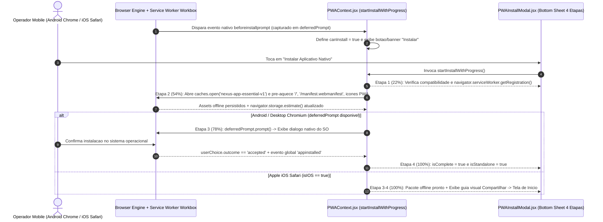

---

### 9.6 Diagrama 13 — Máquina de Estados do Ativo Patrimonial, Termos e Chamados

Em [`src/utils/assetStatus.js`](file:///c:/Users/ShinerayADM/Projetos/nexus-itam/src/utils/assetStatus.js) e [`src/services/termService.js`](file:///c:/Users/ShinerayADM/Projetos/nexus-itam/src/services/termService.js), o status **`Em Trânsito`** possui uma trava arquitetural crítica: **não pertence a `MANUAL_STATUSES`**, portanto nenhum formulário manual (`AssetForm` ou `AssetList`) pode colocá-lo ou retirá-lo diretamente — somente as transações de emissão, recebimento ou cancelamento de Termo de Transferência (`TT-YYYY-NNNN`) podem transicionar esse estado!

```mermaid
stateDiagram-v2
  direction TB

  state "Ciclo de Vida do Ativo Patrimonial (assetStatus.js + termService.js)" as CicloAtivo {
    state "Disponivel (Estoque / Cofre TI)" as Disponivel
    state "Em Uso (Custodia de Colaborador / Unidade)" as EmUso
    state "Em Transito (Exclusivo via Termo TT — Travado p/ Edicao Manual)" as EmTransito
    state "Manutencao (Ordem de Servico Aberta)" as Manutencao
    state "Defeito (Aguardando Triagem / Reparo)" as Defeito
    state "Baixado (Aposentado / Vendido / Doado)" as Baixado
    state "Extraviado (Sinistro / Furto / Perda)" as Extraviado

    [*] --> Disponivel : Cadastro / Compra / Importacao
    [*] --> EmUso : Cadastro Direto c/ Responsavel

    Disponivel --> EmUso : issueResponsibilityTerm (TR) ou Alocacao
    EmUso --> Disponivel : issueReturnTerm (TD — Bom Estado)
    EmUso --> Defeito : issueReturnTerm (TD — Avariado)

    Disponivel --> EmTransito : issueTransferTerm (TT)
    EmUso --> EmTransito : issueTransferTerm (TT)
    EmTransito --> Disponivel : confirmTransferReceipt / attachSignedCopy
    EmTransito --> EmUso : confirmTransferReceipt (assignToReceiver)
    EmTransito --> Disponivel : cancelTransfer (Restaura previousStatus)

    Disponivel --> Manutencao : Abrir Ordem de Servico
    EmUso --> Manutencao : Abrir Ordem de Servico
    Defeito --> Manutencao : Enviar para Assistencia
    Manutencao --> Disponivel : Concluir Reparo (Estoque)
    Manutencao --> EmUso : Concluir Reparo (Devolver ao Titular)

    Disponivel --> Baixado : WriteOffModal (manager+)
    Defeito --> Baixado : Laudo Sem Conserto (manager+)
    Manutencao --> Baixado : Inviabilidade Economica (manager+)
    EmUso --> Extraviado : Registro de Sinistro / BO (manager+)
    Disponivel --> Extraviado : Falta Confirmada em Auditoria (manager+)
  }

  state "Ciclo de Termos (terms.js)" as CicloTermo {
    state "Pendente (TR / TD)" as TermPendente
    state "Em Transito (TT)" as TermTransito
    state "Assinado" as TermAssinado
    state "Recebido OK" as TermRecebido
    state "Recebido c/ Ressalvas" as TermRessalva
    state "Cancelado" as TermCancelado

    [*] --> TermPendente : Emissao TR ou TD
    [*] --> TermTransito : Emissao TT
    TermPendente --> TermAssinado : Assinatura CLT HMAC ou Anexo QR
    TermTransito --> TermRecebido : Todos itens OK ou Anexo QR
    TermTransito --> TermRessalva : Item c/ Avaria ou Falta
    TermTransito --> TermCancelado : cancelTransfer
  }

  state "Ciclo de Chamados SLA (service-tickets)" as CicloTicket {
    state "open (SLA Correndo)" as TkOpen
    state "in_progress (Em Atendimento)" as TkProg
    state "resolved (Solucionado)" as TkRes
    state "closed (Encerrado)" as TkClosed

    [*] --> TkOpen : POST /api/v1/tickets
    TkOpen --> TkProg : Triagem Tecnico TI
    TkProg --> TkRes : Solucao Aplicada (resolved_at)
    TkRes --> TkClosed : Validacao Final
  }
```


---

## Seção 10: Avaliação Arquitetural Master (/architect-review): ADRs, Qualidade, Trade-offs e Guia Operacional

### 10.1 Architecture Decision Records (ADRs)

#### ADR-001: Arquitetura Híbrida Dual-Engine (Strangler Fig Pattern)
- **Status:** Aceito e Implementado.
- **Contexto:** O Nexus ITAM iniciou como uma plataforma Cloud SaaS Serverless (Firebase Auth + Cloud Firestore), excelente para rápida prototipação, cache offline em clientes móveis e custos operacionais mínimos (plano Spark). Entretanto, para expansão corporativa on-premise, soberania de dados e rigor acadêmico em sistemas distribuídos, era indispensável suportar bancos relacionais SQL tradicionais e microsserviços containerizados.
- **Decisão:** Adotar o padrão *Strangler Fig*. O console React 19 opera em modo híbrido transparente via [`src/services/microservicesClient.js`](file:///c:/Users/ShinerayADM/Projetos/nexus-itam/src/services/microservicesClient.js): quando há uma sessão de Gateway ativa (`authSource === 'gateway'`), as operações de ativos, chamados, termos e telemetria são roteadas para as APIs Fastify com persistência no PostgreSQL 16; na ausência desta ou em deploys SaaS gerenciados, opera diretamente contra o Google Cloud Firestore.
- **Consequências:** Máxima flexibilidade de implantação (SaaS em Nuvem ou On-Premise/VPS em Docker), desacoplamento das regras de negócio e viabilidade plena para apresentação em bancas acadêmicas sem perder as funcionalidades existentes de produção.

#### ADR-002: Segregação de Front-ends por Persona e Superfície de Ataque
- **Status:** Aceito e Implementado.
- **Contexto:** O Console Administrativo de TI possui ferramentas de alta complexidade (gestão financeira, RMM com envio de comandos Win32, auditoria de inventário com leitores ópticos e console do Nexus Master). Expor essa mesma aplicação ao colaborador comum que apenas assina termos ou abre tickets aumentava a superfície de ataque e o tamanho do bundle transferido.
- **Decisão:** Separar as interfaces em dois frameworks de vanguarda:
  1. **Frontend 1 (React 19 + Vite):** Console Administrativo corporativo completo para analistas, operadores e gestores de TI.
  2. **Frontend 2 (Vue 3.5 Composition API):** Portal Self-Service independente, ultraleve (~40 KB de gzip), *Zero-Firebase* (100% via API Gateway), projetado para o colaborador final consultar patrimônios sob sua custódia, assinar termos CLT e acompanhar chamados via WebSocket.
- **Consequências:** Isolamento de privilégios, redução do consumo de banda, experiência de usuário otimizada para cada persona e atendimento do requisito de múltiplos frameworks frontend.

#### ADR-003: Isolamento Lógico Schema-per-Service no PostgreSQL 16
- **Status:** Aceito e Implementado.
- **Contexto:** Microsserviços distribuídos não devem compartilhar tabelas diretamente para não criar acoplamento implícito de banco (*Shared Database Anti-Pattern*). No entanto, gerenciar cinco instâncias físicas separadas de banco de dados em uma única VPS ou ambiente de demonstração elevaria excessivamente o consumo de memória RAM.
- **Decisão:** Adotar o padrão *Database Schema-per-Service* em uma instância única do PostgreSQL 16. Foram criados cinco esquemas lógicos estritos: `auth_svc`, `assets_svc`, `tickets_svc`, `compliance_svc` e `telemetry_svc`. Cada microsserviço acessa exclusivamente seu próprio esquema através de um repositório dedicado em [`services/shared/db.js`](file:///c:/Users/ShinerayADM/Projetos/nexus-itam/services/shared/db.js).
- **Consequências:** Baixo consumo de hardware (~150 MB de RAM para todo o cluster), garantias transacionais ACID e facilidade para desacoplar as tabelas em servidores PostgreSQL físicos distintos no futuro.

#### ADR-004: Segurança Zero-Trust Inter-Serviços e Ledger Forense de Termos CLT
- **Status:** Aceito e Implementado.
- **Contexto:** Em arquiteturas distribuídas, a rede interna não deve ser considerada confiável. Uma requisição que ultrapassa o Gateway precisa carregar sua autenticidade comprovada, e termos de responsabilidade de equipamentos exigem validade probatória em litígios trabalhistas.
- **Decisão:**
  1. Implementar autenticação inter-serviços com cabeçalho assinado `X-Gateway-Signature` via HMAC-SHA256, contendo timestamp com tolerância máxima de 60 segundos contra ataques de replay.
  2. Criar no `service-compliance` um ledger imutável (`audit_chain`) com encadeamento criptográfico estilo blockchain (`prev_hash` -> `entry_hash`), além de assinatura eletrônica do termo calculada sobre JSONB canônico com chave secreta corporativa.
- **Consequências:** Proteção contra manipulação de cabeçalhos por atacantes na rede local e prova inegável de autoria e integridade de termos assinados.

#### ADR-005: Agente Nativo Endpoint C#/.NET 4.x sem Dependências Externas
- **Status:** Aceito e Implementado.
- **Contexto:** A gestão de ativos moderna exige telemetria em tempo real (processos, antivírus, discos, hardware e suporte remoto). Softwares de terceiros ou runtimes pesados (Electron, Python) exigem instaladores de centenas de megabytes.
- **Decisão:** Desenvolver o `NexusAgent.cs` em C# puro utilizando o compilador `csc.exe` nativo do .NET Framework 4.x (presente em 100% dos computadores Windows corporativos desde o Windows 7 até o Windows 11).
- **Consequências:** Binário compilado de apenas ~150 KB, sem necessidade de instalar runtimes adicionais, com execução dual: Serviço do Windows (`SYSTEM`) e aplicação de bandeja para consentimento do colaborador na sessão ativa.

---

### 10.2 Avaliação de Atributos de Qualidade (ISO/IEC 25010)

| Atributo de Qualidade | Solução Arquitetural Implementada | Mecanismo de Verificação / Garantia |
| :--- | :--- | :--- |
| **Segurança e Privacidade (LGPD)** | Derivação de senhas com Scrypt (`N=16384`), JWT HS256 com rotação de jti, HMAC inter-serviços, isolamento estrito por `tenantId` e exclusão proposital do `superadmin` nas telas de telemetria e controle remoto de clientes. | Suíte de testes automatizados de regras de segurança (`vitest.rules.config.js` via Firestore Emulator) e testes de integração em `services/tests/`. |
| **Escalabilidade e Desempenho** | API Gateway com Fastify de altíssima vazão (assíncrono por design), índices compostos nas colunas mais buscadas do PostgreSQL e Firestore, e streaming de eventos por WebSocket RFC 6455 sem polling. | Rate-limit configurável no gateway (240 req/min global, 20 req/min para login) e pools de conexões ajustáveis no PostgreSQL. |
| **Resiliência e Tolerância a Falhas** | Event Bus interno implementado com degradação graciosa (`try/catch` silencioso com timeout de 2.500 ms) — uma falha na entrega de notificações em tempo real nunca interrompe uma transação de negócio principal. | Suporte a fallback em memória (`NEXUS_DB_MODE=memory`) caso o banco PostgreSQL esteja indisponível em testes unitários. |
| **Manutenibilidade e Modularidade** | Estruturação em Clean Architecture: separação clara entre Camada de Apresentação (Páginas/Componentes), Hooks de Estado, Serviços de Acesso a Dados e Domínio Puro (`src/utils/`). | Lint estrito com ESLint 9, convenções padronizadas de código e zero referências circulares entre módulos. |
| **Portabilidade e Implantação** | Containerização completa em Docker Compose, arquivos de overlay para ambientes de desenvolvimento e produção com VPS (Caddy TLS 1.3 automático). | GitHub Actions CI com validação automatizada em matriz de versões Node.js (20.x e 22.x). |

---

### 10.3 Trade-offs Conscientes e Roadmap de Evolução

1. **Event Bus HTTP vs. Message Broker Dedicado (RabbitMQ / Kafka / Redis Streams):**
   - *Decisão Atual:* O `eventBus.js` faz dispatch HTTP direto para o `service-nexusdesk` com assinatura HMAC. Essa escolha foi deliberada para manter o footprint de memória leve (sem necessidade de subir mais um container na VPS para demonstrações).
   - *Evolução:* Para escalabilidade de dezenas de milhares de endpoints simultâneos, o barramento interno pode ser facilmente migrado para RabbitMQ ou Redis Pub/Sub com padrão *Transactional Outbox*.
2. **Salas WebSocket em Memória no Service-NexusDesk:**
   - *Decisão Atual:* As conexões ativas são gerenciadas em um `Map<tenantId, Set<Socket>>` na memória do processo Node.js.
   - *Evolução:* Introdução de um adaptador Redis Adapter para sincronização de presença entre múltiplas réplicas do `service-nexusdesk` atrás de um balanceador de carga.
3. **Persistência Híbrida Firestore + PostgreSQL:**
   - *Decisão Atual:* Permite rodar como SaaS nativo na nuvem Google ou como stack 100% on-premise em servidores da empresa. O custo de manter os adaptadores sincronizados é compensado pela flexibilidade total de venda do produto para diferentes perfis de cliente.

---

### 10.4 Guia Rápido de Operação, Execução Local e Testes

#### 1. Executando Todos os Microsserviços e o Gateway Localmente (Modo Desenvolvimento)
```bash
# Inicia os 4 microsserviços + API Gateway em um único comando
npm run dev:microservices
```
Endpoints disponíveis instantaneamente:
- **API Gateway & Swagger UI:** `http://localhost:8000/docs`
- **Healthcheck Geral:** `http://localhost:8000/health`
- **WebSocket RMM/Chamados:** `ws://localhost:8000/ws/nexusdesk`

#### 2. Executando os Frontends
```bash
# Frontend 1: Console Administrativo (React 19) na porta :5173
npm run dev

# Frontend 2: Portal do Colaborador (Vue 3.5) na porta :3001
npm run dev:portal
```

#### 3. Executando a Suíte Completa de Testes
```bash
# Testes unitários do Frontend React 19 (34 suítes / 383 testes)
npm test

# Testes de integração dos Microsserviços Fastify + PostgreSQL
npm run test:services

# Todos os testes de uma só vez
npm run test:all
```

#### 4. Implantação em Produção via Docker Compose
```bash
# Sobe o cluster completo (Postgres 16, 4 Microsserviços, API Gateway, Console React e Portal Vue)
docker compose up -d --build
```
